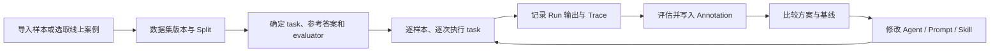

# 业务架构

> 依据：2026-10-16，源码基线 `4de0e4f88`（Phoenix `20.23.0`）。本文描述仓库已经实现的业务；「可信评测平台」是本地项目名称，不代表仓库已有独立的 Skill 管理产品。
> 阅读导航：[技术架构](../03-技术架构/架构详解.md) · [部署指南](../04-部署文档/部署指南.md)。

## 1. 产品边界

Phoenix 把 LLM 应用的运行追踪、评测样本、实验输出、评分和提示词版本放在同一分析环境中。用户先收集真实运行数据，定位问题，再把代表性案例加入数据集，比较不同实现，最后用新流量继续检查效果。

| 关注点 | 当前实现 | 使用边界 |
|---|---|---|
| Agent 离线评测 | 数据集、任意 SDK task、多个 evaluator、重复运行、实验对比、关联 trace | 用户编写的 Agent 通常在调用 SDK 的进程执行，不会因为登记实验就自动部署到服务端 |
| 提示词离线评测 | Playground、提示词版本、数据集绑定评估器、服务端后台实验 | 模型调用需要对应供应商凭证；代码评估器还需要可用沙箱 |
| 在线质量分析 | OTLP 摄入、人工/代码/LLM 注解、追踪与会话指标 | 实时接收 span 不等于每条 span 自动触发评估 |
| 在线回评 | `evals/pxi/online_evals/` 对已入库 PXI trace 回评；GitHub Actions 定时执行；另有 cron 示例 | 当前回评器的选择器、输入和指标面向 PXI；接入其他 Agent 需要适配，不能当作通用在线评测控制台 |
| Skill 评测 | Harbor 任务、verifier、插件技能评测目录；结果可记录为 Phoenix 实验 | 由外部任务环境执行技能并产出 reward；未发现独立的 Skill 实体、注册中心或通用 Skill 版本页面 |
| 结果分析 | 单样本评分、解释、失败、时延、token、成本、基线与实验比较 | 评估规则与数据集决定结论；平台不会自动证明 evaluator 准确 |

主要证据：[前端路由](../../js/app/src/Routes.tsx)、[实验 SDK](../../packages/phoenix-client/src/phoenix/client/experiments/__init__.py)、[在线回评器](../../evals/pxi/online_evals/run.py)、[Harbor 插件](../../packages/phoenix-client/src/phoenix/client/harbor/_plugin.py)。

## 2. 参与者与权限

| 参与者 | 主要工作 | 产品入口 |
|---|---|---|
| 应用/Agent 开发者 | 接入 tracing；编写 task；运行实验；修正提示词或工具流程 | Python/TypeScript SDK、CLI、项目页、Playground |
| 评测维护者 | 准备参考答案、管理数据集版本和 splits、配置评估器、分析误差 | 数据集、评估器、实验比较页 |
| 质量分析人员 | 查看真实 trace、session、错误、时延和成本，添加反馈 | 项目、仪表盘、追踪详情、注解编辑器 |
| 运维/平台管理员 | 部署服务、配置身份认证、模型供应商、密钥、沙箱和保留策略 | `/settings`、部署环境、数据库 |
| 自动化执行方 | 上传 span、调用 REST/GraphQL/MCP、运行 Harbor 或定时回评 | `/v1`、`/graphql`、`/mcp`、CI |

业务参与者不是新增权限角色。代码中可分配的角色为 `ADMIN`、`MEMBER`、`VIEWER`，另有内部系统身份。开启认证后，Viewer 的写入受限，部分管理操作要求管理员；关闭认证时没有按用户身份隔离的保护。项目分组也不能视为租户或数据隔离边界。

证据：[权限依赖](../../src/phoenix/server/authorization.py)、[身份与 token 校验](../../src/phoenix/server/bearer_auth.py)、[REST 路由权限组合](../../src/phoenix/server/api/routers/v1/__init__.py)。

## 3. 业务对象及关系

| 对象 | 业务含义 | 关键关系 |
|---|---|---|
| Project | 一组应用运行数据及配置 | 包含 trace、span、session，关联注解配置和保留策略 |
| Trace / Span | 一次执行链路及其中的步骤 | span 通过 parent ID 组成树；可记录 Agent、LLM、工具和检索操作 |
| ProjectSession | 多轮应用会话 | 把相关 trace 组织成会话；与 PXI 自身的 AgentSession 不同 |
| Annotation | 对运行或输出的反馈/评分 | 可附在 span、trace、session、检索文档或实验 run 上 |
| Dataset / Example | 一组可重复评测的案例 | example 包含 input、output/参考答案、metadata，可关联来源 span |
| DatasetVersion / ExampleRevision | 样本集和单个样本的历史快照 | 实验绑定明确的数据集版本，后续修改不应被误当成同一测试集 |
| DatasetSplit / Label | 样本子集与数据集标签 | split 选择实验样本；label 用于组织和检索 |
| Evaluator / DatasetEvaluator | 评分定义及其数据集绑定 | 定义可复用；绑定配置输入映射和输出约定 |
| Experiment / Run | 一轮方案测试与单次样本执行 | 每个样本可重复执行；run 保存输出、时间、错误和 trace 关联 |
| ExperimentJob / Log | 服务端实验任务与执行记录 | 保存后台调度状态、任务及评估日志 |
| Prompt / Version / Tag | 提示词及发布引用 | 版本保存模板和模型配置；tag 提供可移动引用 |
| AgentSession / Message / Snapshot | PXI 助手会话 | 保存产品内助手的消息与恢复上下文 |

关系来源：[数据库模型](../../src/phoenix/db/models.py)。不要把 session ID、OpenTelemetry trace/span ID 与 GraphQL/REST 的对象 GlobalID 混用。

## 4. 主业务流程

### PROC-1：采集运行数据并定位问题

1. 应用用 OpenInference/OpenTelemetry 描述 LLM、Agent、工具、检索及输入输出，将数据发到 Phoenix。
2. 服务端校验权限、队列容量和存储状态，再解码、排队、批量写入，计算相关 token 与成本信息。
3. 用户按项目、时间、状态和属性筛选，查看调用树、会话、错误、模型调用及检索文档。
4. 人工反馈或外部 evaluator 写入 annotation；需要回归的样本加入数据集。

HTTP 接收成功和可查询到完整数据之间可能有队列延迟。队列已满或数据库空间保护触发时，摄入可能被拒绝；客户端需要按实际错误重试，不能把缺失追踪直接认定为业务请求未执行。

证据：[HTTP traces](../../src/phoenix/server/api/routers/v1/traces.py)、[gRPC 接收](../../src/phoenix/server/grpc_server.py)、[批量写入](../../src/phoenix/db/bulk_inserter.py)。

### PROC-2：建立可复现的离线实验

1. 上传或编辑数据集，整理 input、参考 output 和 metadata，选定版本及样本范围。
2. 明确实验方案：Agent/task、模型与提示词配置、评估器、重复次数和运行元数据。
3. 选择执行方式：SDK 在用户执行环境运行自定义 task；UI 发起的提示词实验可由服务端后台任务执行。
4. 保存每个 run 的输出、错误、时延和 trace；执行一个或多个评估器，保存 score、label、explanation 等结果。
5. 在实验详情与比较页检查分数分布和失败样本，再结合成本、时延及调用链决定是否保留改动。
6. 对失败或未完成的工作使用对应恢复接口；补评不必重新运行已经得到输出的 task。

SDK 的 `run_experiment` 支持同步/异步 task 与 evaluator、`dry_run`、`repetitions`、`retries`、`timeout`。具体执行合同以 SDK 源码为准。服务端 job 对外状态是 `RUNNING`、`COMPLETED`、`STOPPED`；完成并不意味着所有样本评分合格，仍需检查错误和结果。

证据：[SDK 实验](../../packages/phoenix-client/src/phoenix/client/experiments/__init__.py)、[服务端调度](../../src/phoenix/server/daemons/experiment_runner.py)、[Job 状态](../../src/phoenix/server/api/types/ExperimentJob.py)。

### PROC-3：定义评测口径并检查准确性

| 评估方式 | 已有实现 | 适用检查 |
|---|---|---|
| 确定性代码 | SDK 自定义函数、内置规则、服务端代码评估器 | 精确匹配、正则、结构与数值规则 |
| LLM 判分 | 自定义 LLM evaluator、内置分类评估器、统一 LLM 包装器 | 正确性、忠实性、相关性、工具选择和响应处理等 |
| 人工反馈 | span/trace/session 等注解 | 对照判断、误判分析、案例归因 |

数据集绑定通过 input mapping 把样本与 task 输出送入评估器；代码评估器在选定沙箱中运行。评估定义、输入映射、模型和参考答案都可能影响结果。

为保证结论可比较，评测维护者应同时记录数据集版本、方案版本、evaluator 定义/版本、judge 模型和抽样范围。该做法是使用要求，不是平台已经自动完成的准确率校准功能。评估异常、无适用结果和低分应分别分析，不能把缺失分数当作零分。

证据：[服务端评估器](../../src/phoenix/server/api/evaluators.py)、[Python 指标库](../../packages/phoenix-evals/src/phoenix/evals/metrics)、[数据集评估绑定模型](../../src/phoenix/db/models.py)。

### PROC-4：对生产追踪做在线回评

1. 应用先完成正常请求，追踪异步进入 Phoenix；本仓库 PXI 回评器不在业务响应路径内执行。
2. 定时执行器查询近期已稳定的 PXI span，按 evaluator 的 selector 选择目标，并按 trace 做确定性抽样。
3. 查询已有注解，以评估名称和 identifier 判断是否已经评过，再补齐目标 trace 上下文。
4. 运行代码或 LLM evaluator，把结果写回目标 span annotation。
5. 汇总 evaluated、skipped、errors 等信息；单目标失败不阻止其他目标，整体非零退出用于暴露错误。

当前默认回看 48 小时，等待 5 分钟后再评，最多 8 个评估并发。工作流在 UTC `00:17`、`12:17` 执行，也支持手动触发。默认项目为 `pxi_dev`；已有指标包括每轮工具调用数、用户摩擦、人工建议接受情况。

这条实现可作为其他 Agent 在线评测的参考，但必须更换或验证 selector、输入整理、评分规则和项目配置。`examples/cron-evals/` 则展示另一种外部 cron 回评模式。未发现按所有项目统一配置的通用在线规则调度页面；trace 保留策略中的 cron 用于清理数据，不能当作评测调度。

证据：[在线执行器](../../evals/pxi/online_evals/run.py)、[在线评估定义](../../evals/pxi/online_evals/evaluators)、[CI 调度](../../.github/workflows/pxi-online-evals.yml)、[cron 示例](../../examples/cron-evals)。

### PROC-5：通过 Harbor 评测 Agent 或 Skill

1. 在 Harbor 任务中定义 instruction、environment、测试/verifier 和必要的多步骤任务。
2. 在 job 中选择 Agent、模型、重复次数和技能上下文；Harbor 负责隔离环境与实际执行。
3. verifier 输出 reward 及其他度量；Phoenix 插件把任务快照转换为 dataset，把执行条件转换为 experiment，把 trial 转换为 run。
4. 插件写入评分、基础设施状态、token、成本和时延；默认尝试把 ATIF 轨迹转换为 Phoenix trace。
5. 在 Phoenix 中比较不同技能、提示词或 Agent 条件的结果，并回到 trace 和样本检查原因。

插件连接 Phoenix 失败会在任务开始前失败；轨迹上传失败与 reward 计算不是同一种失败。Skill 效果必须由具体任务、对照条件和 verifier 体现，不能仅凭加载某个 `SKILL.md` 就得出「技能有效」结论。

证据：[Harbor 使用说明](../../evals/harbor/README.md)、[任务与 job](../../evals/harbor)、[记录映射](../../packages/phoenix-client/src/phoenix/client/harbor/_recorder.py)、[插件技能评测](../../plugins/claude/arize-phoenix/evals)。

## 5. 功能树与实现位置

| 功能域 | 业务能力 | 主要实现位置 |
|---|---|---|
| 追踪与会话 | 采集、筛选、调用树、比较、注解、迁移与删除 | `src/phoenix/trace/`、`src/phoenix/db/bulk_inserter.py`、`src/phoenix/server/api/routers/v1/{traces,spans,sessions}.py` |
| 数据集 | 样本导入、版本、修订、标签、splits、来源关联 | `src/phoenix/server/api/mutations/dataset_mutations.py`、`src/phoenix/server/api/routers/v1/datasets.py` |
| 评估定义 | LLM、内置、代码评估器及输入映射 | `src/phoenix/server/api/evaluators.py`、`src/phoenix/server/api/mutations/evaluator_mutations.py` |
| 实验执行 | SDK task、后台提示词任务、补评、停止/恢复、日志 | `packages/phoenix-client/`、`js/packages/phoenix-client/`、`src/phoenix/server/daemons/experiment_runner.py` |
| 分析比较 | 基线、实验对比、注解统计、时延与成本 | `src/phoenix/server/api/types/Experiment*.py`、`js/app/src/pages/` |
| 提示词 | 模板、版本、标签、Playground、模型供应商 | `src/phoenix/server/api/mutations/prompt_mutations.py`、`src/phoenix/server/api/routers/v1/prompts.py` |
| PXI | 产品内助手、工具调用、会话存储、建议审批 | `src/phoenix/server/agents/`、`js/app/src/agent/` |
| 自动化接口 | REST、GraphQL、CLI、MCP、SDK | `src/phoenix/server/api/`、`src/phoenix/server/mcp_server.py`、`js/packages/phoenix-cli/` |
| 运维与身份 | 用户、API key、OIDC/LDAP、密钥、沙箱、清理策略 | `src/phoenix/server/authorization.py`、`src/phoenix/server/oauth2.py`、`src/phoenix/server/ldap.py`、`src/phoenix/server/retention.py` |

前端入口以 [Routes.tsx](../../js/app/src/Routes.tsx) 为准：项目 `/projects`、仪表盘 `/dashboards`、数据集 `/datasets`、评估器 `/evaluators`、提示词 `/prompts`、Playground `/playground`、PXI `/chat`、管理 `/settings`。

## 6. 结果分析与业务约束

- 实验应在相同数据集版本和可比较样本范围上做对照。不同 split、judge 或输入映射的分数不能直接解释为方案提升。
- score、label、explanation 分别表示数值、分类与解释；并非每种评估都有数值分数。指标方向由评估定义决定，不能一律把数值更大视为更好。
- 实验分析同时关注成功/失败样本、重复运行波动、评估错误、时延和成本；整体平均分不能替代问题样本检查。
- 成本依赖 token、模型识别和价格配置；缺失成本不能解释为零成本。计算实现见 [成本追踪](../../src/phoenix/server/cost_tracking)。
- 在线回评使用历史追踪；追踪缺失、尚未稳定、抽样过滤或上下文异常会影响可评范围，不代表线上请求全部被评过。
- 临时实验及助手会话存在清理逻辑；trace 可受项目保留策略清理。重要结果不能只依赖临时对象长期保存。
- 注解和样本可能包含真实输入输出；部署时应按数据边界配置认证、数据保留和模型外发。授权是角色及接口规则组合，不能把 UI 隐藏当作权限校验。

## 7. 证据范围与待确认项

本轮对 Git 文件清单及源码/配置进行了全量扫描，并精读入口、数据库关系、追踪写入、实验调度、评估、在线回评、Harbor 映射和相关测试。生成代码、测试与示例也纳入检索；这不等于逐行人工审计全部代码。

尚未确定本地二次开发的具体需求、通用在线规则产品形态、Skill 业务实体和评估准确率验收阈值。本文不把这些目标写成已实现能力。本次未启动服务、调用模型或执行 Harbor 任务；实现证据与运行验证应分开理解。

## 变更历史

| 日期 | 改动 | 依据 |
|---|---|---|
| 2026-10-16 | 以源码替换初始化模板，梳理现有业务与评测边界 | `4de0e4f88` |
