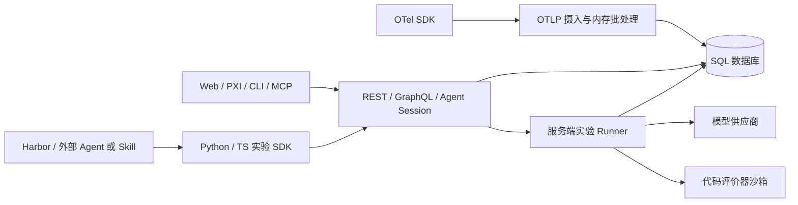

# Phoenix 全工程分析（2026-10-16）

分析基线：`59f7df412308ebb49ddff140902b1eaf1db58fd2`，分支 `feature/init-trusted-eval-platform`，服务版本 `20.23.0`。本报告服务于继续基于 Phoenix 开发 Agent／Skill 离线、在线评测平台的决策；本轮不修改实现，不提交或推送分析产物。

## 1. 结论与覆盖口径

Phoenix 已具备追踪、版本化数据集、实验、评分、Prompt 管理、服务端实验调度、代码评测沙箱及实验对比。最小开发路径是复用这些对象，通过已有 SDK 或 Harbor 插件接入业务 Agent／Skill；尚无需求依据时，不新增另一套数据集、评分、队列或执行框架。

本轮完成的是**全工程清单、模块边界和主要链路的静态分析**。全仓清单为 8,426 个 Git 受控文件：`js/` 4,304、`src/` 725、`packages/` 382、`tests/` 468、`evals/` 244、`scripts/` 329、`docs/` 854、`examples/` 143。上述数字是文件分布，不是逐文件阅读数、测试用例数或通过数。

分析方法分三层：① REA 实际解析 JavaScript／TypeScript 前端并保留 Evidence；② 人工追踪 Python、SDK、数据库、配置和部署的关键入口及上下游；③ 文档、示例、生成代码、底层 C 库及工具辅助目录做清单或入口核对。未做逐行审计、完整安全审计、性能测试、真实模型评测或运行验收。

## 2. 工程组成与实际边界

| 范围 | 职责、主要依赖和调用方向 | 源码依据与分析深度 |
|---|---|---|
| 主服务 | Python／FastAPI／Strawberry／SQLAlchemy async；组装 REST、GraphQL、OTLP、MCP、后台任务、沙箱和实验 Runner | [应用组装](../../src/phoenix/server/app.py) `:673,838,859,935,1231`；关键生命周期已追踪 |
| 公共入口与 Notebook | `phoenix.*` 使用 namespace 组合多个独立包；`launch_app`／Session 是 Notebook 或嵌入式生命周期，不等于 CLI 生产启动 | [公共导出](../../src/phoenix/__init__.py) `:5,7,15`、[Session](../../src/phoenix/session/session.py) `:185,217,268,378`；线程路径默认临时 SQLite 且关闭认证，不接受 PostgreSQL |
| 数据库 | SQLite 或 PostgreSQL；Project→Trace→Span，Dataset→Version／Example／Revision，Experiment→Run→Annotation／Job | [模型](../../src/phoenix/db/models.py) `:808,867,1438,1549,1680,1781,1825,1878`；模型关系与写入主链已追踪 |
| 追踪摄入与查询 | HTTP／gRPC 接收 OTLP，转换 OpenInference 语义，批量持久化并更新成本和缓存，REST／GraphQL 查询 | [HTTP 摄入](../../src/phoenix/server/api/routers/v1/traces.py) `:461,697`、[批量写入](../../src/phoenix/db/bulk_inserter.py) `:115`、[Span 查询](../../src/phoenix/server/api/routers/v1/spans.py) `:993`；主链已追踪 |
| Web 应用 | React、React Router、Relay、Zustand、Emotion；覆盖项目追踪、会话、数据集、实验、评价器、Prompt、Playground、配置和 PXI | [入口](../../js/app/src/App.tsx) `:15,25`、[路由](../../js/app/src/Routes.tsx) `:184,539,720,786,816,972`、[Relay](../../js/app/src/RelayEnvironment.ts) `:21,157,169`；REA 加关键源码追踪 |
| Python client | 同步／异步 HTTP 客户端；数据集、实验、恢复、Run 与评分写回、Harbor 插件 | [实验资源](../../packages/phoenix-client/src/phoenix/client/resources/experiments/__init__.py) `:780,971,1216,2216,2281`；实验执行和写回已追踪 |
| Python evals | Score、函数／LLM 评价器、输入映射、供应商适配、DataFrame 批量评分 | [评价器](../../packages/phoenix-evals/src/phoenix/evals/evaluators.py) `:159,303,509,601,1409,1559`；核心执行边界已追踪，未评估 Judge 准确率 |
| Python otel | 配置 provider、exporter、processor，注册已有 OpenInference instrumentor | [OTel 实现](../../packages/phoenix-otel/src/phoenix/otel/otel.py) `:65,829`；入口核对，未逐框架运行 |
| TypeScript client／evals／otel | REST 客户端、客户端实验 Runner、函数／模型评测、Node.js 追踪注册；与 Python SDK 能力应分别核对 | [实验 Runner](../../js/packages/phoenix-client/src/experiments/runExperiment.ts) `:368,604,678`、[函数评价器](../../js/packages/phoenix-evals/src/core/FunctionEvaluator.ts) `:15`、[OTel 注册](../../js/packages/phoenix-otel/src/register.ts) `:343,468`；核心边界已追踪 |
| CLI／PXI CLI | `px` 提供资源操作、API、认证、profile 等命令；独立 `pxi` 是终端聊天应用 | [命令注册](../../js/packages/phoenix-cli/src/cli.ts) `:33,42,113`、[PXI 入口](../../js/packages/phoenix-cli/src/pxi/index.tsx) `:24,29,41`；入口、配置、认证传输已追踪，非逐命令审计 |
| config／testing | config 解析端点、headers、项目及 `.env.phoenix`；testing 按 OpenAPI 生成 MSW mock，为私有 workspace 测试工具 | [配置解析](../../js/packages/phoenix-config/src/env.ts) `:242,716,822`、[MSW 工厂](../../js/packages/phoenix-testing/src/node.ts) `:30,38`；配置优先级和 mock 边界已核对 |
| MCP | Python 主服务提供 HTTP MCP；TS 包另外提供 stdio MCP。传输、身份和工具范围不同 | [服务端 MCP](../../src/phoenix/server/mcp_server.py) `:565,583`、[TS MCP](../../js/packages/phoenix-mcp/src/index.ts) `:36,52`；入口和作用域已核对 |
| 评测工程 | `evals/pxi/` 包含自用 Agent 基准和在线回评；`evals/harbor/` 有 Agent 与 verifier。它们不是通用业务平台的已交付界面 | [PXI 实验](../../evals/pxi/harness/run_experiment.py) `:226,294`、[在线回评](../../evals/pxi/online_evals/run.py) `:210`、[Harbor Agent](../../evals/harbor/agents/phoenix_chat_agent.py) `:16`；关键入口与数据流已追踪 |
| SQLite 原生扩展 | `phoenix-sqlean` 为 SQLite 数据库能力，单独打包且不在 uv workspace 内 | [构建](../../packages/phoenix-sqlean/setup.py) `:23,66,127`；打包边界已核对，未审计 C 实现 |
| 公共计算与服务工具 | 检索指标 NDCG／precision／MRR／hit 被 GraphQL 使用；内部 Tracer 与客户端 OTel 分层；公共认证、日志、时间、内容 hash、模板渲染为活跃依赖 | [检索指标](../../src/phoenix/metrics/retrieval_metrics.py) `:11,48,71,85,100`、[内部 Tracer](../../src/phoenix/tracers.py) `:116,197`、[公共认证](../../src/phoenix/auth.py) `:22,327`、[内容 hash](../../src/phoenix/utilities/content_hashing.py) `:7`；入口和实际引用已核对，未做算法安全审计 |
| 部署与工具 | Make／uv／pnpm、Docker、Compose、Helm、Kustomize、CI；`scripts/` 另有开发运维、mock LLM、迁移和代码生成工具 | [Makefile](../../Makefile)、[Dockerfile](../../Dockerfile)、[CI](../../.github/workflows/typescript-CI.yml)；主要入口与生产差异已核对 |
| 辅助与分发 | `plugins/`、`.agents/` 为宿主插件／技能；`prompts/` 为评价器配置；`schemas/` 为接口／配置契约；`docs/`、`api_reference/`、`internal_docs/`、`examples/`、`tutorials/`、`java/examples/` 为文档与集成资料 | [Codex 插件](../../plugins/codex/arize-phoenix/plugin.json)、[Java 示例](../../java/examples/google-adk/README.md)；清单与代表入口核对，未逐条运行或全文审计 |

## 3. 核心架构

上述是调用与数据流示意，不代表网络隔离边界。PXI 浏览器操作由前端注册与审批机制处理，不应和服务端代码评价器沙箱混为一谈。

目录名还需区分：`src/phoenix/datasets/` 目前只有空占位，实际数据集能力位于 server／db／client；`core/__init__.py`、`experimental/evals/models/openai.py`、`utilities/span_store.py` 也为空占位。`experimental/datagen/` 则是 CLI 实际使用的开发数据生成工具，不承诺公共 API 兼容性，见[声明](../../src/phoenix/experimental/datagen/__init__.py)和[CLI 调用](../../src/phoenix/server/cli/commands/datagen.py) `:75,81`。不沿用当前树中不存在的旧 inferences／experiments／evals 子目录结构。

## 4. 关键业务链路

1. **Trace → 查询**：`POST /v1/traces` → BackgroundTasks 解码 → OTLP／OpenInference 转换 → 内存队列 → 批事务及单 Span 保存点 → Project／Trace／Session／Span → 成本汇总、缓存失效 → 查询。项目归属优先级为 Header、resource attribute、默认项目。[摄入](../../src/phoenix/server/api/routers/v1/traces.py) `:491,697`、[插入](../../src/phoenix/db/insertion/span.py) `:128,256,289`。
2. **生产样本 → 数据集**：GraphQL `add_spans_to_dataset` 验证 Dataset／Span → 新建 DatasetVersion → 建 Example 并记录来源 Span → 写 Revision 中的 input／output／metadata／原标注 → 发布变更事件。数据集不是只有一张不断覆盖的 JSON 表。[Mutation](../../src/phoenix/server/api/mutations/dataset_mutations.py) `:222,251,287,315,338`。
3. **SDK 离线实验**：读 Dataset／版本 → 创建 Experiment → 在调用方进程执行 task 与 repetition → 写 Run／错误／时间／trace_id → 在调用方运行 evaluator → 写 score／label／explanation → 界面对比。Python 与 TS SDK 都有此路径；SDK `dry_run` 不记录结果，仍会执行用户 task，不能当隔离模式。[Python 实现](../../packages/phoenix-client/src/phoenix/client/resources/experiments/__init__.py) `:971,982,1007,3713,3769,3892`、[TS 实现](../../js/packages/phoenix-client/src/experiments/runExperiment.ts) `:604,614,651`。
4. **服务端 Prompt 实验**：`chat_completion_over_dataset` → 固定版本和样本快照 → 持久化 Prompt 配置与 evaluator 关联 → 创建／启动 Job → Runner 领取、调度模型任务 → LLM／内置／代码 evaluator → RunAnnotation 与评测 Trace。当前 Job 类型为 `PROMPT`／`EVAL_ONLY`，不是任意 Skill 任务执行器。[Subscription](../../src/phoenix/server/api/subscriptions.py) `:296,398,419,457`、[Runner](../../src/phoenix/server/daemons/experiment_runner.py) `:529,823,2216`、[Job 模型](../../src/phoenix/db/models.py) `:1884`。
5. **Harbor → Phoenix**：Harbor 负责 agent、sandbox 和 verifier → 插件同步任务数据集、创建或恢复实验 → 接受终态 trial，跳过将重试的 attempt → 保留 verifier 原始 rewards、另外记录 `infra_ok` → 尝试导入 ATIF → 写 Run 和评分。Phoenix 不重新计算 Harbor reward。[插件](../../packages/phoenix-client/src/phoenix/client/harbor/_plugin.py) `:110,158,232,241,267,275`、[评分](../../packages/phoenix-client/src/phoenix/client/harbor/_scores.py) `:94,125`。
6. **在线回评**：通用 cron 示例查询近期 Span 后评分写回；PXI runner 另有 lookback、settle delay、候选发现、已有标注过滤、采样和批量写回。后者是专用实现，可复用模式但不能直接称为任意项目的通用规则产品。[cron 示例](../../examples/cron-evals/run_evals.py) `:21,54,58`、[PXI 回评](../../evals/pxi/online_evals/run.py) `:197,210,227,257,269,274`。
7. **结果对比与操作**：前端通过 URL 中多个 `experimentId` 选择基准和对比实验，以 grid／list／metrics 三种视图查询；指标含时延、tokens、成本与标注评分。PXI 会话走 REST 的 chat／compact／tool_outputs／tool_approvals，并处理 busy／消息过期／模型过期冲突。[对比页面](../../js/app/src/pages/experiment/ExperimentComparePage.tsx) `:96,134`、[指标页面](../../js/app/src/pages/experiment/ExperimentCompareMetricsPage.tsx) `:105,120,133`、[会话 API](../../js/app/src/agent/chat/agentChatApi.ts) `:4,20,28,36`。

## 5. 多实例、恢复与可靠性

Phoenix 支持多实例共享 PostgreSQL，不能因为 CLI 启动一个 Uvicorn Server 就判定只能单副本。Helm 提供 `replicaCount`。[部署模板](../../helm/templates/phoenix/deployment.yaml) `:14`、[架构说明](../phoenix/self-hosting/architecture.mdx) `:48`。

Runner 用每实验数据库租约协调：随机 replica_id；Job 存 owner／claim 时间；单条条件 UPDATE 原子领取；心跳校验 ownership；过期任务可被其他副本接管；Run 与评分分别 upsert。claim 两分钟过期，心跳约 60～72 秒，孤儿扫描约 120～132 秒；源码不是启动后立即扫描恢复。[Runner](../../src/phoenix/server/daemons/experiment_runner.py) `:2232,2262,2532,2559,2788,2849`、[常量](../../src/phoenix/config.py) `:3830`。

跨副本 stop 先更新数据库为 STOPPED，再尝试停止本地任务；远端副本要在心跳失去 ownership 后停止。因此响应 STOPPED 不保证远端模型调用已经终止。租约和 upsert 也不等于外部调用 exactly-once；故障接管存在重叠调用的可能，尚未实测。[停止入口](../../src/phoenix/server/api/mutations/experiment_mutations.py) `:89,122`、[心跳与取消](../../src/phoenix/server/daemons/experiment_runner.py) `:2809,2867`。

其他已证实边界：HTTP 摄入 200 在后台解码入队前返回，内存 deque 不是持久消息队列；停机排空有时限，事务重试耗尽或提交状态不明可能释放已接受数据。评价器 annotation 和评测 Trace 分开持久化，不是同一原子事务；临时模型凭证不落库，仅凭原请求临时凭证的实验不能承诺崩溃后自动恢复。[批量写入](../../src/phoenix/db/bulk_inserter.py) `:160,199,386`、[评测写入及恢复](../../src/phoenix/server/daemons/experiment_runner.py) `:999,1033,2552,2716`。这些是源码边界及机制推导，不是本轮复现的故障。

## 6. 身份、配置与执行环境

- 身份与写权限：Bearer／Cookie、JWT、API key、OAuth2 与条件启用的权限中间件；Viewer、Admin 等约束已有实现。关闭认证时，不能把权限类名称当成实际认证保护。[Bearer](../../src/phoenix/server/bearer_auth.py) `:78`、[授权](../../src/phoenix/server/authorization.py) `:73,93,109`。
- CLI 配置：显式参数 > 显式进程环境变量 > 所选 profile > 就近 `.env.phoenix` > 默认值；由追踪导出地址推导的 API 地址有例外。OAuth token 绑定其签发 endpoint，换 endpoint 会清理旧 token。Node 文件发现行为不适用于浏览器。[CLI 配置](../../js/packages/phoenix-cli/src/config.ts) `:316,344,354,379,416`、[浏览器配置](../../js/packages/phoenix-config/src/envFile.browser.ts) `:14`。
- 沙箱：注册表按实际 SDK 可用性加载 WASM、E2B、Daytona、Vercel、Deno、Modal、Monty、Docker 等适配；存在适配器不证明当前部署已安装或可达。前端浏览器操作还会校验能力、session、输入及用户审批。[注册表](../../src/phoenix/server/sandbox/__init__.py) `:377,387`、[前端分发](../../js/app/src/agent/uiOperations/dispatch.ts) `:34,70,78,101,105`。
- 隔离：Project 是业务分组，不能直接当租户安全边界。架构资料将单实例定义为一个 tenant，并给出独立实例／数据库或 PG schema 的部署方式；本轮未做权限矩阵和隔离测试。[架构说明](../phoenix/self-hosting/architecture.mdx) `:38,66,77`。

## 7. 构建、部署和验证组织

Python 支持 `>=3.11,<3.15`，本地默认 3.11，Docker 使用 3.13；Node 要求 `>=24.20.0`，pnpm 为 `12.0.0`。uv 约束为 `>=0.12.19,<0.13`，仓库 wrapper 固定选下界版本。依赖精确解析仍以锁文件为准。[Python 配置](../../pyproject.toml) `:5,470,493`、[uv wrapper](../../scripts/uv.sh) `:14,25`、[JS 配置](../../js/package.json) `:47,51`。

`make setup` 准备依赖；完整 `make dev` 当前经 `dekit` 启动，另有 `make dev-backend`／`make dev-frontend` 分开入口。Docker 多阶段构建前端和 Python 包，最终为非 root 镜像，暴露 6006／4317／9090；根 Compose 使用 PostgreSQL 16。Helm 默认一个副本、可调副本数，提供 healthz／readyz 和 90 秒终止宽限。[Makefile](../../Makefile) `:155,275,279,282`、[前端脚本](../../js/app/package.json) `:13,17,22,23`、[Dockerfile](../../Dockerfile) `:22,59,131,163,172`、[Helm 配置](../../helm/values.yaml) `:7,12`。

重要发布差异：开发环境优先使用本地 workspace 包；Docker 用 `--no-sources` 选择已发布 client／evals／otel。修改这些包后，本地开发成功不证明生产镜像包含相同修改。[workspace 来源](../../pyproject.toml) `:499`、[Docker 构建](../../Dockerfile) `:59`。

| 验证范围 | 静态统计与实际验证状态 |
|---|---|
| Python 单元／集成 | `tests/unit/` 298 个测试文件，`tests/integration/` 38 个；本轮未执行 |
| Python 包 | client 42、evals 20、otel 3 个测试文件；本轮未执行；sqlean 的非标准命名测试不计入本表 |
| 前端／JS 包 | `js/app/src/` 260、`js/app/tests/` 33、`js/packages/` 178 个测试文件；本轮未执行 |
| 上述范围合计 | **872 个测试文件，非 872 个用例或通过数**；Python 计 `test_*.py`，JS 计 `.test/.spec.[jt]sx`，排除依赖目录 |
| CI | 48 个 workflow；有 Python DB 矩阵、迁移／schema／权限检查、JS 构建／生成代码漂移／类型／lint／测试，以及独立 E2E／Harbor 流程；本轮未执行 |
| 运行时 | 未启动服务、重建容器、迁移数据库、调用模型、运行 Harbor 或在线回评；未验证多副本、故障恢复、吞吐和 Judge 准确性 |

`make test` 不包含所有独立验证层。Python tox 会另建安装环境；集成测试会临时抬高安装包版本以绕过功能版本门槛；普通 E2E 默认内存 SQLite、启用认证并关闭部分能力，不能等同生产配置。部分单元 fixture 替换 MCP／Monty 等实际组件，mock 通过不证明真实可达。[测试入口](../../Makefile) `:290,309,313,503,567`、[tox](../../tox.ini) `:127,138,144`、[E2E 服务](../../js/app/tests/utils/testServer.mjs) `:18,24,67,75`、[unit fixture](../../tests/unit/conftest.py) `:136,151,190,203,216`。

## 8. REA 实测证据与限制

完整摘要视图和一条导入引用的原始 Evidence 已保存到 [REA 证据摘要](./REA证据摘要-2026-10-16.json)。该文件保留 artifact hash、父 Evidence ID、coverage、limitations 和 unknowns；它不是完整应用图谱导出。

| REA 操作 | 结果与准确口径 |
|---|---|
| `analyze_javascript_application(js/app)` | 识别 3,087 个相关文件，解析 3,079 个，解析失败 2 个，访问 1,498,822 个 AST 节点；application=partial，semantic=partial，语义图达到 100,000 节点上限，剩余语义 unknown 27,486；不能声称完整调用图 |
| 全前端父 Evidence | `ev_62e37879e86d2485f524bd9576739ba3d88e55077223ff45fb7ce0a63b94bf12`；摘要视图 `ev_f3f0b29d29ad02a21b44fa9c9851753aee09eafd3f9bbc35bc7c419950010bc8` |
| 全图上的特征追踪 | 操作完成但返回超过约 10 MiB 的 MCP 传输预算；未取得可阅读的追踪内容，不据此宣称已解析实验调用路径；ID 记录在证据摘要中 |
| `analyze_javascript_application(js/app/src/pages/experiment)` | 39 个文件全部解析，0 解析失败，访问 33,677 个 AST 节点；application=complete，但 semantic=unknown，仍有 2,665 个语义 unknown；仅说明该子目录应用清单完整 |
| 实验子目录父 Evidence | `ev_13f1e8d47e9c4ec73ae11fb62e434b0061ae06ff8ba2c6500d420067fb0e10ed`；摘要视图 `ev_59eef21b240bf4b5b9e8f5e230724edd7a48817d7ac6b187c9902cd148964e34` |
| 单项证据 | `ev_30cf781b950a186267c69d61333c854b984583c2ae92569968e15b41852cf853` 显示 `ExperimentCompareTable.tsx:62` 的 `@phoenix/.../ExperimentComparePageQueries` 导入未解析；缩小目录和别名引用会限制跨模块恢复，已用源码关系补充，不能称为 REA 已证明的完整链 |

两次分析的完整响应均超过 MCP 传输预算；通过 retained Evidence 的 summary／page／item 视图读取，未因返回过大而重复同一分析。全前端两处解析失败的具体位置与原因仍未定位。本轮没有用 REA 覆盖 Python 服务端、数据库或部署行为，也没有把静态语法证据当作运行观察。

## 9. 静态发现与待验证项

| 项目 | 已观察内容 | 尚需验证 |
|---|---|---|
| TS task 错误与 Span 状态 | task 捕获错误后设 ERROR，REST 记录后又无条件设 OK，存在 Run.error 与 Trace 状态不一致的路径；[源码](../../js/packages/phoenix-client/src/experiments/runExperiment.ts) `:606,636` | 用失败 task 复现，再决定修复；本轮未改实现 |
| TS evaluator 写回 | 评分 `client.POST` 未 await，源码标注 best effort；[源码](../../js/packages/phoenix-client/src/experiments/runExperiment.ts) `:852` | 用延迟／失败 HTTP 响应核实返回、落库和错误传播；未声称已实测丢分 |
| Harbor 兼容性 | 插件依赖 Harbor 私有属性；不接受部分 regrade／多 dataset／混合任务配置；[适配](../../packages/phoenix-client/src/phoenix/client/harbor/_adapter.py) `:46,60,118,121` | 在实际 Harbor 版本运行兼容测试；extra 的 Python 条件与服务器开发版本分开核实 |
| 在线规则产品 | 在 `src/phoenix/server/`、模型、前端 pages 和路由按 online-eval／evaluation-rule／sampling-rate 等模式检索，结合已读入口，未建立通用规则产品的完整证据链 | 负面检索受命名和已读范围限制，不代表工程绝无其他实现；PXI 回评与实验 Runner 已单独确认 |
| 数据与恢复 | 接受／持久化、租约接管、跨副本 stop、评分与 Trace 双事务均有明确边界 | 需要运行故障注入与一致性验证，不能凭源码承诺无损或 exactly-once |

## 10. 针对本项目的最小开发方向

先选一个真实 Agent 或 Skill，用固定版本数据集接入已有 Python 实验 SDK；如执行需要文件系统与隔离环境，复用 Harbor 插件和现有 reward／ATIF 接入。沿用 Experiment／Run／Annotation 展示成功率、业务分数、时延和成本，不先引入 Skill 独立实体或新的评分数据库。

下一轮验证优先级：① 一条离线样本从执行到结果对比的真实闭环；② 固定业务评分标准并与人工标签校准；③ 按实际在线需求评估是否扩展 PXI 回评模式；④ 复现上表 TS 状态和写回问题，以及需要的恢复／权限场景。服务端 Prompt Runner 与通用 Agent／Skill Runner 的边界应保持清楚。

当前交付是模块级分析基线，不代表上述运行验证已完成。底层 C、全部示例／Notebook、每个 CLI 子命令、所有权限分支、所有评价器和所有沙箱适配仍未逐项审计。
