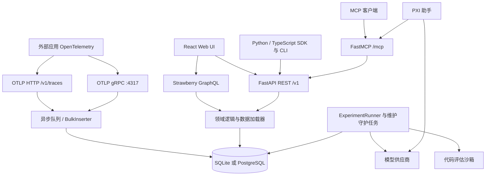
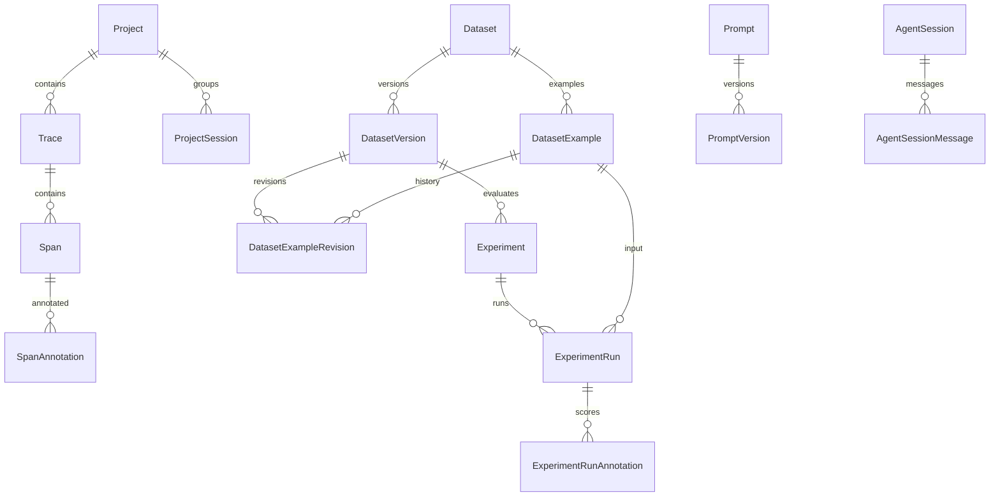

# 技术架构

> 源码基线：`4de0e4f88`；核对日期：2026-10-16；Phoenix 服务端版本：`20.23.0`。本文是现有实现说明，不是拟议重构方案。
> 阅读导航：[业务架构](../02-业务架构/业务架构.md) · [部署指南](../04-部署文档/部署指南.md)。

## 1. 系统组成

这是 Python 与 TypeScript 单仓库。服务端提供 Web UI、REST、GraphQL、OTLP HTTP/gRPC、后台实验及 MCP；Python/TypeScript 客户端和评测库可独立安装。应用、CI 或 Harbor 在外部执行的 Agent/task 通过 SDK 回写结果，不必与 Phoenix 服务同进程。

图中模块是逻辑职责，不代表必须拆成独立服务。主要装配发生在 [create_app](../../src/phoenix/server/app.py)，常规启动由 [serve 命令](../../src/phoenix/server/cli/commands/serve.py) 驱动。

## 2. 技术栈与版本来源

| 层次 | 当前实现 | 版本/约束来源 |
|---|---|---|
| Python | 支持 `>=3.11,<3.15`；本地 Makefile 安装目标选择 3.11 | [pyproject.toml](../../pyproject.toml)、[.python-version](../../.python-version)、[Makefile](../../Makefile) |
| Web 服务 | FastAPI、Starlette、Uvicorn | FastAPI `>=0.137.0`，其余以 `uv.lock` 为准 |
| GraphQL | Strawberry、异步 resolver、DataLoader | Strawberry `0.332.0`；[schema](../../src/phoenix/server/api/schema.py) |
| ORM/迁移 | SQLAlchemy async、Alembic | SQLAlchemy `>=2.1.1,<3`；[DB 引擎](../../src/phoenix/db/engines.py) |
| 数据库 | SQLite + aiosqlite + sqlean，或 PostgreSQL + asyncpg | PostgreSQL 开发 Compose 使用 16；非 MySQL 项目 |
| 追踪 | OpenTelemetry/OTLP、OpenInference 语义 | Python/TS OTEL 包、HTTP 与 gRPC 接收器 |
| 前端 | React、React Router、Relay、Zustand、Emotion、React Aria | React `19.3.0`、Router `^8.4.0`、Relay `^21.0.1`、Zustand `^5.0.15` |
| 前端构建 | Vite、Relay compiler、Vitest、Playwright、oxlint/oxfmt | [前端清单](../../js/app/package.json)、[Vite 配置](../../js/app/vite.config.mts) |
| 工具链 | Node.js、pnpm、uv、Make | Node `>=24.20.0`；pnpm `12.0.0`；uv `>=0.12.19,<0.13` |
| LLM/PXI | pydantic-ai、模型供应商适配、流式消息协议 | [Agent 工厂](../../src/phoenix/server/agents/agent_factory.py) |
| 代码执行 | 沙箱注册表、会话管理、Monty runtime | [sandbox](../../src/phoenix/server/sandbox)、[monty_runtime.py](../../src/phoenix/server/monty_runtime.py) |

依赖约束不等于锁定安装版本，精确依赖以 [uv.lock](../../uv.lock) 和 [pnpm-lock.yaml](../../js/pnpm-lock.yaml) 为准。Docker 构建使用 Python 3.13，与本地默认 3.11 不同；均在服务包支持范围内。

## 3. 目录职责与包边界

| 目录 | 职责 |
|---|---|
| `src/phoenix/server/` | 应用装配、HTTP/gRPC、认证、后台任务、Agent、MCP、沙箱 |
| `src/phoenix/server/api/` | REST 路由、GraphQL query/mutation/type、DataLoader、评估与模型调用 |
| `src/phoenix/db/` | ORM、数据库引擎、迁移、批量写入与数据维护 |
| `src/phoenix/trace/` | span 模型、OTLP 转换、查询 DSL、fixtures |
| `src/phoenix/config.py` | 环境变量名称、默认值、解析和验证 |
| `src/phoenix/server/static/` | 前端构建产物，开发前未必存在；生产 Python 包/镜像包含它 |
| `packages/phoenix-client/` | `arize-phoenix-client`：REST 客户端、实验执行、pytest 和 Harbor 插件 |
| `packages/phoenix-evals/` | `arize-phoenix-evals`：评估执行器、模型适配和内置指标 |
| `packages/phoenix-otel/` | `arize-phoenix-otel`：Python tracing 初始化与导出 |
| `packages/phoenix-sqlean/` | SQLite/sqlean 原生扩展包；独立发布，排除在 uv workspace 外 |
| `js/app/` | Web UI、路由、Relay 数据读取、状态、组件、前端测试 |
| `js/packages/` | client、evals、otel、CLI、MCP、config、testing 等 TS 包 |
| `schemas/` | GraphQL、OpenAPI、DDL 等跨语言接口产物 |
| `prompts/` | 内置分类评估器配置与生成输入 |
| `evals/pxi/` | PXI 离线/在线评估代码与配置 |
| `evals/harbor/` | Agent benchmark 的任务、Agent 适配、环境、job 和 verifier |
| `examples/`、`tutorials/`、`java/` | 使用示例、部署/集成教学，不等同于服务必需依赖 |
| `tests/`、各包 tests | Python 单元/集成测试；UI E2E 在 `js/app/tests/` |
| `helm/`、`kustomize/`、`Dockerfile` | Kubernetes 与镜像部署资产 |
| `scripts/`、`.github/workflows/` | 开发、代码生成、CI、发布、评估自动化 |
| `.agents/`、`plugins/` | 编码代理技能与插件分发，不是业务数据库 |

Python workspace 包通过 `[tool.uv.sources]` 引用本地实现；TypeScript workspace 由 pnpm 管理。避免只安装服务端目录而遗漏 SDK、schema 或构建依赖。

## 4. 启动与生命周期

1. `phoenix`/`arize-phoenix` console script 进入 [main.py](../../src/phoenix/server/main.py)，初始化 Settings、日志并解析 CLI。
2. `serve` 解析数据库、网络、认证、TLS、外部资源和 Agent 配置，创建异步数据库引擎；默认引擎创建过程执行迁移。
3. `create_app` 装配 REST、GraphQL、Agent、认证和 MCP，配置中间件、模型/凭证和后台组件。
4. lifespan 启动批量写入器、gRPC、DML 事件处理、保留清理、模型缓存、系统设置、磁盘监测、沙箱与实验调度。
5. HTTP 由 Uvicorn 提供，静态 UI 与 API 同源；退出时按上下文栈逆序停止后台工作与沙箱。

沙箱会话管理器先于实验 runner 启动、晚于 runner 关闭，避免任务退出后仍创建泄漏的沙箱会话。文档 MCP 的外部初始化失败会降级记录日志，不应阻止整个服务启动。

## 5. API、前端与接口生成

| 接口 | 路径/默认端口 | 用途与权威定义 |
|---|---|---|
| Web UI | `/`，HTTP `6006` | [Routes.tsx](../../js/app/src/Routes.tsx) |
| REST | `/v1/...` | [路由目录](../../src/phoenix/server/api/routers/v1)、[OpenAPI](../../schemas/openapi.json) |
| GraphQL | `/graphql` | [schema.py](../../src/phoenix/server/api/schema.py)、[schema.graphql](../../js/app/schema.graphql) |
| OTLP HTTP | `POST /v1/traces` | `application/x-protobuf`；支持 gzip/deflate，其他类型返回 415 |
| OTLP gRPC | `4317` | OTLP TraceService；[grpc_server.py](../../src/phoenix/server/grpc_server.py) |
| MCP | `/mcp`，默认启用 | [mcp_server.py](../../src/phoenix/server/mcp_server.py) |
| 健康检查 | `/healthz`、`/readyz` | 前者表示 HTTP 进程响应，后者执行数据库查询 |
| 服务版本 | `/arize_phoenix_version` | UI/SDK 兼容检查 |
| Prometheus | `9090`，默认不开启 | [prometheus.py](../../src/phoenix/server/prometheus.py) |

本基线提交的 OpenAPI 文件包含 127 个 HTTP 操作（含 auth、Agent、健康等路径，不全是 `/v1`）。接口逐项参数以 schema 和路由为准，本文不复制另一份容易漂移的 API 手册。

React Router 组织页面，Relay 读取 GraphQL、管理归一化缓存，Zustand 保存交互状态；部分请求通过 REST 和流式协议。Vite 输出到 Python 的 static 目录，生产部署不需要另起 Node UI 服务。前端不采用新项目默认 Vue/TDesign 技术栈。

生成链：Python GraphQL schema → Relay；Python OpenAPI → Python/TS client 与 UI types；`prompts/` → 内置评估配置代码。使用 `make graphql`、`make openapi`、`make codegen-prompts`，不要手改生成结果。细分命令见 `make help`。

## 6. 数据模型与存储

此图展示主要业务关系；例如 split、标签、版本引用和 evaluator 绑定还有关联表，精确外键与删除行为以 [models.py](../../src/phoenix/db/models.py) 为准。

### 6.1 主要数据域

| 数据域 | 代表性表 |
|---|---|
| 追踪 | `projects`、`traces`、`spans`、`project_sessions`、各类 annotation 表 |
| 数据集 | `datasets`、`dataset_versions`、`dataset_examples`、`dataset_example_revisions`、split/label 关联表 |
| 实验 | `experiments`、`experiment_runs`、`experiment_run_annotations`、`experiment_jobs`、`experiment_logs` |
| 提示词 | `prompts`、`prompt_versions`、`prompt_version_tags`、label 关联表 |
| 评估与沙箱 | `evaluators`、LLM/代码/内置子表、`code_evaluator_code_versions`、`dataset_evaluators`、`sandbox_configs` |
| 身份和配置 | `users`、`user_roles`、`api_keys`、access/refresh token、OAuth 表、`secrets`、`system_settings` |
| 模型与成本 | `generative_models`、`token_prices`、`span_costs`、`span_cost_details`、自定义供应商 |
| PXI | `agent_sessions`、`agent_session_messages`、`agent_session_snapshots` |

### 6.2 两种数据库的实际差异

- SQLite 使用 sqlean、显式事务与单连接写池，写事务独占连接；读侧使用独立池。单连接写入避免异步 session 在同一连接交错提交，代价是写入需排队。
- PostgreSQL 使用 asyncpg 和连接池，支持更适合共享运行的部署形态；有外部数据库、schema、只读副本及云身份连接配置。
- 两种方言有 JSON、聚合及迁移差异；不能把某一数据库专用 SQL 当作两者通用。
- Alembic 定义在 [migrations](../../src/phoenix/db/migrations)；持久数据库启动默认升级，另有 `phoenix db migrate` 独立命令。降级不能假设只回退镜像就足够。

## 7. 追踪摄入与读模型

OTLP HTTP/gRPC → 解码 span → 容量/空间与授权检查 → BulkInserter 队列 → 批量事务 → DML 事件 → 聚合、缓存失效与后续查询。

批量写入把请求接收与数据库吞吐解耦；代价是接收后查询可能短暂滞后，以及进程内队列不是持久消息队列。`PHOENIX_MAX_SPANS_QUEUE_SIZE` 默认 20,000，是保护内存的启发式上限，单批请求可能使实际队列暂时超过它。

模型/token 价格参与成本计算，DML 事件用于维护缓存和变更状态。GraphQL 通过 DataLoader 合并读取，避免每个字段逐行发查询；SQLite 还配置部分查询缓存。

证据：[bulk_inserter.py](../../src/phoenix/db/bulk_inserter.py)、[dml_event_handler.py](../../src/phoenix/server/dml_event_handler.py)、[DataLoader](../../src/phoenix/server/api/dataloaders)。

## 8. 评估与实验执行

### 8.1 SDK 和服务端任务是两种执行边界

- SDK：用户的 Python/TS 进程运行 task/evaluator，使用 REST 创建实验、上传 run 与评估结果。适合任意 Agent、检索链、外部系统和 CI。
- 服务端：UI 生成可持久化的实验 job，后台执行提示词任务及数据集评估器；由 Phoenix 管理停止、恢复、日志和并发。
- 二者复用实验、样本和注解数据模型，但不应把 SDK callable 误认为服务端已保存并可任意远程执行的任务定义。

### 8.2 后台调度

`ExperimentRunner` 在进程内调度，并把实验所有权、执行进度与结果写入数据库。调度先获取并发席位，再按实验公平选择可运行项；优先处理评估、到期重试，再执行新 task。限流的任务不会阻塞其他实验。

实现包含 claim、心跳、失效 claim 回收、重试退避、停止取消和重启恢复。当前全局席位常量为 1,000，另有任务级并发/供应商限流；这不是吞吐承诺。外部调用与数据库写入不是一个事务，不能据此承诺 exactly-once 执行。

### 8.3 evaluator 与代码执行

LLM、内置、代码三类 evaluator 实现统一评估接口；数据集绑定通过 input mapping 整理输入；结果转换为实验注解，部分场景还记录评估 trace。

沙箱注册了 WASM、Monty、Deno、Docker、Daytona、E2B、Modal、Vercel 等后端。Python/TypeScript、安装依赖、环境变量及网络访问能力随后端不同。默认允许所有 provider 类型，并不表示本机已安装全部 runtime 或具备远程凭证；`PHOENIX_ALLOWED_SANDBOX_PROVIDERS=NONE` 可全部禁用。

Monty 限制 Python 运行环境；WASM/Deno 属于本地执行选择；Docker 需要可达 Docker daemon；托管后端需要对应账户、凭证及网络。沙箱会话由 SessionManager 管理生命周期。细节以 [注册表](../../src/phoenix/server/sandbox/__init__.py) 和各 adapter 为准。

## 9. PXI、MCP 与外部评测

- PXI 使用 pydantic-ai 构建助手，组合 UI 上下文、浏览器动作、Phoenix MCP、文档、GitHub 等能力；会话消息和快照入库，面向 Web 的响应使用流式消息协议。
- 部署环境开关构成能力上限，数据库 system settings 可在其下运行时关闭助手、限制记录等。默认助手可用不代表模型凭证已配置。
- 外部 `/mcp` 由 FastMCP 从 REST/OpenAPI 派生工具，并复用身份/权限；默认 code mode 提供发现工具及受限 `execute`，也有 GraphQL/分析 SQL 能力。PXI 内部可用工具范围与外部 MCP 不完全相同。
- `PHOENIX_SKILLS_PATHS` 指向服务端技能目录，仅代表技能加载，不是技能质量评测系统。
- 在线回评是 `evals/pxi/online_evals/` 与定时工作流组成的外部执行链；Harbor 同样在独立执行环境运行，通过 Python client 插件写入结果。

## 10. 安全与数据边界

认证支持本地账户、OAuth2/OIDC、LDAP；Phoenix 也实现供 CLI/MCP 等客户端使用的 OAuth2 授权服务，这与接入外部身份供应商是两件事。REST 依赖、GraphQL permission classes、MCP guard 和 gRPC interceptor 分别承担对应入口权限。

Secret 服务使用由 `PHOENIX_SECRET` 派生的密钥加密敏感配置；未设置时存在开发用途的确定性派生行为，不能把它等同于安全的生产密钥管理。该 secret 同时关系到认证与已有加密数据，应稳定保存；轮换需要考虑重新加密。

界面禁用按钮、模型供应商展示白名单、禁止公共资源自动下载等开关的作用范围不同，不能互相替代。`PHOENIX_ALLOW_EXTERNAL_RESOURCES=False` 不会阻断运营方明确配置的 LLM/托管沙箱网络调用。

证据：[加密实现](../../src/phoenix/server/encryption.py)、[权限](../../src/phoenix/server/authorization.py)、[配置](../../src/phoenix/config.py)、[MCP guard](../../src/phoenix/server/mcp_server.py)。

## 11. 验证与维护入口

| 范围 | 已有验证代码/命令 |
|---|---|
| 实验调度和取消恢复 | [test_experiment_runner.py](../../tests/unit/server/daemons/test_experiment_runner.py) |
| SDK 实验行为 | [test_experiments.py](../../tests/integration/client/test_experiments.py) |
| 批量写入事务与重试 | [test_bulk_inserter.py](../../tests/unit/db/test_bulk_inserter.py) |
| 在线回评去重与异常 | [test_run.py](../../tests/unit/pxi/evals/online_evals/test_run.py) |
| Harbor 数据与评分映射 | [Harbor client tests](../../packages/phoenix-client/tests/client/harbor) |
| Python/TS/UI | `make test-python`、`make test-ts`、`make test-frontend` |
| 类型、格式及接口权限 | `make typecheck`、`make check-graphql-permissions`；其他命令见 Makefile |
| Helm | `make test-helm`、[test_helm.py](../../scripts/ci/test_helm.py) |

这里列出既有测试作为行为证据，不表示本轮已经执行这些测试。文档生成只做静态结构、路径、命令和配置核验；完整运行验证需要安装环境和外部服务。

## 12. 分析覆盖与限制

全仓清单为 8,426 个 Git 文件；本轮按源码/配置扩展名扫描 5,918 个文件，约 129 万行（含生成代码、测试、示例、Notebook、C 扩展与锁定配置，排除技能文档树）。清单、schema 和包配置另做核对，关键实现另做流程追踪及测试对照。该统计表示检索覆盖，不表示每行代码都经过人工语义审计。

本次未发现 Celery/Redis 作为主服务必需调度组件，也未发现独立 Skill 业务域或通用在线评测规则服务。可扩展点应以本次需求驱动；本文不为未来多租户、拆服务或队列系统预先引入新架构。

## 变更历史

| 日期 | 改动 | 依据 |
|---|---|---|
| 2026-10-16 | 以实际源码描述模块、接口、存储与执行边界 | `4de0e4f88` |
