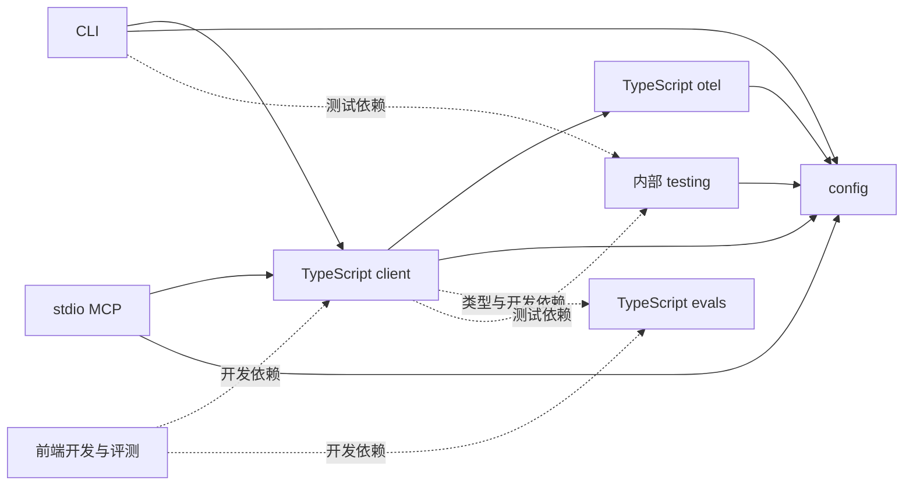

# Phoenix 目录迁移计划

状态：**方案 B，待审阅，尚未开始迁移。**

目标：把后端、前端、SDK 和部署文件放到明确的位置。每完成一步，就证明这一部分仍然可用，通过后再进行下一步。

设计依据：[工程目录规范对齐设计，第 9 节](../specs/2026-10-16-project-structure-design.md#9-方案-b-的目标与验收约束)。以下目录是本项目提出的方案，并非全局 AGENTS.md 规定的固定模板。

## 一、为什么这样迁移

这次迁移的收益是让人从目录就能找到“平台在哪里、给外部项目用的包在哪里、怎样部署”。它不会自动减少依赖、提升性能，也不会把各部分变成完全独立的项目。

| 安排 | 原因 | 必须付出的修改 |
|---|---|---|
| 后端放 `backend/` | 平台服务和平台测试放在一起，方便找代码与验证 | 修改 Python 打包、测试、资源和 Docker 路径 |
| 前端放 `frontend/` | 明确它是平台页面，区别于 TypeScript 工具包 | 修改前端构建、测试以及向后端输出页面文件的路径 |
| Python 包放 `sdk/python/` | 将平台主程序与供其他项目安装的 Python 包分开 | 修改 uv、tox、包文档和发布清单 |
| TypeScript 包放 `sdk/typescript/` | 保留各包独立发布，同时集中管理它们的共同依赖 | 修改 pnpm 工作区、包间引用和发布脚本 |
| Helm/Kustomize 放 `deploy/` | 集中查找 Kubernetes 部署方式 | 修改部署生成、检查和发布路径 |
| 两种语言的工作区配置保留在根目录 | 前端和工具包需要共同构建，平台也需要本地 Python 包 | 不复制配置；更新真实成员路径和锁文件 |
| 接口定义、模板、插件资源保持共享 | 多个产物使用同一份输入，复制后容易不同步 | 更新引用，继续由同一份输入生成 |

`sdk/` 在当前提案中是对外 Python/TypeScript 包的归组名称，里面也包含 CLI、MCP、SQLite 扩展和内部测试工具，并不是每一项都属于 SDK。这是目录命名的边界，不应据此合并它们的发布方式。

**不拆成多个仓库的原因：**它们共享接口定义、模板、类型和测试；当前没有证据表明拆仓能解决实际问题。此次只改变源码位置，保留一个仓库内协同开发和分别打包的能力。

## 二、到底有多少个产物

为避免重复计数，这里按“独立发布或安装的交付单元”统计，同一个包的不同版本、CPU 架构、wheel/源码包格式只算一项。

**主要交付单元共 16 项：5 个 Python 包 + 6 个 npm 包 + 1 个 Docker 镜像系列 + 1 个 Helm Chart + 3 个宿主插件。**这是仓库定义的交付单元，不代表本次已发布这些产物，也不代表本地拥有上游发布权限。

| 编号 | 产物名称 | 做什么 | 当前源码或配置 |
|---|---|---|---|
| 1 | `arize-phoenix` | Phoenix 平台，包含后端和构建后的网页 | 根 `pyproject.toml`、`src/phoenix/`、`js/app/` |
| 2 | `arize-phoenix-client` | Python 调用平台、管理数据和运行实验 | `packages/phoenix-client/` |
| 3 | `arize-phoenix-evals` | Python 评估器与评分能力 | `packages/phoenix-evals/` |
| 4 | `arize-phoenix-otel` | Python 追踪接入 | `packages/phoenix-otel/` |
| 5 | `arize-phoenix-sqlean` | 平台使用的 SQLite 原生扩展 | `packages/phoenix-sqlean/` |
| 6 | `@arizeai/phoenix-client` | TypeScript 调用平台及运行实验 | `js/packages/phoenix-client/` |
| 7 | `@arizeai/phoenix-evals` | TypeScript 评估器 | `js/packages/phoenix-evals/` |
| 8 | `@arizeai/phoenix-otel` | TypeScript 追踪接入 | `js/packages/phoenix-otel/` |
| 9 | `@arizeai/phoenix-config` | TypeScript 包共用配置能力 | `js/packages/phoenix-config/` |
| 10 | `@arizeai/phoenix-cli` | `px`、`phoenix-cli`、`pxi` 命令 | `js/packages/phoenix-cli/` |
| 11 | `@arizeai/phoenix-mcp` | 通过 stdio 提供工具的 MCP 程序 | `js/packages/phoenix-mcp/` |
| 12 | Phoenix Docker 镜像 | 直接运行平台及所需环境 | 根 `Dockerfile` |
| 13 | `phoenix-helm` | Kubernetes 安装包 | `helm/Chart.yaml` |
| 14 | Codex 插件 | 在 Codex 中接入 Phoenix | `plugins/codex/arize-phoenix/` |
| 15 | Claude Code 插件 | 在 Claude Code 中接入 Phoenix | `plugins/claude/arize-phoenix/` |
| 16 | Cursor 插件 | 在 Cursor 中接入 Phoenix | `.cursor-plugin/` 及共享技能 |

另外有 **3 项内部构建或测试单元**，不算上面的对外交付数量：

| 单元 | 为什么单独说明 |
|---|---|
| `phoenix-ui` | 私有前端工程，生成页面文件并装入平台，不是单独发布的 npm 产品 |
| `@arizeai/phoenix-testing` | 私有 TypeScript 测试工具包，供其他包开发测试使用 |
| `harbor-verifiers` | Harbor 评测校验包，供仓库评测任务构建和使用，未列入五个 Python 产品的发布清单 |

因此，迁移需要关注的是 **16 项主要交付单元，以及 3 项内部单元**。这不是 19 个服务，也不意味着要启动 19 个进程。

文档站和 API 文档也会生成网页，但属于文档输出；示例、教程、Storybook、Kustomize、Compose 和各云平台配置不在上述软件交付计数中。`px` 的三个命令名不重复算三个包，Python 主包与 Docker 镜像则是同一平台的两种独立交付方式。

## 三、源码之间确实有依赖，但依赖方式不同

### 1. Python：安装依赖与源码直接导入要分开看

根 `pyproject.toml` 声明平台安装依赖 client、evals、otel 和 sqlean 四个包。开发时，前三个通过 uv 使用本仓库源码；sqlean 是独立原生扩展，不属于 uv 工作区成员。

| 关系 | 实际含义 |
|---|---|
| 平台 → 四个 Python 包 | 安装主包时需要这些依赖；不能因为都在本仓库就直接合并源码 |
| Python client → Python evals | 有一处可选导入，用于识别评估器的限流异常；evals 未安装时有替代处理，不是 client 的强制安装依赖 |
| Harbor 校验包 → 平台、client、evals | 清单声明依赖，并直接使用 client 和 evals 源码提供的接口 |
| Python client / otel → Phoenix 服务 | 通过网络 API / 追踪协议连接，不需要读取服务端源码 |

在此次检索的 `src/phoenix/` 中，未发现直接导入 `phoenix.client`、`phoenix.evals`、`phoenix.otel` 的语句。这里的“平台依赖四个包”依据是安装清单，不能夸大为后端源码到处直接引用它们。

Python SDK 安装时不需要把服务端一起安装。evals 的本地评分与 otel 的埋点配置也不意味着必须在同一进程运行 Phoenix；向平台上传或查询结果时才涉及服务通信。

### 2. TypeScript：存在明确的包间依赖

下图箭头表示“左边使用右边”，实线是包清单中的运行依赖：



前端把 client 和 evals 声明为开发依赖；例如前端自用评测直接调用它们。页面源码中展示给用户的 SDK 接入示例字符串，不代表浏览器在实际运行该 SDK，不能只搜索到包名就算成运行依赖。

client 对 evals 的跨包导入包含 `import type`，与 CLI 真正调用 client 函数也不同。因此既要验证编译和类型声明，也要验证安装后的程序运行，不能只看一种依赖。

**对应构建次序：**先满足 config、otel 等基础包，再构建依赖它们的 client，之后构建 CLI/MCP；开发和测试还要准备 evals/testing。由 pnpm 根据包清单排序，不手写另一套构建调度。

### 3. 前后端：通过接口通信，但交付时装在一起

```text
Python 服务定义接口
    ├─ OpenAPI → Python client、TypeScript client、前端类型、测试工具
    └─ GraphQL → 前端 Relay、Harbor 查询代码

前端源码 → 页面构建文件 → Python 主包 → Docker 镜像

prompts/ → Python 与 TypeScript 的评估模板生成代码
```

这里没有 Python 直接 import TypeScript 源码。它们通过接口定义、生成代码以及构建文件发生关联。

当前 Vite 把页面输出到 `src/phoenix/server/static/`，Docker 随后把它复制进后端构建阶段。后端路径搬了，前端输出路径必须当步修改，否则后端即使启动成功也可能没有页面。

Docker 使用 `uv sync --no-sources` 安装已发布的 Python SDK。**修改本仓库 SDK 后，本地源码测试通过，不代表 Docker 已包含这些修改。**目录迁移暂时保留这一既有方式，并分别验证本地与镜像内容。

### 4. 插件、两个 MCP 和部署文件

Python 服务本身提供 `/mcp`；npm 的 `@arizeai/phoenix-mcp` 是另一个 stdio 程序，依赖 TypeScript client/config。它们不能算成同一个独立产物，也不能把每个插件都理解成内嵌 npm MCP。

Claude Code 和 Cursor 的插件配置直接连接远程 MCP 地址；Codex 还有自己的 stdio 启动器。它们共享部分技能资源，运行时需要能连接 Phoenix，但不需要各自复制整套后端源码。

Helm、Kustomize 和 Compose 使用镜像及配置部署服务，不导入 Python/TypeScript 源码。Helm 还有可选 PostgreSQL Chart 依赖；这与当前 Docker 连接 Mac 本地 PostgreSQL 是不同部署方式。

## 四、迁移后放在哪里

| 内容 | 现在的位置 | 迁移后的位置 |
|---|---|---|
| 后端源码 | `src/phoenix/` | `backend/src/phoenix/` |
| 后端测试 | `tests/` | `backend/tests/` |
| 前端应用及其测试 | `js/app/` | `frontend/` |
| Python SDK、评估库、追踪库和 SQLite 扩展 | `packages/` | `sdk/python/` |
| TypeScript SDK、CLI、MCP 和内部测试包 | `js/packages/` | `sdk/typescript/` |
| TypeScript 示例 | `js/examples/` | `examples/typescript/` |
| TypeScript 性能测试 | `js/benchmarks/` | `benchmarks/typescript/` |
| TypeScript 工程脚本 | `js/scripts/` | `scripts/typescript/` |
| Kubernetes 部署文件 | `helm/`、`kustomize/` | `deploy/helm/`、`deploy/kustomize/` |

根目录继续放 Makefile、Python 项目配置、Dockerfile 和 Compose。原 `js/` 下的 pnpm 配置、锁文件、`.changeset/` 和共享 TypeScript 配置移到根目录，让前端与 TypeScript 包继续共用一套依赖管理。Python 也保留根目录的一套项目配置，不再复制一份到 backend。

插件、共享技能、接口定义、评估模板、教程、现有其他示例和文档保留原来的职责。隐藏文件、许可文件和发布配置按实际用途保留。

## 五、每一步怎样算完成

每一步都按同样的顺序执行：

1. 搬迁这一部分，同时修改指向旧目录的构建、测试、自动化和文档。
2. 运行该步骤列出的验证，记录通过、失败和未执行的项目。
3. 通过后形成一份独立提交，再开始下一步。

**独立验证，是指可以取出某一步完成后的代码，单独确认它能用。**这不意味着所有步骤可以同时做。前端和 TypeScript 包共用依赖配置，需要放在同一步迁移。

包名、导入方式、命令名称、接口和数据库结构保持不变。不建立空目录、旧路径软链接或跳转脚本来维持表面兼容。

## 六、分六步执行

### 第 0 步：确认迁移前的情况

**改什么：**先不搬源码。记录当前版本和已有改动，列出所有引用待迁目录的配置、脚本和发布流程。

- [ ] 保存已有改动清单，区分本次迁移与之前的教程翻译、文件清理。
- [ ] 运行后端、TypeScript 和三个 Python SDK 的测试，以及前端、Python 主包构建，记录原本就存在的失败。
- [ ] 运行接口和模板生成命令，保存迁移前的结果供后面比较；保存部署配置的生成结果。

**验证方式：**使用第七节的现有命令，在独立工作区执行，避免改写用户已有文件。

**完成标准：**知道迁移前哪些检查通过、哪些失败、哪些缺少环境。无法取得必要结果时，先解决对应问题。

### 第 1 步：搬 Python SDK

**改什么：**`packages/` → `sdk/python/`。同步根 `pyproject.toml`、`uv.lock`、`tox.ini`、Makefile、依赖文件、版本清单、API 文档和 Python 发布流程中的路径。

- [ ] 原样移动四个包，保留名称、版本和内部结构；SQLite 扩展沿用原来的原生构建方式。
- [ ] 更新依赖锁文件中的本地路径，确认依赖版本没有改变。
- [ ] 运行三个 SDK 的测试；分别生成安装包，在仓库外的独立 Python 环境安装并导入。SQLite 扩展还需执行一条实际查询。
- [ ] 运行后端测试，确认平台仍能使用 SDK；检查发布流程能找到新路径，读取历史版本时能找到当时的旧路径。

**验证方式：**三个 SDK 的 tox 测试、四个包的构建与安装检查，以及 `make test-python`。SQLite 扩展的其他平台由原有 CI 验证，缺少结果的平台单独标明。

**完成标准：**SDK 可从新目录开发和打包，安装后不依赖仓库路径，平台不再需要旧 `packages/`。

### 第 2 步：搬后端和后端测试

**改什么：**源码放到 `backend/src/phoenix/`，平台测试放到 `backend/tests/`。同步 Python 打包、类型检查、数据库迁移工具、测试、脚本和 CI 的路径。

- [ ] 移动源码和测试，更新测试数据及资源引用；数据库只搬源码文件，不改表结构。
- [ ] 修改前端输出和 Docker 文件复制路径，让页面文件进入新后端目录。此时前端仍在 `js/app/`。
- [ ] 运行后端测试、类型检查，再构建前端、Python 安装包和 Docker 镜像。
- [ ] 在仓库外安装 Python 包，并从源码压缩包重新构建；确认页面、迁移文件、模板和技能资源都随包提供。
- [ ] 用独立测试容器启动新镜像，检查健康接口、首页及首页引用的 JS/CSS 文件。

**验证方式：**`make test-python`、`make typecheck-python`、`make build-frontend`、`make build-python`，加安装包和 Docker 实际启动检查。

**完成标准：**后端能测试、能安装、能启动；前端仍可构建并由后端提供，不需要旧 `src/` 和 `tests/`。

### 第 3 步：一起搬前端和 TypeScript 工程

**改什么：**前端搬到 `frontend/`，TypeScript 包搬到 `sdk/typescript/`；示例、性能测试和脚本按第四节的表格搬迁。

- [ ] 将 pnpm 配置移到根目录，更新锁文件、相对路径、代码检查配置、Makefile 和 CI；配置冲突时合并，不能覆盖原有规则。
- [ ] 同步前端构建、Relay、Storybook、浏览器测试、接口生成、包文档和发布脚本。不搬旧依赖缓存，重新安装。
- [ ] 从未安装依赖的独立工作区开始，执行冻结锁文件安装，运行 TypeScript 类型检查、测试和全部包构建。
- [ ] 重新生成接口和模板，与第 0 步比较，确认没有业务变化；连续生成两次应不再出现新增差异。
- [ ] 对六个公开包分别打包，在仓库外安装，检查导出入口、类型和文档；验证 CLI 帮助命令、MCP 初始化和工具列表。内部测试包保持私有。
- [ ] 构建 Storybook、Python 主包和 Docker 镜像，验证前后端仍能配合。旧 `js/` 中的有效文件全部安排好位置后再移除旧目录。

**验证方式：**`pnpm install --frozen-lockfile`、`make typecheck-ts`、`make test-ts`、`make build-ts`、`make build-frontend`，加各包安装、CLI/MCP 和镜像启动检查。

**完成标准：**前端、SDK、CLI 和 MCP 都能从新布局使用，不需要旧 `js/`。本地 env 等用户文件单独保护，不把真实凭证加入版本控制。

### 第 4 步：搬部署文件，更新工程入口

**改什么：**Helm 和 Kustomize 放到 `deploy/`，同步部署脚本、自动化流程和文档。

- [ ] 更新 `scripts/update_helm.py`、`scripts/update_kustomize.py`、`scripts/ci/test_helm.py`、Makefile 和相关 CI。
- [ ] 检查 Helm 配置，逐个生成现有 Helm/Kustomize 部署配置，与迁移前比较，确认部署内容没有变化。
- [ ] 检查根 Compose 配置；在临时安装目录核对插件清单、启动器和资源，保留宿主要求的隐藏入口。
- [ ] 更新 AGENTS.md、DEVELOPMENT.md、README、文档索引和部署指南，使说明与实际目录一致。

**验证方式：**`make test-helm`、`helm lint deploy/helm`、`helm template phoenix deploy/helm`、各 Kustomize 配置生成、`docker compose config --quiet`，加插件资源和文档链接检查。

**完成标准：**部署文件搬家前后表达相同的部署内容，插件和文档入口可用。配置检查不等于已经在 Kubernetes 集群部署。

### 第 5 步：用完整系统验收

**改什么：**复核全部迁移结果，补齐现有测试未覆盖的实际使用场景。

- [ ] 从独立工作区安装冻结的依赖，运行全部受影响测试和构建；最终 Docker 镜像使用 `--no-cache` 构建。
- [ ] 使用独立容器和本机 PG 的专用测试数据库，检查健康接口、页面、静态资源和项目查询。
- [ ] 运行 LangChain/LangGraph demo 的四个测试并实际发送追踪，验证可查、入库，并且重启测试容器后仍然存在。
- [ ] 用小数据集和不调用外部模型的评分函数运行一次离线评测，确认结果和标注可取回。
- [ ] 在浏览器验证项目导航和追踪详情；复核 SDK 安装、CLI/MCP、插件与部署结果。
- [ ] 在隔离环境故意改错页面输出路径和一个 SDK 打包入口，确认对应检查会失败；恢复后重新通过。

**完成标准：**页面、追踪、离线评测、PG 持久化及各独立安装包都有实际验证结果。必要项目未执行时，标为“未完成验收”。

## 七、常用验证命令

以下是现有入口。各步骤按影响范围运行，不在每次小改后重复全量测试。

| 要验证什么 | 命令 |
|---|---|
| 后端测试 / 类型检查 | `make test-python` / `make typecheck-python` |
| Python SDK 测试 | `tox run -e phoenix_client,phoenix_evals,phoenix_otel` |
| TypeScript 测试 / 类型检查 | `make test-ts` / `make typecheck-ts` |
| 前端 / TypeScript 包构建 | `make build-frontend` / `make build-ts` |
| Python 主包构建 | `make build-python` |
| 接口和模板生成 | `make graphql`、`make openapi`、`make codegen-prompts`、`make codegen-harbor-graphql` |
| 部署配置检查 | `make test-helm`、`docker compose config --quiet` |

优先复用现有测试，缺少必要场景时才补测试，不为目录搬迁另建通用检查框架。涉及新路径的关键检查，要先证明旧配置会失败，再修改并验证通过。

## 八、结果放哪里，失败怎么办

所有基线、安全和验收报告统一放到 **`docs/06-交付审计/`**，不另建报告目录。

结果按后端、SDK、前端、静态检查和实际运行分别记录：测试文件与用例数、通过/失败/跳过数、新增和浏览器场景的实测值，以及时间、代码版本和工具版本。构建记录包含安装包、镜像标识和是否使用缓存。

某一步失败，就停在这一步修复；需要撤回时，同时恢复该步移动的目录和修改的配置。有后续步骤时按相反顺序撤回，不覆盖用户的新改动，不强制重置仓库。

整个迁移使用独立测试容器与数据库，不自动替换当前服务，不删除已有数据库或数据卷，不升级依赖，不发布软件包。当前 Docker 使用发布版 Python SDK、本地使用源码 SDK 的方式保持不变。

## 九、SDD 执行约定

先审阅本计划中的迁移理由、依赖关系、目标路径和完成标准，再开始实施。执行时逐项勾选，每步通过后审阅并提交；提交前执行项目安全检查，报告按第八节存放。不自动推送或发布。

执行代理使用 `superpowers:executing-plans`；只有用户选择子代理执行时才使用 `superpowers:subagent-driven-development`。本次仅修改计划文字，未开始迁移，也未执行计划中的构建或测试。

## 十、核对依据

| 核对依据 | 支持的结论 |
|---|---|
| [Python 主包配置](../../../pyproject.toml)、[版本清单](../../../.release-please-manifest.json) | 五个 Python 产品及 uv 源码依赖 |
| [client 的可选 evals 导入](../../../packages/phoenix-client/src/phoenix/client/utils/executors.py) | 可选源码依赖与强制安装依赖的区别 |
| [JS 工作区](../../../js/pnpm-workspace.yaml)、各包 package.json | 六个公开 npm 包、一个私有测试包及包间依赖 |
| [前端 package.json](../../../js/app/package.json)、[Vite 配置](../../../js/app/vite.config.mts) | 前端开发依赖与页面构建输出 |
| [Dockerfile](../../../Dockerfile)、[Makefile](../../../Makefile) | 页面装入平台、SDK 安装来源和共享生成链 |
| [Harbor 包配置](../../../evals/harbor/verifiers/pyproject.toml) | 内部校验包的依赖 |
| [Helm 配置](../../../helm/Chart.yaml)、[Claude 市场](../../../.claude-plugin/marketplace.json)、[Codex 插件](../../../plugins/codex/arize-phoenix/plugin.json)、[Cursor 插件](../../../.cursor-plugin/plugin.json) | 部署包及三类宿主插件 |

执行后的测试与交付证据统一存放到 `docs/06-交付审计/`。
