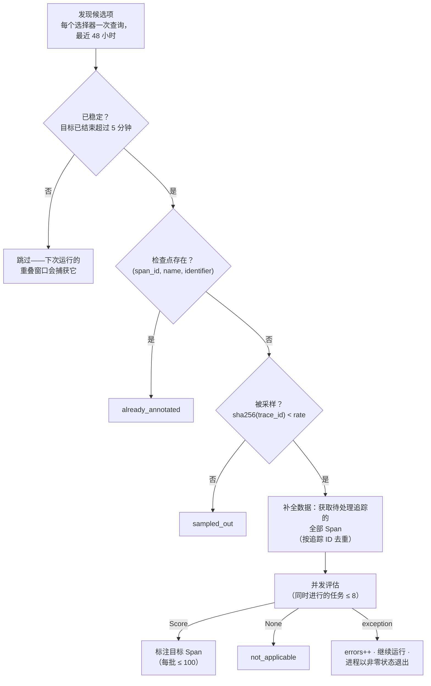
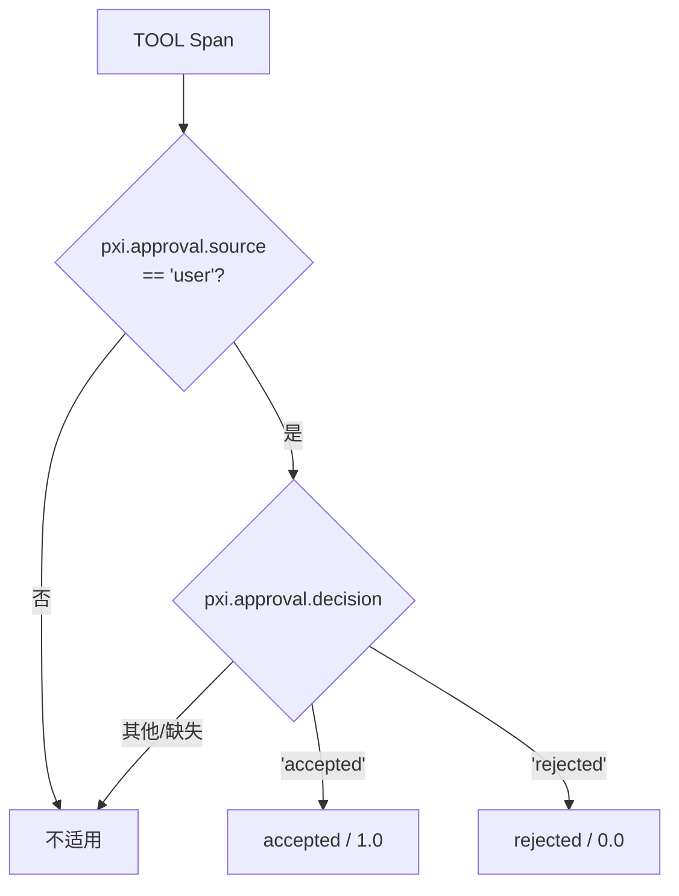
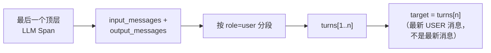

<a id="pxi-online-evals--how-it-works"></a>

# PXI 在线评测——工作原理

一个定时批处理作业，从 Phoenix 拉取近期摄取的 PXI Span，对其运行质量评估器，再将结果作为**幂等的 Span 标注**写回各评估器的目标 Span。它作为普通 Phoenix API 客户端运行；服务器进程和数据摄取路径中都不执行任何评测。

<a id="target-discovery-roots-and-tool-spans"></a>

## 目标发现：根 Span 与 TOOL Span

每个评估器声明一个 `SpanSelector`。运行器将使用相同选择器的评估器分组，并为**每组执行一次发现查询**：

| 选择器 | `names` | `span_kinds` | `parent_id` | `attributes` | 评估器 |
|---|---|---|---|---|---|
| 轮次根 Span | `pxi.turn` | `AGENT` | `"null"` | — | `tool_count_per_turn`, `user_friction` |
| 审批决策 | — | `TOOL` | *（未设置）* | `pxi.approval.source = user` | `suggestion_accepted` |

根 Span 评估器为整个轮次评分。`suggestion_accepted` 为每个操作分别评分，因此同一轮次中的多个决策仍彼此独立。

稳定等待时间依据目标的 `end_time`；检查点使用 `(span_id, name, identifier)`；采样使用 `trace_id`。

<a id="the-pipeline"></a>

## 处理流水线



`discovered` 统计目标 Span，因此 `suggestion_accepted` 报告的是建议数，而非轮次数：

```
tool_count_per_turn: discovered=11 already_annotated=0 sampled_out=0 not_applicable=0 evaluated=11 errors=0 written=11
user_friction:       discovered=11 already_annotated=0 sampled_out=0 not_applicable=6 evaluated=5  errors=0 written=5
suggestion_accepted: discovered=34 already_annotated=0 sampled_out=0 not_applicable=8 evaluated=26 errors=0 written=26
```

CLI 还可通过 `--summary-json` 将相同计数器写为带版本的 JSON 报告。在 GitHub Actions 中，它会自动将精简的评估器表格追加到作业摘要。不适用的结果按原因分组，以便区分个别不完整追踪和评估器正常的适用性过滤。

<a id="anatomy-of-a-turn-trace"></a>

## 轮次追踪的结构

一条追踪 = 一个对话轮次。所有 Span 都是根 Span `pxi.turn` 的后代（拓扑来自真实的脱敏追踪 `tests/.../fixtures/pxi_turn_trace.json`）：

```
pxi.turn (AGENT, root)        input.value = "can you save this trace to a dataset?"
├── model (LLM)  ──┐
├── list_datasets (TOOL)      Agent 循环交替执行模型调用与
├── model (LLM)               工具执行；此处有 9 个 LLM + 8 个 TOOL Span。
├── ask_user (TOOL)           每个 LLM Span 的输入包含截至当时的全部消息；
├── model (LLM)               最后一个包含完整历史。
├── create_dataset (TOOL)
├── add_spans_to_dataset (TOOL, ERROR)
├── bash (TOOL)
├── add_spans_to_dataset (TOOL)   ← 重试
├── call_subagent (TOOL)
│   └── PXISubagent.iter (AGENT)
│       ├── model (LLM)
│       ├── query_phoenix (TOOL)
│       └── load_skill_reference (TOOL)
└── ... （最后一个 LLM Span 携带完整对话记录）
```

**`tool_count_per_turn`** 统计追踪中的每个 TOOL Span，包括嵌套在 `call_subagent` 等其他工具下的工具。元数据将按时间顺序统计的工具总量分解为顶层和嵌套工具名称。

<a id="how-suggestion_accepted-reads-a-decision"></a>

## `suggestion_accepted` 如何读取决策

需要审批的工具先暂存变更，UI 展示接受/拒绝卡片，用户的点击会以保留标记的形式写入工具输出：

```json
{"approval": {"decision": "accepted", "source": "user"}}
```

服务器将该标记提升为 `pxi.approval.decision` 和 `pxi.approval.source`。评估器只读取这些属性。



发现过程不使用工具名称允许列表。新增的审批工具只要输出该标记就会被纳入。

该标记发布前摄取的 Span 不含 `pxi.approval.*` 属性，因此不会被发现，也无法回填。

发现过程按 `source = user` 过滤，一次查询即可覆盖接受和拒绝两种人工决策。

其他结果不写入标注：

| 情况 | 记录形式 | 不标注的原因 |
|---|---|---|
| 自动接受 | `source: "auto"` | 绕过权限检查，不是用户决策 |
| 待审批 | 无标记 | 用户尚未决定 |
| 因页面跳转而取消 | 无标记（`output-error`） | 卡片被关闭，没有作出决策 |
| 工具错误 | 无标记（`output-error`） | 没有提出可供决策的内容 |
| 未知或格式错误的决策 | — | 不是用户最终决策 |
| 不需要审批的工具 | 无标记 | 不存在审批环节 |

标注仅携带 `{"tool_name": ...}`。

`submit_{code,llm}_evaluator_draft` 仍未纳入评测，因为其对话框决策未写入工具输出。参见 [#15033](https://github.com/Arize-ai/phoenix/issues/15033)。

<a id="how-user_friction-finds-its-target"></a>

## `user_friction` 如何找到目标

裁判判断该轮次的**用户消息**是否表达了对助手*此前*行为的不满。它需要对话历史，而单条追踪已包含这些历史：



最后一个 LLM Span 的输入就是 Agent 自身看到的完整历史：会话的所有先前轮次，加上本轮用户消息及工具交互。更早的顶层 LLM 调用是同一对话的累积快照，因此不单独合并。嵌套在 `call_subagent` 下的 LLM 调用属于子 Agent 的私有对话，会被有意排除；顶层 `call_subagent` 工具调用仍在主对话记录中可见。分段**只在 `role == "user"` 时发生**：最后一条用户消息之后的助手/工具消息（Agent 在工具调用间“自言自语”）归入同一轮次。因此，目标始终是*最新用户消息*，绝非消息链中的最后一条消息。

历史按两种层次渲染：较早轮次采用精简形式，用户正在回应的轮次采用详细形式。该渲染与构建 `user-friction-alignment-v0.5` 黄金标签时使用的渲染逐字节一致：

```
### User                        ─┐
what happened in this trace?     │ compact tier (older turns)
> Tools (2): bash ✓, search ✓    │
### Assistant                   ─┘
The trace completed cleanly...
> Tool: list_datasets           ─┐ detailed tier (reacted-to turn):
> Tool: add_spans_to_dataset     │ tool-by-tool, errors kept,
> Error: dataset not found...    │ ask_user questions in full
[agent asked: "Continue?" ...]  ─┘
```

<a id="checkpointing-the-annotation-is-the-state"></a>

## 检查点：标注*就是*状态

没有额外的数据库或状态文件。评估前，运行器会向 Phoenix 查询哪些**目标 Span**已带有该评估器的标注，并跳过它们：

| 评估器 | 目标 | 检查点标识符 |
|---|---|---|
| `tool_count_per_turn` | 根 Span `pxi.turn` | `pxi-online-evals:tool-count-per-turn:v2` |
| `user_friction` | 根 Span `pxi.turn` | `pxi-online-evals:user-friction:v1:openai:gpt-5.5` |
| `suggestion_accepted` | 审批 TOOL Span | `pxi-online-evals:suggestion-accepted:v1` |

键按目标区分，因此某条建议的检查点不会阻止同一轮次中其他建议的评估。

- 48 小时回看窗口与每 12 小时的调度产生约 4 倍**重叠**，因此遗漏或崩溃的运行会自动补齐，同时不会重复评估。
- 提升 `vN`（评判标准/评分方式变化）或更换裁判模型会开启一个**新序列**并回填窗口，绝不覆盖旧序列。
- 仅查询运行器**自身**的标注名称：人工反馈（点赞/点踩、笔记）绝不会阻止运行，新评估器会在下次运行时自动回填。

<a id="sampling-consistent-across-evaluators"></a>

## 采样：所有评估器保持一致

`sha256(trace_id)` → 每条追踪对应一个数值，所有评估器共享该数值。相同采样率选出**完全相同**的追踪；较低采样率选出的追踪是较高采样率结果的**真子集**。因此，被采样的追踪会携带所有适用标注，不会随机缺失部分标注。

```
rate 1.00  ████████████████████  所有追踪
rate 0.50  ██████████            所有评估器都取相同的前半部分
rate 0.25  █████                 0.50 采样结果的子集
```

<a id="safeguards"></a>

## 保护措施

| 考虑的故障 | 保护措施 | 触发时的行为 |
|---|---|---|
| 评判仍在运行的轮次或进行中的操作 | 从**目标自身结束**时间起等待 5 分钟 | 等待下次运行 |
| 推测并非用户决策的结果（自动接受、待定、取消、出错、格式错误） | 使用结构化字段决策规则，并明确设置不适用分支 | 不写入标注 |
| 前端新增审批工具却没有对应评测 | 工具写入统一审批标记；发现依据标记，而非工具名称 | 自动评测新工具；若发布时未带标记，前端漂移检查会失败 |
| 评判归属错误：对话记录最后一轮不是该追踪自身的消息 | 目标必须是最后一条 user 角色消息，由人编写，**且等于根 Span 的 `input.value`**（在摄取时独立记录） | 跳过并警告；绝不将评判检查点写到错误的根 Span 上（幂等性会使错误永久保留） |
| 非人类编写的“用户”消息（旧版 UI 上下文块、Agent 循环续接消息、工具错误载荷） | `is_human_message` 分类器，与构建黄金标签时使用的分类器相同 | 作为不适用跳过；**不回退**到更早的人工轮次 |
| 子 Agent 内部 LLM Span 错占对话记录（它可能在主 Agent 最后一次调用*之后*才开始） | 优先使用根 Span 的直接子 LLM Span | 采用主对话记录 |
| 裁判输入过大 | 渲染后输入上限为 50k 字符 | 跳过并警告 |
| 补全大量追踪时被静默截断 | 达到 Span 上限时拆批重试；单条追踪超限视为错误 | 正确性优先于便利性 |
| 发现范围无限增长 | 每个选择器查询设置硬上限（5,000 个 Span），超限时明确报错、指出选择器并使运行失败 | 运维人员缩小窗口 |
| 单个异常目标影响整次运行 | 按目标隔离异常 | 记录日志并计数；继续运行；进程以非零状态退出，使定时作业标红 |
| 裁判配置错误 | 启动时验证提供商/API 密钥 | 在处理任何追踪前快速失败 |
| 拓扑异常（孤立工具 Span、缺失祖先、环） | 作为不适用跳过并警告 | 不完整追踪无法产生可信的工具计数，也不应影响后续定时运行 |

<a id="assumptions"></a>

## 前提假设

1. **一条追踪 = 一个轮次**，以 `pxi.turn` AGENT Span 为根，该轮用户消息位于根 Span 的 `input.value`。（适用于 2026 年 7 月之后的追踪格式；已通过近期生产追踪验证。）
2. **最后一个顶层 LLM Span 携带完整会话历史**，重建对话不需要按会话抓取数据或合并中间 LLM 快照。嵌套子 Agent 的 LLM 历史不属于面向用户的对话记录。
3. 当前追踪中，**UI 上下文绝不会作为用户消息传入**（它通过 Agent 指令传递）。分类器中的 `<phoenix_ui_context>` 检查是保留的旧格式保护，用于与黄金标签保持一致及进行深度历史回填。
4. 追踪结构已通过实测验证：在近期 47 条生产追踪中，每个最终轮次均解析为人工消息，`input.value` 交叉检查的不匹配次数为零。

<a id="operations"></a>

## 运维

- **调度**：GitHub Actions，UTC 00:17 / 12:17；手动触发默认使用 `--dry-run`；本地 CLI 要求传入 `--project`，除非已设置 `PHOENIX_PROJECT` 或 `PHOENIX_PROJECT_NAME`。未传入 `--dry-run` 时仍默认写入。
- **裁判配置**（所有 LLM 评估器共享）：
  `PHOENIX_AGENTS_EVALS_PROVIDER` / `PHOENIX_AGENTS_EVALS_MODEL`
  （默认 `openai` / `gpt-5.5`，已在黄金数据的开发集划分上验证）。
- 凭证仅向评估步骤开放；日志只包含聚合计数，绝不包含追踪内容。
