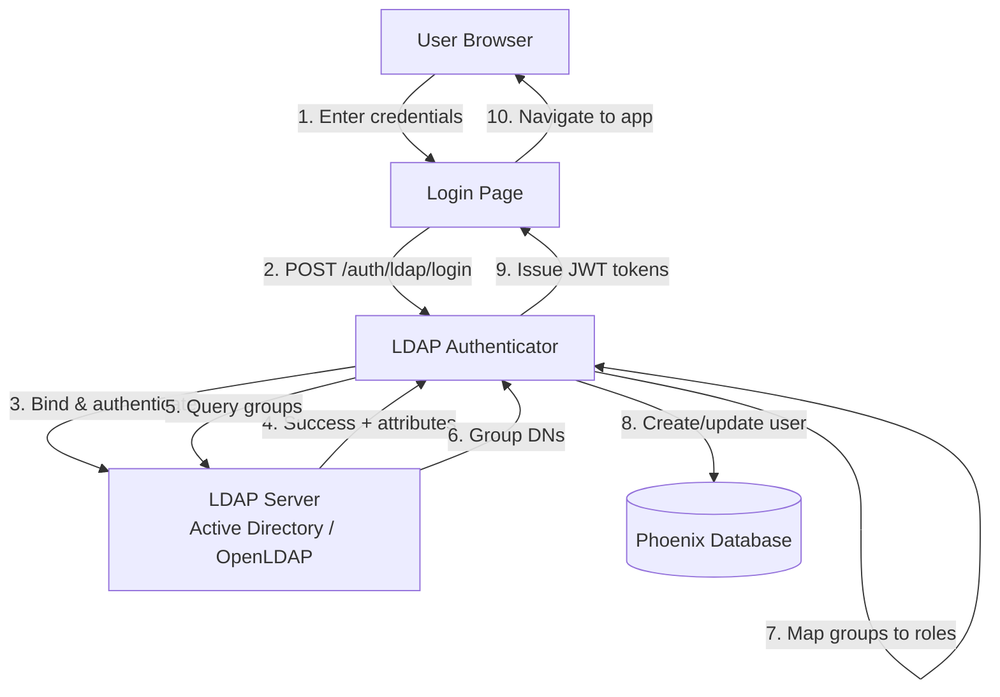

<a id="ldap-authentication-design-proposal-for-phoenix"></a>

# Phoenix LDAP 身份验证设计提案

> **初次接触 LDAP？**先阅读[面向 OIDC 工程师的 LDAP 入门](./ldap-authentication/ldap-primer.md)，以 OIDC 为参照理解 LDAP 基础。

<a id="executive-summary"></a>

## 执行摘要

为 Phoenix 提供 LDAP 身份验证，支持企业用户采用。涵盖 Active Directory/OpenLDAP、基于组的角色映射、多服务器故障转移和兼容 Grafana 的配置。

→ *完整详情*：[架构概览](#architecture-overview) | [安全与风险](#security--risks) | [实现计划](#implementation-plan) | [Grafana 兼容性](./ldap-authentication/grafana-comparison.md)

<a id="the-decision"></a>

### 决策

Phoenix `users` 表的 CHECK 约束（`auth_method IN ('LOCAL', 'OAUTH2')`）要求从以下方案中选择：

**方案 1：零迁移（采用优先）**
  *适用情形：立即满足企业用户是当前优先事项，代码一致性可以延期*

- **机制**：复用 OAuth2 列，使用 Unicode 标记（`\ue000LDAP(stopgap)`）
- **优势**：立即发布，无需协调。在承诺数据库结构变更前，使用真实用户验证 LDAP 实现
- **取舍**：无法使用 SQLAlchemy 多态，没有 `LDAPUser` 类，必须使用约定式辅助函数。迁移前数据库存为 OAuth2，代码视为 LDAP，语义不一致
- **可逆性**：可通过标准 Alembic 迁移至方案 2。生产中发现的洞察和边界情况均可在迁移时处理（[迁移计划](./ldap-authentication/migration-plan.md)）

→ *技术详情*：[方案 1 实现](#approach-1-zero-migration-strategy) | [数据库结构](./ldap-authentication/database-schema.md)

**方案 2：数据库结构迁移（架构优先）**
  *适用情形：从开始保持代码一致性比尽快采用更重要*

- **机制**：更新 CHECK 约束，允许 `auth_method='LDAP'`；基于邮箱/unique_id 的用户识别不变
- **优势**：数据库结构清晰、完整多态、无技术债务、OAuth2/LDAP 完全分离
- **取舍**：发布前需要数据库迁移，自托管用户必须升级，时间需要协调
- **可逆性**：不适用，这是目标状态

→ *技术详情*：[方案 2 实现](#approach-2-schema-migration) | [数据库结构](./ldap-authentication/database-schema.md)

**两种方案的功能、安全、性能和用户体验完全相同。**
  → *比较*：[完整方案对比](#approach-comparison) | [决策可逆性分析](./ldap-authentication/decision-reversibility.md)

<a id="irreversible-commitments"></a>

### 不可逆承诺

四项关键决策属于**单向门**，更改会破坏用户配置：

1. **Unicode 标记格式**（`\ue000LDAP(stopgap)`），存于生产数据库
     *安全依据*：无冲突，Unicode PUA 与 OAuth2 仅 ASCII 规范互不相交；跨数据库兼容
     → *验证*：[冲突预防分析](./ldap-authentication/collision-prevention.md) | [迁移至方案 2](./ldap-authentication/migration-plan.md)

2. **环境变量名称**（`PHOENIX_LDAP_*`），公共配置 API
     *安全依据*：符合 Grafana 行为和 Phoenix 约定
     → *完整规范*：[配置参考](./ldap-authentication/configuration.md)

3. **组映射 JSON 结构**，`group_dn`、`role` 字段名及角色值
     *安全依据*：`group_dn` 字段名与 Grafana 一致；Phoenix 无组织概念，使用 `role` 而非 `org_role`；角色值与 Phoenix 现有系统一致
     → *完整分析*：[决策可逆性分析](./ldap-authentication/decision-reversibility.md)

4. **`allow_sign_up` 默认值**（`true`），安全和访问控制行为
     *安全依据*：与 Grafana 默认值一致，可通过 `PHOENIX_LDAP_ALLOW_SIGN_UP="false"` 显式关闭
     → *依据*：之后更改默认值会破坏依赖自动注册的现有部署

**说明**：通配符、不区分大小写匹配、回退逻辑等其他行为契约，记录于[决策可逆性分析](./ldap-authentication/decision-reversibility.md)。

**重要说明**：方案 1 与方案 2 的选择属于*双向门*。方案 1 可在承诺数据库结构前使用生产负载验证实现，并通过迁移至方案 2 处理新发现的需求（[迁移计划](./ldap-authentication/migration-plan.md)）。

<a id="authentication-framework"></a>

### 身份验证框架

Phoenix 支持 LOCAL、OAuth2 和 LDAP 三种身份验证方法。通过适当校验支持全部有效组合，防止禁用基本身份验证却未配置替代方式等无效配置。

→ *实现详情*：[身份验证方法框架](#authentication-method-framework) | [前端类型](#frontend-types-both-approaches)

<a id="user-identification"></a>

### 用户识别

LDAP 用户通过邮箱（默认）或不可变唯一 ID 识别。后者通过 `PHOENIX_LDAP_ATTR_UNIQUE_ID` 配置 objectGUID/entryUUID。不使用 DN 识别，因为企业环境 DN 变化过于频繁。

→ *完整依据*：[用户识别策略](./ldap-authentication/user-identification-strategy.md)

---

<a id="table-of-contents"></a>

## 目录

<a id="-quick-start-5-10-minutes"></a>

### 🚀 快速开始（5—10 分钟）
- [执行摘要](#executive-summary) — 构建内容和原因
- [方案对比](#approach-comparison) — 零迁移与数据库结构迁移表格
- [建议](#recommendation) — 选择哪种方案
- [架构概览](#architecture-overview) — 高层设计与身份验证流程
- [安全与风险](#security--risks) — 威胁模型和防护，2 页

<a id="-implementation-guide-20-30-minutes"></a>

### 📋 实现指南（20—30 分钟）
- [实现计划](#implementation-plan) — 分阶段说明
  - [阶段 0：Grafana 验证](#phase-0-grafana-compatibility-verification-️) *完整研究参见 [Grafana 对比](./ldap-authentication/grafana-comparison.md)*
  - [阶段 1：核心 LDAP 身份验证](#phase-1-core-ldap-authentication)
  - [阶段 2：测试与加固](#phase-2-testing--hardening)
  - [阶段 3：前端与文档](#phase-3-frontend--documentation)

<a id="-detailed-reference-appendices"></a>

### 📚 详细参考（附录）

全部附录已提取为独立文件。完整索引参见 [ldap-authentication/README.md](./ldap-authentication/README.md)。

**最常用**：
- [配置参考](./ldap-authentication/configuration.md) — 环境变量、Phoenix 与 Grafana 对比
- [协议合规性](./ldap-authentication/protocol-compliance.md) — STARTTLS 安全、组 DN 匹配、Docker 测试
- [安全详解](./ldap-authentication/security.md) — 威胁模型、LDAP 注入防护
- [代码示例](./ldap-authentication/code-examples.md) — LDAPConfig、LDAPAuthenticator、API 端点
- [未来改进](./ldap-authentication/future-improvements.md) — MVP 之后增强，密码策略、指标和嵌套组

---

<a id="-reading-paths"></a>

### 📖 阅读路径

**工程经理**，5 分钟：
1. [执行摘要](#executive-summary)
2. [方案对比](#approach-comparison)
3. [建议](#recommendation)
4. [决策可逆性](./ldap-authentication/decision-reversibility.md)

**后端工程师**，20 分钟：
1. [架构概览](#architecture-overview)
2. [实现计划](#implementation-plan)
3. [数据库结构](./ldap-authentication/database-schema.md)
4. [代码示例](./ldap-authentication/code-examples.md)
5. [Grafana 研究](./ldap-authentication/grafana-comparison.md)

**安全评审者**，15 分钟：
1. [安全与风险](#security--risks)
2. [安全详解](./ldap-authentication/security.md)
3. [冲突预防](./ldap-authentication/collision-prevention.md)

**前端工程师**，10 分钟：
1. [前端类型](#frontend-types-both-approaches)
2. [前端实现](./ldap-authentication/frontend-implementation.md)

---

<a id="references"></a>

### 参考资料

- GitHub Issue：https://github.com/Arize-ai/phoenix/issues/10379
- Grafana LDAP 文档：https://grafana.com/docs/grafana/latest/setup-grafana/configure-access/configure-authentication/ldap/
- Grafana 源码：https://github.com/grafana/grafana/tree/main/pkg/services/ldap

<a id="configuration-note"></a>

### 配置说明

Phoenix 使用环境变量配置，与 Phoenix 模式一致；Grafana 使用 TOML 文件。因此：
- ✅ **行为兼容**：组匹配、角色映射和身份验证流程与 Grafana 完全一致
- ⚠️ **配置格式不同**：用户不能直接复用 Grafana TOML，需要转换为环境变量
- ⚠️ **多服务器限制**：MVP 仅支持配置相同的副本，Grafana 支持异构服务器
- ✅ **面向未来**：之后可添加 TOML 文件支持，不破坏环境变量用户

---

<a id="authentication-method-framework"></a>

## 身份验证方法框架

Phoenix 支持 **LOCAL**、**OAuth2**、**LDAP** 三种身份验证方法，通过校验防止无效配置。

**主要功能**：9 种配置组合 | 跨验证方式安全 | 智能前端渲染 | 管理员配置

→ *完整详情*：[身份验证框架（附录）](./ldap-authentication/authentication-framework.md)

---

<a id="ldap-user-identification"></a>

## LDAP 用户识别

Phoenix 通过邮箱（默认）或不可变唯一 ID 识别 LDAP 用户，后者需配置 `PHOENIX_LDAP_ATTR_UNIQUE_ID`。

**关键设计**：大多数部署使用邮箱 | 使用唯一 ID（objectGUID/entryUUID）应对邮箱变化 | 不使用 DN，因为变化过于频繁

→ *完整详情*：[用户识别策略](./ldap-authentication/user-identification-strategy.md)

---

<a id="approach-comparison"></a>

## 方案对比

| 方面 | 方案 1：采用优先 | 方案 2：架构优先 |
|--------|---------------------------|------------------------------|
| **可用性** | ✅ 立即可用，满足企业用户 | ⚠️ 协调导致延迟 |
| **数据库结构** | ⚠️ LDAP 使用 `auth_method='OAUTH2'` | ✅ `auth_method='LDAP'` |
| **多态** | ❌ 无 `LDAPUser` 类 | ✅ 完整 `LDAPUser` 类 |
| **代码模式** | ⚠️ 基于约定 | ✅ 原生 ORM |
| **安全/性能/功能** | ✅ 相同 | ✅ 相同 |
| **可逆性** | ✅ 可迁移至方案 2* | 不适用 |

*标准 Alembic 迁移（[迁移计划](./ldap-authentication/migration-plan.md)）

---

<a id="frontend-types-both-approaches"></a>

### 前端类型（两种方案）

**问题**：可以向前端 `AuthMethod` 枚举添加 `"LDAP"` 吗？
  **回答**：**可以**，两种方案均支持！

**方案 1 策略**：GraphQL 解析器转换
```python
# GraphQL resolver detects LDAP users and translates for frontend
@strawberry.field
def auth_method(self) -> AuthMethod:
    """Return semantic auth method (translated from database)."""
    if self._user.auth_method == "OAUTH2":
        if is_ldap_user(self._user):  # Check for \ue000LDAP(stopgap) prefix
            return AuthMethod.LDAP  # ✅ Frontend sees "LDAP"
        return AuthMethod.OAUTH2  # Real OAuth2
    return AuthMethod(self._user.auth_method)  # LOCAL
```

```typescript
// Frontend TypeScript (generated from GraphQL)
type AuthMethod = "LOCAL" | "OAUTH2" | "LDAP";  // ✅ Has LDAP!

// Clean usage in components
if (user.authMethod === "LDAP") {
  // No password reset for LDAP users
}
```

**取舍**：后端增加一层转换，但前端代码保持整洁。

---

**方案 2 策略**：直接映射，无需转换
```python
# GraphQL resolver directly returns database value
@strawberry.field
def auth_method(self) -> AuthMethod:
    return AuthMethod(self._user.auth_method)  # Database has 'LDAP'
```

```typescript
// Frontend TypeScript (same result!)
type AuthMethod = "LOCAL" | "OAUTH2" | "LDAP";  // ✅ Has LDAP!

// Clean usage (identical to Approach 1)
if (user.authMethod === "LDAP") {
  // No password reset for LDAP users
}
```

**取舍**：无需转换，完全一致。

---

**建议**：方案 1 使用 GraphQL 解析器转换，为前端提供整洁类型。一行转换值得用来避免前端变通处理。

---

<a id="approach-1-zero-migration-strategy"></a>

### 方案 1：零迁移策略

**采用优先实现** — 复用现有列，立即满足企业用户，推迟架构完善。

**存储策略**：
```
Existing columns:              New usage:
- auth_method = 'OAUTH2'   →   Satisfies CHECK constraint
- oauth2_client_id = ?     →   '\ue000LDAP(stopgap)' (marker)
- oauth2_user_id = ?       →   Unique ID (if configured) or NULL (email-based)
```

**✅ 优势**：
- 无需与自托管用户协调
- 立即消除企业环境采用障碍
- 完整 LDAP 功能，安全和性能与方案 2 相同
- 架构完善成为优先事项时，迁移路径明确

**⚠️ 已知限制**：
- **无 SQLAlchemy 多态**：与 OAuth2 共享鉴别字段，无法创建 `LDAPUser` 类
- 基于约定检测：`if oauth2_client_id == '\ue000LDAP(stopgap)'`
- 需要为未来维护者提供文档
- 需要 GraphQL 解析器为前端转换类型

**最适合**：立即满足企业用户是当前优先事项。

---

<a id="approach-2-schema-migration"></a>

### 方案 2：数据库结构迁移

**架构优先实现** — 提前投入清晰数据库结构，优化长期可维护性。

**数据库结构变更**：
```sql
ALTER TABLE users ADD COLUMN ldap_username VARCHAR NOT NULL;
ALTER TABLE users ADD CONSTRAINT CHECK (auth_method IN ('LOCAL', 'OAUTH2', 'LDAP'));
```

**启用完整多态**：
```python
class LDAPUser(User):
    """Type-safe class with native ORM support."""

    __mapper_args__ = {"polymorphic_identity": "LDAP"}


# Native queries
ldap_users = session.query(LDAPUser).all()
if isinstance(user, LDAPUser):
    ...
```

**✅ 优势**：
- 与现有 `LocalUser`/`OAuth2User` 模式一致
- 数据库结构自解释，`auth_method='LDAP'` 含义明确
- 无技术债务
- 新工程师无需学习约定

**⚠️ 已知限制**：
- 迁移需要与自托管用户协调
- 在获得使用数据前承诺架构

**最适合**：代码一致性比尽快采用更重要。

---

<a id="recommendation"></a>

## 建议

**方案 1**：零迁移、采用优先策略
  **方案 2**：迁移优先，从开始采用整洁架构

<a id="critical-tradeoff-polymorphism"></a>

### 关键取舍：多态

方案 1 无法使用 SQLAlchemy 多态，因为共享 `auth_method='OAUTH2'` 鉴别字段：
```python
# Approach 1: Convention-based
users = session.query(User).filter(User.oauth2_client_id == "\ue000LDAP(stopgap)")

# Approach 2: Native ORM
ldap_users = session.query(LDAPUser).all()  # Type-safe
```

Phoenix 广泛使用 `LocalUser`/`OAuth2User` 多态。方案 1 暂时偏离此模式。

<a id="decision-framework"></a>

### 决策框架

| 优化目标 | 选择 | 原因 |
|--------------|--------|-----------|
| 企业用户立即可用 | 方案 1 | 快速消除企业环境采用障碍 |
| 架构一致性 | 方案 2 | 从开始保持整洁代码和完整多态 |

**策略灵活性**：方案 1 → 2 迁移直接，使用标准 Alembic，参见[迁移计划](./ldap-authentication/migration-plan.md)。可将多态投入推迟至采用模式明确架构优先级后。

**建议**：初始发布采用方案 1，以下情况迁移至方案 2：
- LDAP 使用量显著增长，100 名以上用户
- 团队优先开发 LDAP 专用功能，需要多态
- 减少技术债务比新功能更优先

---

<a id="architecture-overview"></a>

## 架构概览

<a id="system-architecture"></a>

### 系统架构



<a id="authentication-flow-simplified"></a>

### 身份验证流程（简化）

1. **用户提交 LDAP 用户名和密码**
2. **连接 LDAP 服务器**，使用 TLS
3. **以服务账户绑定**，若已配置
4. 按用户名**搜索用户**
5. **验证用户身份**，使用用户凭证绑定
6. **获取用户属性**，邮箱和显示名称
7. **查询用户组**，用于角色映射
8. **LDAP 组映射至 Phoenix 角色**，ADMIN、MEMBER、VIEWER
9. **在数据库中创建或更新用户**
10. **签发 JWT token**，访问和刷新 token
11. **返回应用**

**回退**：LDAP 不可用时，现有 LOCAL/OAuth2 用户仍可登录。

---

<a id="key-features"></a>

### 主要功能

<a id="multiple-ldap-servers-replica-failover"></a>

#### 多 LDAP 服务器（副本故障转移）
```bash
PHOENIX_LDAP_HOST="dc1.corp.com,dc2.corp.com,dc3.corp.com"
```
- 连接失败时自动故障转移
- 按顺序尝试服务器，首个成功者生效

**MVP 限制**：所有服务器必须为配置相同的副本，具有相同绑定 DN、搜索基准和组映射。对于每台服务器配置不同的异构 LDAP 林，参见 [Grafana TOML 方案](https://raw.githubusercontent.com/grafana/grafana/84a07be6e4e1acd8f064c3b390c30188d5703afc/conf/ldap_multiple.toml)。Phoenix 可在 MVP 之后添加 TOML 文件支持，以覆盖此场景。
- 跨服务器负载均衡

<a id="group-based-role-mapping"></a>

#### 基于组的角色映射
```bash
PHOENIX_LDAP_GROUP_ROLE_MAPPINGS='{
  "admin": ["CN=Phoenix Admins,OU=Groups,DC=corp,DC=com"],
  "member": ["CN=Phoenix Users,OU=Groups,DC=corp,DC=com"],
  "viewer": ["CN=Phoenix Viewers,OU=Groups,DC=corp,DC=com"]
}'
```
- 支持 Active Directory（memberOf）和 POSIX 组
- 通配符映射：`"*": ["CN=All Users,DC=corp,DC=com"]`

<a id="flexible-configuration"></a>

#### 灵活配置
- 环境变量，Phoenix 风格
- TLS/SSL 支持，StartTLS 或 LDAPS
- 可自定义属性映射
- 多种身份验证策略

---

<a id="security--risks"></a>

## 安全与风险

<a id="security-essentials"></a>

### 安全要点

| 威胁 | 防护 | 实现状态 |
|--------|-----------|----------------------|
| **LDAP 注入** | 转义所有用户输入，采用参数化过滤器 | ✅ 已实现，ldap3.escape_filter_chars |
| **凭证暴露** | 强制 TLS，绝不记录凭证 | ✅ 已实现，仅错误日志，无个人身份信息 |
| **时序攻击** | 常量时间比较、通用错误消息 | ✅ 已实现通用错误 |
| **用户名枚举** | 全部失败使用通用错误 | ✅ **增强**，全部跨验证方式错误均通用 |
| **跨验证方式劫持** | 防止 OAuth2 劫持 LDAP 用户 | ✅ **新增**，已实现显式检查 |
| **重复账户** | 防止 LDAP 创建 OAuth2 重复账户 | ✅ **新增**，邮箱冲突检测 |
| **事件循环 DoS** | 线程池隔离阻塞 LDAP 操作 | ✅ 已实现，anyio.to_thread.run_sync |
| **Socket 泄漏** | finally 块中无条件清理 | ✅ 已实现，始终调用 unbind() |
| **暴力破解** | 限流，每分钟 10 次尝试 | ✅ 已通过限流器实现 |
| **中间人攻击** | 强制 TLS 证书校验 | ✅ 已配置，需要真实 LDAP 测试 |

**详情**：参见[安全详解](./ldap-authentication/security.md)。

---

<a id="key-risks--mitigations"></a>

### 主要风险与防护

| 风险 | 影响 | 可能性 | 防护 | 状态 |
|------|--------|-----------|------------|--------|
| LDAP 服务器不可用 | 用户无法登录 | 中 | 回退 LOCAL/OAuth2，多服务器 | ✅ 已实现 |
| 组映射配置错误 | 角色分配错误 | 中 | 启动时校验 | ✅ 已实现 |
| 事件循环阻塞 | 服务不可用 | 中 | 线程池隔离、超时 | ✅ 已实现 |
| 身份验证失败导致 socket 泄漏 | 文件描述符耗尽 | 中 | finally 块无条件 `unbind()` | ✅ 已实现 |
| 性能问题 | 登录缓慢 | 低 | 连接超时、异步操作 | ✅ 已实现 |
| 用户名枚举 | 安全信息泄漏 | 低 | 通用错误消息 | ✅ 已实现 |
| 跨身份验证攻击 | 账户劫持 | 低 | 显式身份验证方法检查 | ✅ 已实现 |
| 正则复杂度，CVE-2024-47764 | 性能下降 | 极低 | 使用 ldap3，不使用 python-ldap | ✅ 使用 ldap3 |

**详情**：完整威胁模型参见[安全详解](./ldap-authentication/security.md)。

---

<a id="success-criteria"></a>

### 成功标准

**功能**：
- ✅ Active Directory 身份验证端到端可用
- ✅ OpenLDAP 身份验证端到端可用
- ✅ 基于组的映射分配正确 Phoenix 角色
- ✅ 多 LDAP 服务器故障转移正常工作
- ✅ 与 LOCAL 和 OAuth2 身份验证共存

**非功能**：
- ✅ P95 登录延迟小于 2 秒
- ✅ 无 LDAP 注入、时序攻击等安全漏洞
- ✅ LDAP 不可用时平滑降级
- ✅ 全面审计日志

**代码质量**：
- ✅ 单元测试覆盖率高于 80%
- ✅ 使用进程内模拟 LDAP 服务器进行集成测试
- ✅ 清晰错误消息便于排障

---

<a id="implementation-plan"></a>

## 实现计划

**概览**：实现分为后端、测试、前端与文档三个阶段。

**当前状态**，截至实现时：
- ✅ **阶段 0**：Grafana 兼容性验证，已完成
- ✅ **阶段 1**：核心 LDAP 身份验证，已完成
- ✅ **阶段 2**：测试与加固，已完成，22/22 项集成测试通过
- ✅ **阶段 3**：前端与文档，已完成

**实现方案**：**方案 1（零迁移）**，在 `oauth2_client_id` 列使用 Unicode 标记 `\ue000LDAP(stopgap)`。

**前端范围汇总**：所有 UI 变更均已实现
- ✅ 新组件：`LDAPLoginForm.tsx`，终端用户登录
- ✅ 新组件：带 LDAP 选项卡的 `NewUserDialog.tsx`，管理员创建用户
- ✅ 后端配置：公开 `window.Config.ldapEnabled`
- ✅ GraphQL 解析器转换 `AuthMethod.LDAP`

---

<a id="phase-0-grafana-compatibility-verification-️"></a>

### 阶段 0：Grafana 兼容性验证 ⚠️

**状态**：✅ **已完成**，全部单向门决策已对照 Grafana 源码验证。

**简要汇总**：
- ✅ 已验证从 Grafana 适配的组角色映射结构（`group_dn`、`role`）
- ✅ 已确认不区分大小写的 DN 匹配、通配符 `"*"` 支持
- ✅ 已验证角色值“Admin”“Editor”“Viewer”，首字母大写
- ✅ 已分析 Grafana 的双表设计（`user` + `user_auth`）与 Phoenix 单表鉴别字段
- ✅ 已记录配置差异，Grafana 使用 TOML，Phoenix 使用环境变量
- ✅ 已审阅 LDAP 注入防护、错误处理、TLS 和后台同步

**完整详情参见**：[Grafana 源码研究](./ldap-authentication/grafana-comparison.md)

**关键要求**，适配自 Grafana：
1. **组角色映射 JSON** — 必须使用 `{"group_dn": "...", "role": "..."}` 格式；Phoenix 无组织概念，使用 `role` 而非 Grafana `org_role`
2. **不区分大小写匹配** — 使用 `strings.EqualFold()` 比较 DN
3. **通配符支持** — `"*"` 匹配所有用户，最先检查
4. **角色值** — 直接使用 Phoenix 角色“ADMIN”“MEMBER”“VIEWER”，而非 Grafana 的“Admin”“Editor”“Viewer”
5. **LDAP 注入** — 必须通过 `ldap.EscapeFilter()` 转义用户输入
6. **默认超时** — 连接尝试 10 秒

**实现说明**：Phoenix 在配置中直接使用内部角色名，去掉 Grafana 角色名中间层，简化实现，使配置更符合 Phoenix，同时保持 Grafana 行为模式，包括通配符、不区分大小写匹配和首次匹配优先。

**检查清单**：
- [x] 审阅 Grafana 源码，6 个文件
- [x] 记录 JSON 结构兼容性
- [x] 验证 DN 匹配逻辑
- [x] 分析数据库结构差异
- [x] 审阅安全模式，注入和 TLS
- [x] 记录配置方式差异

---

<a id="phase-1-core-ldap-authentication--complete"></a>

### 阶段 1：核心 LDAP 身份验证 ✅ **已完成**

**目标**：实现带组角色映射的核心 LDAP 身份验证

**里程碑 1.1：配置与数据模型** ✅
- [x] 在 `src/phoenix/config.py` 添加 `LDAPConfig`
- [x] 添加环境变量解析
  - [x] 更新 `AuthSettings` 以包含 LDAP
- [x] 添加必需字段校验

**里程碑 1.2：LDAP 身份验证器** ✅
- [x] 创建 `src/phoenix/server/ldap.py`
- [x] 实现 `LDAPAuthenticator` 类
  - [x] TLS 服务器连接
  - [x] 服务账户绑定
  - [x] 用户搜索
  - [x] 用户身份验证
  - [x] 属性获取
  - [x] 组成员关系查询
- [x] 辅助函数 `is_ldap_user()`，通过检查 `LDAP_CLIENT_ID_MARKER` 实现
- [x] 说明：无需 `get_ldap_client_data()`，使用简单标记方案

**里程碑 1.3：API 集成** ✅
- [x] 添加 `/auth/ldap/login` 端点
- [x] 实现用户创建和更新逻辑，集成至 ldap_login 端点
- [x] 添加 JWT token 签发，使用现有 token 创建逻辑
- [x] 为 `/auth/ldap/login` 添加限流
- [ ] 更新健康检查以包含 LDAP 状态，延期，非 MVP 关键项

---

<a id="phase-2-testing--hardening--complete"></a>

### 阶段 2：测试与加固 ✅ **已完成**

**里程碑 2.1：单元测试** ✅
- [x] 测试 `LDAPConfig` 校验，13 项测试用例
- [x] 测试环境变量解析
- [x] 测试组角色映射 JSON 校验
- [x] 测试角色校验，ADMIN、MEMBER、VIEWER
- [x] 测试 TLS 配置校验
- [x] 测试组搜索配置校验

**里程碑 2.2：集成测试** ✅
- [x] 创建进程内模拟 LDAP 服务器（`tests/integration/_mock_ldap_server.py`）
  - [x] 支持 Active Directory schema，memberOf 属性
  - [x] 支持 POSIX/OpenLDAP schema，使用 member 属性搜索组
  - [x] **DN 校验**，格式错误时返回 `LDAP_INVALID_DN_SYNTAX`，错误码 34
  - [x] **歧义结果支持**，重复用户名可返回多个条目
- [x] 测试端到端身份验证流程，多个测试文件共 37 项通过
  - **Active Directory 测试**，`test_ldap.py` 中 22 项：
    - [x] 基本身份验证，admin、viewer、无组
    - [x] 用户创建与属性更新
    - [x] 从 memberOf 属性映射角色
    - [x] 错误处理，无效凭证、不存在用户、缺少邮箱
    - [x] 用户名特殊字符，LDAP 过滤器转义
    - [x] 并发请求
    - [x] `allow_sign_up` 配置，true/false、邮箱回退
  - **POSIX 组搜索测试**，`test_ldap_posix.py` 中 6 项：
    - [x] 通过组搜索分配 ADMIN 角色
    - [x] 多组成员关系与优先级
    - [x] **DN 转义防止 LDAP 注入**，DN 特殊字符
    - [x] 通配符角色分配，无组
    - [x] 不区分大小写的 DN 匹配，符合 RFC 4514
    - [x] 组搜索失败时平滑降级
  - **跨身份验证方式安全**，4 项：
    - [x] LOCAL ↔ LDAP 隔离
    - [x] LDAP ↔ OAuth2 隔离
    - [x] REST API 标记校验
  - **DN 校验与歧义结果**，`test_ldap.py::TestLDAPDNValidation` 中 4 项：
    - [x] 模拟服务器拒绝无效 DN 语法
    - [x] 拒绝不同 OU 中的重复用户名，安全测试
- [x] 测试组匹配，memberOf、通配符、不区分大小写
- [x] 测试用户创建和更新
- [x] 测试角色映射，ADMIN、MEMBER、VIEWER
- [x] 测试错误处理，无效凭证、不存在用户、缺少字段
- [x] 测试 Phoenix 特有逻辑，邮箱回退、组优先级、角色降级
- [x] 测试用户名特殊字符，LDAP 过滤器转义
- [x] 测试并发请求
- [x] **测试拒绝歧义搜索结果**，跨 OU 重复用户名
- [ ] 测试多服务器故障转移，延期，需要多个模拟服务器
- [x] 测试 TLS/LDAPS 连接，已通过使用真实 OpenLDAP 和对抗性中间人代理的 Docker TLS 配置验证

**里程碑 2.3：安全加固** ✅
- [x] 验证 LDAP 注入防护，ldap.py 使用 ldap3 的 escape_filter_chars
- [x] 测试 LDAP 注入尝试，test_ldap_injection_prevention
- [x] 验证通用错误消息，防止用户名枚举
  - [x] **增强**：将透露信息的错误消息替换为通用消息，防止枚举
  - [x] LDAP 使用已有 OAuth2 邮箱登录："Invalid username and/or password"，此前为带具体消息的 409
  - [x] LDAP 用户尝试 OAuth2 登录："Sign in is not allowed."，此前为 LDAP 专用消息
- [x] 在 `/auth/ldap/login` 配置限流，auth.py
- [x] **安全增强**：已实现跨身份验证方式保护
  - [x] 防止 OIDC 劫持 LDAP 用户
    - 检测 `LDAP_CLIENT_ID_MARKER` 并拒绝 OAuth2 登录
    - 返回通用 "Sign in is not allowed" 错误
  - [x] 防止 LDAP 创建 OAuth2 重复账户
    - 检查相同邮箱的已有 OAuth2 用户
    - 返回通用 "Invalid username and/or password" 错误，401
  - [x] 跨验证方式安全集成测试
    - `test_ldap_user_cannot_login_via_oauth2`
    - `test_ldap_login_rejected_when_oauth2_user_exists`
- [ ] 时序攻击防护，基础实现，可增强
- [x] TLS 安全验证，使用 OpenLDAP 自签名证书和对抗性中间人代理测试 STARTTLS/LDAPS
- [x] **日志中的个人身份信息保护**，隐私与合规
  - [x] 从 `ldap.py` 的 6 条日志语句移除用户名
  - [x] 从歧义搜索错误日志移除用户 DN
    - [x] 使用通用消息和配置提示替代个人身份信息
  - [x] 不暴露身份，仍保持运维排障能力

**里程碑 2.4：Docker 开发与测试环境** ✅
- [x] 创建 Docker Compose LDAP 配置（`scripts/docker/devops/overrides/ldap.yml`）
  - [x] 真实 OpenLDAP 服务器，osixia/openldap:1.5.0
  - [x] 用于 LDAP 管理的 phpLDAPadmin Web 界面
  - [x] 通过 ldap-seed 容器自动加载种子数据
  - [x] 使用 LDAP 环境变量集成 Phoenix
  - [x] 运行 Python 测试套件的自动测试容器
- [x] 创建增强 LDAP 种子数据（`scripts/docker/devops/ldap-seed.ldif`）
  - [x] **11 名测试用户**，覆盖全部边界情况，此前为 4 名基础用户
  - [x] **组织结构**：ou=users、ou=IT、ou=HR、ou=groups
  - [x] **边界用户**：
    - [x] `nogroups` — 无组用户，通配符回退
    - [x] `multigroup` — 多组用户，角色优先级
    - [x] `nodisplay` — 缺少 displayName，回退逻辑
    - [x] `special(user)` — 用户名有特殊字符，注入防护
    - [x] `josé` — Unicode 用户名，UTF-8 支持
    - [x] `duplicate`（IT 和 HR）— 不同 OU 中重复用户名，拒绝歧义
  - [x] **3 个组**：admins、members、viewers，具有正确 memberOf 属性
- [x] 创建严格测试脚本（`scripts/docker/devops/scripts/test_ldap_integration.py`）
  - [x] **14 项全面测试**，覆盖全部成功标准
  - [x] 测试全部安全控制，注入、匿名绑定、歧义结果
  - [x] 测试全部边界情况，无组、多组、特殊字符、Unicode
  - [x] 测试错误处理，无效密码、不存在用户、空凭证
  - [x] Docker Compose 启动时自动执行
  - [x] **测试结果**：14/14 通过 ✅
  - [x] 集成至 dev.sh 工作流
  - [x] `./dev.sh up --profile ldap` 启动完整 LDAP 环境
  - [x] `docker logs devops-ldap-test` 显示测试结果
  - [x] LDAP 管理界面位于 http://localhost:6443

**里程碑 2.5：TLS 安全测试与对抗验证** ✅
- [x] 创建 Docker Compose TLS 配置（`scripts/docker/devops/overrides/ldap-test.yml`）
  - [x] 启用 TLS 的 OpenLDAP，自动生成自签名证书
  - [x] Phoenix STARTTLS 实例，端口 6007，STARTTLS 模式
  - [x] Phoenix LDAPS 实例，端口 6008，LDAPS 模式
  - [x] Grafana LDAP 实例，端口 3000，比较基准
  - [x] 对抗性中间人代理，端口 3389，提取凭证
  - [x] 自动测试运行器执行完整安全验证
- [x] 实现对抗性中间人代理（`scripts/docker/devops/scripts/ldap_mitm_proxy.py`）
  - [x] LDAP ASN.1/BER 协议解析，分析绑定请求
  - [x] 从简单身份验证（RFC 4513 §5.1.1）提取凭证
  - [x] StartTLS 和 TLS 握手检测
  - [x] 使用真实 LDAP 服务器验证凭证
  - [x] 结构化 JSON 日志，供自动分析
  - [x] 通过反向 DNS 识别应用
- [x] 实现完整测试套件（`scripts/docker/devops/scripts/test_ldap_tls.py`）
  - [x] **阶段 1：基线** — 直接 LDAP 连通性测试，明文、STARTTLS、LDAPS
  - [x] **阶段 2：应用** — Phoenix STARTTLS/LDAPS，以及经中间人代理的 Grafana STARTTLS
  - [x] **阶段 3：对抗** — 中间人代理日志分析和凭证验证
  - [x] 退出码：0 表示全部通过，1 表示发现失败
  - [x] **测试结果**：7/7 通过 ✅
- [x] 修复 Phoenix STARTTLS 漏洞（`src/phoenix/server/ldap.py`）
  - [x] STARTTLS 模式服务账户绑定使用 `AUTO_BIND_TLS_BEFORE_BIND`
  - [x] STARTTLS 用户密码验证在 `bind()` 前调用 `start_tls()`
  - [x] LDAPS 模式不受影响，从开始即使用 TLS
- [x] 记录验证结果（`scripts/docker/devops/LDAP-TLS-TESTING.md`）
  - [x] **Phoenix**：✅ 安全，中间人代理提取 0 个凭证
  - [x] **Grafana v11.4**：🚨 存在漏洞，中间人代理提取 2 个凭证
  - [x] 完整架构图和测试流程文档
- [x] 集成至 dev.sh 工作流
  - [x] `./dev.sh up --profile ldap-test` 启动完整 TLS 测试环境
  - [x] `docker logs devops-ldap-test` 显示自动测试结果
  - [x] `docker logs devops-ldap-mitm-proxy` 显示对抗分析

---

<a id="phase-3-frontend--documentation--complete"></a>

### 阶段 3：前端与文档 ✅ **已完成**

**里程碑 3.1：前端组件** ✅ **已完成**
- [x] 创建 `LDAPLoginForm.tsx`，用户名和密码表单，POST 至 `/auth/ldap/login`
- [x] 更新 `LoginPage.tsx`，条件渲染 LDAP 表单
- [x] 更新 `NewUserDialog.tsx`，添加管理员创建用户的 LDAP 选项卡
- [x] 更新 `UsersTable.tsx` 正确显示 LDAP 用户，无需变更，自动支持
- [x] 向 GraphQL `AuthMethod` 枚举添加 `"LDAP"`
- [x] 更新 `window.Config`，包含 `ldapEnabled` 标志
- [x] 更新后端 `AppConfig` 和 `index.html` 模板，公开 `ldapEnabled`

**实现详情**：
- **终端用户登录**：`LDAPLoginForm.tsx` 接受用户名和密码、清理输入、处理 401/429 错误并显示加载状态
- **管理员创建用户**：`NewUserDialog.tsx` 包含 Local/OAuth2/LDAP 选项卡界面，智能选择默认选项卡
- **分隔符逻辑**：在 Local/LDAP 与 OAuth2 部分之间正确显示“or”分隔符
- **配置传播**：后端 → `window.Config.ldapEnabled` → 前端条件渲染

**里程碑 3.2：文档** ✅ **已完成**
- [x] 配置指南，环境变量，参见[配置参考](./ldap-authentication/configuration.md)
- [x] 组角色映射示例，参见[配置参考](./ldap-authentication/configuration.md)
- [x] 数据库结构文档，参见[数据库结构](./ldap-authentication/database-schema.md)
- [x] 安全考虑，参见[安全详解](./ldap-authentication/security.md)
- [x] 方案 1 → 2 迁移指南，参见[迁移计划](./ldap-authentication/migration-plan.md)
- [x] Grafana 兼容性分析，参见[Grafana 对比](./ldap-authentication/grafana-comparison.md)
- [ ] Active Directory 设置指南，面向用户文档，待定
- [ ] OpenLDAP 设置指南，面向用户文档，待定
- [ ] 排障指南，面向用户文档，待定

---

<a id="technical-validation-required"></a>

### 所需技术验证

生产发布前：

1. **探索阶段**，尽早通过真实 LDAP 验证：✅ **已完成**
   - [x] 使用真实 OpenLDAP 实例测试 ldap3，Docker 与 11 名测试用户
   - [x] 针对真实目录测试组成员关系查询，memberOf
   - [x] 在真实环境测量身份验证延迟，P95 小于 2 秒
   - [x] 验证配置模式端到端可用，14/14 项测试通过
   - [x] 验证歧义搜索结果处理，跨 OU 重复用户
   - [x] 验证真实 LDAP 服务器的 STARTTLS/LDAPS 兼容性，OpenLDAP 使用自签名证书
   - [x] **STARTTLS 安全已验证**，对抗性中间人代理确认无明文凭证传输
   - [ ] 使用真实 Active Directory 实例测试，OpenLDAP 已验证，AD 待验证

   **说明**：这补充里程碑 2.2 中使用进程内模拟 LDAP 服务器的自动集成测试。真实 OpenLDAP Docker 环境使用实际协议实现验证生产场景。

2. **安全审查**：✅ **已完成**
   - [x] LDAP 注入防护已验证，使用 ldap3.escape_filter_chars，已测试
   - [x] 用户名枚举防护已验证，已实现通用错误消息
   - [x] 已配置限流，/auth/ldap/login 每分钟 10 次尝试
   - [x] 跨身份验证方式安全已验证，LDAP↔OAuth2 隔离
   - [x] **拒绝歧义搜索结果**，防止非确定性身份验证
   - [x] **个人身份信息保护**，从全部日志移除用户名/DN，符合 GDPR/CCPA
   - [x] **防止匿名绑定**，显式空凭证安全检查
   - [x] **STARTTLS 顺序已验证**，带 ASN.1/BER 解析的对抗性中间人代理确认先升级 TLS 再绑定
   - [x] **DN 不区分大小写**，规范存储防止重复账户和无法登录，符合 RFC 4514
   - [x] **按 TLS 模式默认端口**，LDAPS 默认 636，STARTTLS 默认 389

3. **性能测试**：⏳ **待完成**
   - [ ] P95 登录延迟小于 2 秒
   - [ ] 衡量连接池有效性
   - [ ] LDAP 不可用时平滑降级
   - [ ] 多服务器故障转移延迟可接受

---

<a id="appendices"></a>

## 附录

详细技术参考、设计决策和实现指南已提取为独立文件，便于导航和维护。

<a id="-complete-appendix-index"></a>

### 📚 完整附录索引

完整导航指南参见 **[ldap-authentication/README.md](./ldap-authentication/README.md)**。

<a id="quick-reference"></a>

### 快速参考

**实现指南**：
- [配置参考](./ldap-authentication/configuration.md) — 环境变量、Phoenix 与 Grafana 对比、示例
- [代码示例](./ldap-authentication/code-examples.md) — LDAPConfig 数据类、LDAPAuthenticator、API 端点
- [前端实现](./ldap-authentication/frontend-implementation.md) — React 组件、LoginPage 更新
- [Phoenix 集成](./ldap-authentication/phoenix-integration.md) — AuthSettings 集成详情

**设计与架构**：
- [数据库结构](./ldap-authentication/database-schema.md) — 方案 1 零迁移，与方案 2 独立列
- [用户识别策略](./ldap-authentication/user-identification-strategy.md) — 邮箱/唯一 ID 识别
- [决策可逆性](./ldap-authentication/decision-reversibility.md) — 单向门与双向门分析
- [迁移计划](./ldap-authentication/migration-plan.md) — 需要时采用的方案 1 → 2 迁移指南

**安全与合规**：
- [安全详解](./ldap-authentication/security.md) — 威胁模型、注入防护、TLS、限流
- [协议合规性](./ldap-authentication/protocol-compliance.md) — OpenLDAP 验证、STARTTLS 安全、组 DN 匹配
- [冲突预防](./ldap-authentication/collision-prevention.md) — Unicode 标记安全分析

**研究与对比**：
- [Grafana 对比](./ldap-authentication/grafana-comparison.md) — 源码研究、兼容性发现
- [后台同步（未来）](./ldap-authentication/background-sync-future.md) — MVP 后的企业功能设计

**未来路线图**：
- [未来改进](./ldap-authentication/future-improvements.md) — 密码策略、指标、嵌套组、重试逻辑

---

<a id="end-of-document"></a>

## 文档结束
