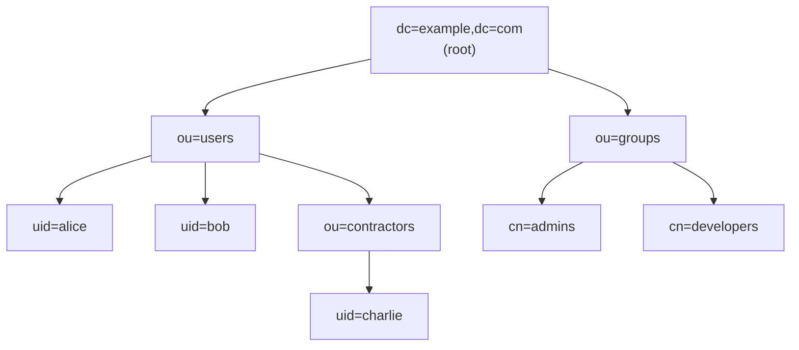
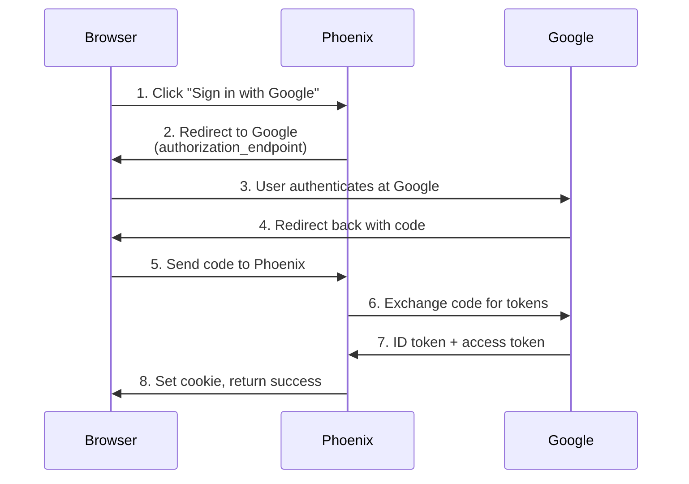
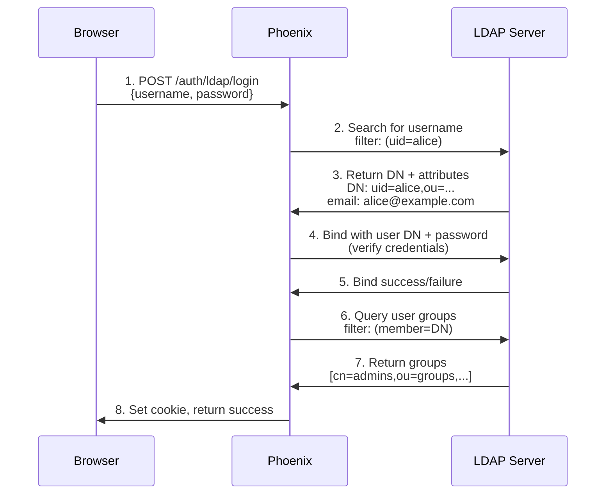
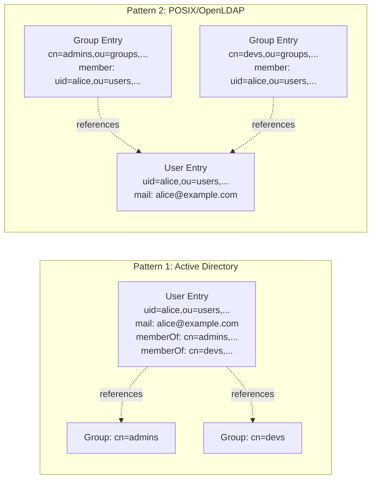
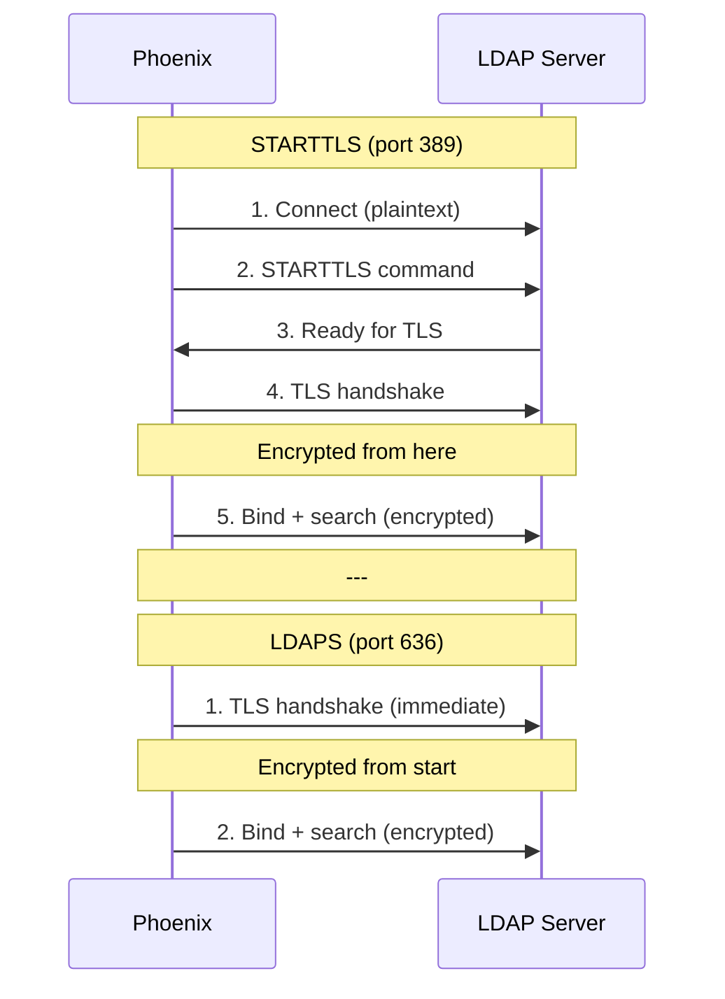
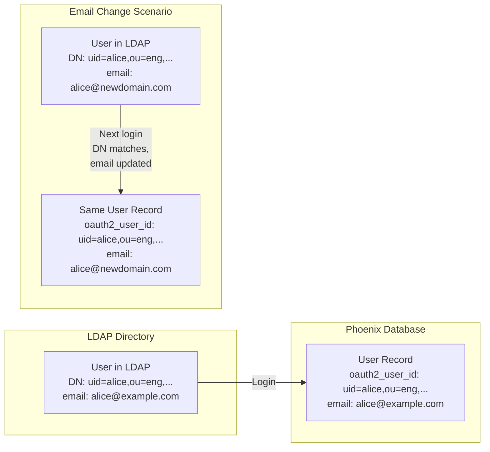

<a id="ldap-primer-for-oidc-engineers"></a>

# 面向 OIDC 工程师的 LDAP 入门

**目标读者**：熟悉 OAuth2/OIDC、需要了解 LDAP 身份验证的工程师。

---

<a id="tldr-ldap-vs-oidc"></a>

## 概览：LDAP 与 OIDC

| 方面 | OIDC | LDAP |
|--------|------|------|
| **协议类型** | 现代 REST/JSON API | 二进制协议，ASN.1/BER 编码 |
| **主要用途** | 委托身份验证，第三方 | 直接身份验证，同一组织 |
| **用户标识符** | 邮箱或 UUID，取决于提供方 | 专有名称（DN），层次路径 |
| **身份验证流程** | 浏览器重定向 → 授权码 → token 交换 | 使用用户名和密码直接绑定目录 |
| **信任模型** | 信任外部 IdP，例如 Google、Okta | 信任内部目录服务器，例如 Active Directory、OpenLDAP |
| **部署** | SaaS 或本地部署 | 几乎总在本地或私有云 |
| **年代** | 现代，2014 年起 | 传统，1993 年起，基于 1988 年的 X.500 |

**使用场景**：
- **OIDC**：外部用户、消费者应用、“通过 Google 登录”
- **LDAP**：企业内部应用、企业网络集成、现有 AD 基础设施

---

<a id="what-is-ldap"></a>

## 什么是 LDAP？

**LDAP（轻量目录访问协议）**是通过 TCP/IP 访问和管理目录服务的协议。

可将其理解为：
- **数据库**：保存用户账户、组和组织结构
- **身份验证协议**：直接验证凭证
- **查询语言**：使用过滤器搜索目录树

<a id="core-concept-the-directory-tree"></a>

### 核心概念：目录树

OIDC 使用无状态 HTTP，而 LDAP 将数据组织成**层次树结构**：



**完整专有名称（DN）**：
- Alice：`uid=alice,ou=users,dc=example,dc=com`
- Bob：`uid=bob,ou=users,dc=example,dc=com`
- Charlie：`uid=charlie,ou=contractors,ou=users,dc=example,dc=com`
- 管理员组：`cn=admins,ou=groups,dc=example,dc=com`

**OIDC 对应概念**：没有树结构，用户平铺，通过邮箱或不透明 ID（`sub` 声明）识别。

---

<a id="distinguished-names-dn"></a>

## 专有名称（DN）

**DN = 用户在目录树中的完整路径**

DN 示例：
```
uid=alice,ou=engineering,dc=example,dc=com
```

**逐项说明**：
- `uid=alice` — 用户标识符，即用户名
- `ou=engineering` — 组织单位，即部门或团队
- `dc=example,dc=com` — 域组件，即公司域名

**OIDC 对应概念**：最接近的是 `sub`（主体）声明：
```json
{
  "sub": "auth0|5f8e9a1234567890abcdef12",  // OIDC
  "email": "alice@example.com"
}
```

但 OIDC 的 `sub`：
- ✅ **稳定**，类似 DN
- ✅ **在每个提供方内唯一**，类似每个目录内的 DN
- ❌ **没有层次结构**，而 DN 编码组织结构
- ❌ **不适合人类阅读**，而 DN 展示部门、位置等信息

---

<a id="authentication-flow-comparison"></a>

## 身份验证流程对比

<a id="oidc-flow-what-you-know"></a>

### OIDC 流程（已有知识）



**要点**：Phoenix **永远看不到密码**，身份验证由 Google 处理。

---

<a id="ldap-flow-new"></a>

### LDAP 流程（新知识）



**主要区别**：
- ✅ Phoenix 直接**接收密码**，不进行重定向
- ✅ Phoenix **查询 LDAP 服务器**，不是 REST API
- ✅ **两项 LDAP 操作**：搜索以查找用户，绑定以验证密码
- ✅ **二进制协议**，不是 HTTP/JSON

---

<a id="key-ldap-concepts"></a>

## LDAP 关键概念

<a id="1-bind-operation-authentication"></a>

### 1. 绑定操作（身份验证）

**“绑定”** = 向 LDAP 服务器进行身份验证。

分为两类：

**服务账户绑定**，即搜索绑定模式：
```python
# Phoenix binds with read-only service account
connection = Connection(
    server, user="cn=readonly,dc=example,dc=com", password="service_password", auto_bind=True
)

# Then searches for user by username
connection.search(
    search_base="ou=users,dc=example,dc=com",
    search_filter="(uid=alice)",
)
# Returns: uid=alice,ou=engineering,dc=example,dc=com
```

**用户绑定**，验证凭证：
```python
# Bind as the actual user (proves they know password)
user_connection = Connection(
    server,
    user="uid=alice,ou=engineering,dc=example,dc=com",
    password=user_provided_password,
    auto_bind=True,
)

if user_connection.bound:
    print("✓ Password correct")
```

**OIDC 对应概念**：没有对应概念，OIDC 提供方在内部处理。

---

<a id="2-ldap-filters-query-language"></a>

### 2. LDAP 过滤器（查询语言）

过滤器用于搜索目录树，类似 SQL WHERE 子句，但采用 LISP 风格的前缀语法：

| 过滤器 | 含义 | OIDC 类比 |
|--------|---------|--------------|
| `(uid=alice)` | 查找 uid=alice 的用户 | 按邮箱搜索 |
| `(objectClass=user)` | 查找所有用户对象 | 按类型过滤 |
| `(&(uid=alice)(objectClass=user))` | AND 逻辑 | 多个条件 |
| `(\|(uid=alice)(uid=bob))` | OR 逻辑 | 任意匹配 |
| `(uid=a*)` | 通配符 | 前缀搜索 |
| `(memberOf=cn=admins,ou=groups,...)` | 组成员关系 | 角色/声明 |

**示例：Active Directory 用户搜索**：
```ldap
(&(objectClass=user)(sAMAccountName=alice))
```

**Phoenix 转义用户输入**以防止 LDAP 注入，类似防范 SQL 注入：
```python
from ldap3.utils.conv import escape_filter_chars

# User input: alice
escaped = escape_filter_chars("alice")
filter_str = f"(&(objectClass=user)(uid={escaped}))"
```

---

<a id="3-attributes-user-fields"></a>

### 3. 属性（用户字段）

LDAP 用户具有**属性**，类似 JSON 字段，但由 schema 定义：

常见属性：

| 属性 | 用途 | OIDC 对应声明 |
|-----------|---------|----------------------|
| `uid` | 用户名 | `preferred_username` |
| `mail` | 邮箱地址 | `email` |
| `displayName` | 全名 | `name` |
| `memberOf` | 组成员关系，AD | `groups` 或 `roles` |
| `cn` | 通用名称 | `name` |
| `sn` | 姓 | `family_name` |
| `givenName` | 名 | `given_name` |
| `userPassword` | 密码哈希，不可读取 | 不适用，由 IdP 处理 |

**Phoenix 查询属性**：
```python
# After finding user, read their attributes
email = user_entry.mail.value
display_name = user_entry.displayName.value
groups = user_entry.memberOf.values  # List of DNs
```

---

<a id="4-groups--role-mapping"></a>

### 4. 组与角色映射

两种组成员关系模式：



**模式 1（Active Directory）**：
- 用户条目具有 `memberOf` 属性，列出组 DN
- Phoenix 直接读取 `memberOf`，效率高，仅需一次查询

**模式 2（POSIX/OpenLDAP）**：
- 组条目具有 `member` 属性，列出用户 DN
- Phoenix 必须按 `(member=<user_dn>)` 搜索组，较慢，需要 N 次查询

**Phoenix 配置**：
```bash
# Map LDAP groups → Phoenix roles
PHOENIX_LDAP_GROUP_ROLE_MAPPINGS='[
  {"group_dn": "cn=admins,ou=groups,dc=example,dc=com", "role": "ADMIN"},
  {"group_dn": "cn=developers,ou=groups,dc=example,dc=com", "role": "MEMBER"}
]'
```

**OIDC 对应概念**：
```json
{
  "groups": ["admins", "developers"],  // Flat list in ID token
  "roles": ["admin"]                    // Or roles claim
}
```

**主要区别**：OIDC 组位于 **token 中**，由客户端携带。LDAP 组**每次登录均会查询**，在服务端处理，始终保持最新。

---

<a id="common-ldap-implementations"></a>

## 常见 LDAP 实现

<a id="1-active-directory-microsoft"></a>

### 1. Active Directory（微软）

**定义**：微软的 LDAP 实现，在企业中最常见。

**独有特性**：
- 使用 `sAMAccountName` 而非 `uid` 作为用户名
- 使用 `memberOf` 属性表达组成员关系，效率高
- 可使用 `userPrincipalName` 代替邮箱
- 使用全局编录进行多域搜索

**AD 的 Phoenix 配置**：
```bash
PHOENIX_LDAP_HOST="ad.corp.example.com"
PHOENIX_LDAP_PORT=389
PHOENIX_LDAP_USER_SEARCH_FILTER="(&(objectClass=user)(sAMAccountName=%s))"
PHOENIX_LDAP_ATTR_EMAIL="mail"
PHOENIX_LDAP_ATTR_DISPLAY_NAME="displayName"
PHOENIX_LDAP_ATTR_MEMBER_OF="memberOf"
```

---

<a id="2-openldap"></a>

### 2. OpenLDAP

**定义**：开源 LDAP 服务器，常见于 Linux 环境。

**独有特性**：
- 使用 `uid` 作为用户名
- POSIX 组，需要独立组搜索
- 比 AD 更符合 RFC

**OpenLDAP 的 Phoenix 配置**：
```bash
PHOENIX_LDAP_HOST="ldap.example.com"
PHOENIX_LDAP_PORT=389
PHOENIX_LDAP_USER_SEARCH_BASE_DNS='["ou=people,dc=example,dc=com"]'
PHOENIX_LDAP_USER_SEARCH_FILTER="(&(objectClass=inetOrgPerson)(uid=%s))"
PHOENIX_LDAP_GROUP_SEARCH_BASE_DNS='["ou=groups,dc=example,dc=com"]'
PHOENIX_LDAP_GROUP_SEARCH_FILTER="(memberUid=%s)"
```

---

<a id="3-389-directory-server"></a>

### 3. 389 Directory Server

**定义**：Red Hat 的 LDAP 服务器，OpenLDAP 的后继产品。

**独有特性**：
- 类似 OpenLDAP
- 性能和复制更佳
- 支持多主节点

---

<a id="security-considerations"></a>

## 安全考虑

<a id="tlsssl-encryption"></a>

### TLS/SSL（加密）

**两种模式**，类似 HTTPS 与 HTTP：



**STARTTLS（端口 389）**：
- 先建立明文连接，再升级至 TLS
- **Phoenix 默认方式**，类似 HTTP→HTTPS 升级模式

**LDAPS（端口 636）**：
- 从连接开始即使用 TLS，类似 HTTPS

**OIDC 对应概念**：始终使用 HTTPS，从开始即启用 TLS。

**Phoenix 配置**：
```bash
# Default: STARTTLS on port 389
PHOENIX_LDAP_TLS_MODE="starttls"

# Or: LDAPS on port 636
PHOENIX_LDAP_TLS_MODE="ldaps"
PHOENIX_LDAP_PORT=636
```

---

<a id="ldap-injection-like-sql-injection"></a>

### LDAP 注入（类似 SQL 注入）

**攻击**：将特殊字符注入用户名，操纵搜索过滤器。

示例：
```python
# Vulnerable code (DON'T DO THIS)
username = request.username  # "admin)(uid=*"
filter_str = f"(uid={username})"
# Result: (uid=admin)(uid=*)  ← Matches all users!
```

**Phoenix 防护**：
```python
from ldap3.utils.conv import escape_filter_chars

username = escape_filter_chars(request.username)  # Escapes special chars
filter_str = f"(uid={username})"
```

**OIDC 对应概念**：不适用，OIDC 使用 HTTP/JSON，不使用自定义查询语言。

---

<a id="phoenix-ldap-implementation-highlights"></a>

## Phoenix LDAP 实现要点

<a id="dn-based-identification-stable-primary-key"></a>

### 基于 DN 的识别（稳定主键）

Phoenix 使用 **DN** 而非邮箱作为主要标识符：



**为什么使用 DN？**
- ✅ 邮箱变化时保持稳定
- ✅ 每个 LDAP 目录内唯一
- ✅ 与 Grafana 方案一致

**OIDC 对应概念**：存储稳定的 `sub` 声明，每次登录同步邮箱。

---

<a id="rfc-4514-canonicalization-prevent-duplicates"></a>

### RFC 4514 规范化（防止重复）

DN **不区分大小写**，且允许不同空白写法：

```
Same user, different representations:
- "UID=Alice,OU=Users,DC=Example,DC=Com"
- "uid=alice, ou=users, dc=example, dc=com"
- "uid=alice,ou=users,dc=example,dc=com"
```

Phoenix 在存储前进行**规范化**：
```python
from phoenix.server.ldap import canonicalize_dn

dn_raw = "UID=Alice,  OU=Users, DC=Example, DC=Com"
dn_canonical = canonicalize_dn(dn_raw)
# Result: "uid=alice,ou=users,dc=example,dc=com"
```

**OIDC 对应概念**：无需此步骤，`sub` 始终由 IdP 规范化。

---

<a id="email-fallback-for-admin-provisioned-users"></a>

### 为管理员预配置用户提供邮箱回退

Phoenix 支持在首次 LDAP 登录前**预配置**用户：

```python
# Admin creates user at startup (DN unknown)
user = models.User(
    email="alice@example.com",
    oauth2_client_id=LDAP_CLIENT_ID_MARKER,
    oauth2_user_id=None,  # DN unknown yet
)

# First LDAP login:
# 1. DN lookup fails (oauth2_user_id=NULL)
# 2. Email fallback finds user
# 3. Phoenix upgrades: oauth2_user_id = canonical_dn
# 4. Future logins use DN
```

**OIDC 对应概念**：类似模式，按邮箱预配置用户，在首次登录时通过 `sub` 声明关联。

---

<a id="when-to-choose-ldap-vs-oidc"></a>

## LDAP 与 OIDC 的选择时机

<a id="choose-ldap-when"></a>

### 适合选择 LDAP 的情况：

✅ **企业内部应用**
- 已有 Active Directory 基础设施
- 所有用户属于同一组织
- 企业网络，需要 VPN

✅ **传统系统集成要求**
- 必须与现有 LDAP 系统集成
- 没有迁移 IdP 的预算

✅ **细粒度组管理**
- 目录中存在复杂组织结构
- 组由 IT 管理，而非开发者

<a id="choose-oidc-when"></a>

### 适合选择 OIDC 的情况：

✅ **现代架构**
- 云原生应用
- 微服务
- 外部用户，例如客户、合作伙伴

✅ **SaaS 便利性**
- 托管 IdP，例如 Okta、Auth0、Keycloak
- 多租户应用
- “通过 Google/GitHub 登录”模式

✅ **无状态身份验证**
- JWT token，无需会话服务器
- API 优先设计

<a id="use-both-phoenixs-approach"></a>

### 同时使用两者（Phoenix 的方案）：

Phoenix 支持**同时使用 LDAP 和 OIDC**：
- 内部用户 → LDAP，企业目录
- 外部用户 → OIDC，例如 Google、GitHub
- 管理员 → Local，密码

```bash
# Enable all three
PHOENIX_ENABLE_AUTH="true"
PHOENIX_DISABLE_BASIC_AUTH="false"  # Local password
PHOENIX_OAUTH2_CLIENT_ID="..."      # OIDC
PHOENIX_LDAP_HOST="ldap.corp.com"   # LDAP
```

---

<a id="further-reading"></a>

## 延伸阅读

**RFC（标准）**：
- [RFC 4511](https://www.rfc-editor.org/rfc/rfc4511.html) — LDAP 协议
- [RFC 4514](https://www.rfc-editor.org/rfc/rfc4514.html) — 专有名称（DN）
- [RFC 4515](https://www.rfc-editor.org/rfc/rfc4515.html) — 搜索过滤器
- [RFC 4516](https://www.rfc-editor.org/rfc/rfc4516.html) — LDAP URL

**用于对比的 OIDC 资料**：
- [OpenID Connect Core](https://openid.net/specs/openid-connect-core-1_0.html)
- [OAuth 2.0 RFC 6749](https://www.rfc-editor.org/rfc/rfc6749.html)

**Phoenix LDAP 文档**：
- [主规范](../ldap-authentication.md)
- [配置参考](./configuration.md)
- [安全详解](./security.md)
- [Grafana 对比](./grafana-comparison.md)

---

