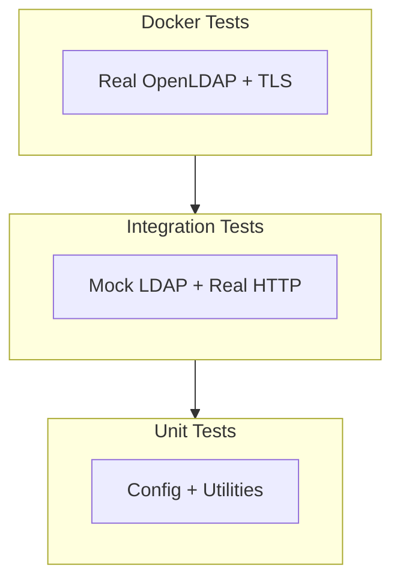

<a id="ldap-testing-procedures"></a>

# LDAP 测试流程

运行 LDAP 身份验证测试的快速参考。

---

<a id="test-layers"></a>

## 测试层次



<a id="running-tests"></a>

## 运行测试

<a id="unit-tests"></a>

### 单元测试

```bash
# LDAP config tests
tox -e unit -- -k ldap
```

<a id="integration-tests"></a>

### 集成测试

```bash
# All LDAP tests
tox -e integration -- -k ldap

# Specific test class
tox -e integration -- -k TestLDAPAuthentication
```

<a id="docker-tests"></a>

### Docker 测试

```bash
cd scripts/docker/devops

# Start environment
docker compose -f compose.yml -f overrides/ldap-test.yml up -d

# View test results
docker logs -f devops-ldap-test
```

---

<a id="key-files"></a>

## 关键文件

| 文件 | 用途 |
|------|---------|
| `tests/unit/test_config.py` | 单元测试，配置解析 |
| `tests/integration/auth/test_ldap.py` | 集成测试 |
| `tests/integration/auth/conftest.py` | 测试 fixture |
| `tests/integration/_mock_ldap_server.py` | 模拟 LDAP 协议 |
| `scripts/docker/devops/scripts/test_ldap_integration.py` | Docker 测试 |
| `scripts/docker/devops/scripts/test_ldap_tls.py` | TLS/STARTTLS 测试 |
| `scripts/docker/devops/overrides/ldap-test.yml` | Docker 环境 |
| `scripts/docker/devops/LDAP-TLS-TESTING.md` | TLS 测试指南 |
