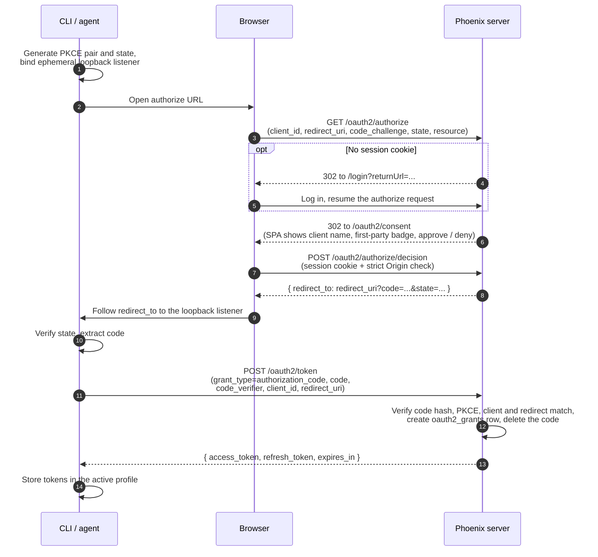
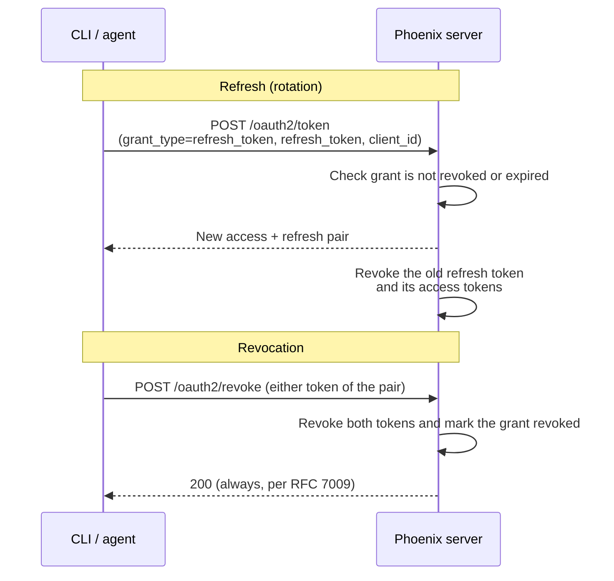

<a id="oauth2-authorization-server-and-cli-login"></a>

# OAuth2 授权服务器与 CLI 登录

<a id="table-of-contents"></a>

## 目录

| # | 章节 | 重点 |
|---|---|---|
| 1 | [执行摘要](#executive-summary) | 构建内容 |
| 2 | [架构](#architecture) | 组件与授权码流程 |
| 3 | [数据模型](#data-model) | 新表与令牌表新增列 |
| 4 | [端点](#endpoints) | 授权服务器 HTTP 接口 |
| 5 | [重定向 URI 模型](#redirect-uri-model) | 三种交付类别及原因 |
| 6 | [动态客户端注册](#dynamic-client-registration) | 策略开关与注册清理 |
| 7 | [CLI 登录](#cli-login) | `px auth login` 端到端流程 |
| 8 | [作为受保护资源的 MCP](#mcp-as-a-protected-resource) | `/mcp` 挂载、401 质询、逐资源发现 |
| 9 | [设计决策](#design-decisions) | 主要选择及依据 |
| 10 | [测试](#testing) | 分层单元与集成测试策略 |
| — | [附录：环境变量](#appendix-environment-variables) | 配置接口 |
| — | [附录：标准符合性](#appendix-standards-compliance) | 按 RFC 汇总 |
| — | [附录：经验教训](#appendix-lessons-learned) | 根路径与 SPA 导航易错点 |

---

<a id="executive-summary"></a>

## 执行摘要

<a id="what-we-built"></a>

### 构建了什么

Phoenix 现已成为 OAuth2 **授权服务器**：第三方应用可通过带 PKCE 的标准授权码流程获取 Phoenix Bearer 令牌，由用户在同意页面批准访问。此前 Phoenix 只是 OAuth2/OIDC **客户端**，通过外部身份提供方登录用户；除人工复制 API 密钥外，无法向其他应用签发自己的令牌。

- **授权码 + PKCE（S256）流程**：浏览器同意、一次性哈希授权码、交换为 Phoenix 已有的访问/刷新令牌对。
- **`px auth login`**：Phoenix CLI 使用临时回环回调服务完成完整流程，按配置档保存令牌并自动刷新。
- **动态客户端注册（RFC 7591）**：Claude Code、Cursor、VS Code、Codex CLI 和其他 MCP 宿主等智能体平台可自行注册，无需管理员预先配置客户端，由三档策略开关控制。
- **发现**：提供 RFC 8414 授权服务器元数据和 RFC 9728 受保护资源元数据，使遵循标准的客户端能通过两个 well-known URL 自动配置。
- **MCP 端点作为受保护资源**：在 `/mcp` 挂载最小 MCP 服务，对未认证调用者返回指向 RFC 9728 元数据的质询，从而通过真实 MCP 客户端（MCP Inspector、Cursor、Claude Code）验证完整的发现 → 注册 → 同意 → 令牌链路。
- **撤销（RFC 7009）**和**刷新令牌轮换**：按授权记录管理生命周期，每次批准对应持久的 `oauth2_grants` 记录，可整体撤销。
- **零新增依赖**：使用标准库加密能力和仓库已有的 `joserfc`/`pydantic`。

授权**语义**，即获准令牌可以执行什么，由独立的作用域和权限工作负责，有意不在本文范围内；本文只涵盖协议机制。

<a id="key-files"></a>

### 关键文件

| 文件 | 用途 |
|---|---|
| `src/phoenix/server/api/routers/oauth2_authorization_server.py` | 端点实现：authorize、token、revoke、register、metadata |
| `src/phoenix/server/oauth2_authorization_server.py` | 纯验证逻辑：PKCE、重定向 URI、state、资源标识符 |
| `src/phoenix/db/migrations/versions/132d988c5bef_*.py` | 单次迁移：三张新表和令牌表新增列 |
| `src/phoenix/db/facilitator.py` | 初始化第一方 `phoenix-cli` 客户端，清理过期授权码 |
| `js/app/src/pages/auth/OAuth2ConsentPage.tsx` | SPA 授权同意页面 |
| `js/packages/phoenix-cli/src/oauth.ts` | CLI 侧 PKCE、回环回调服务、令牌交换/刷新/撤销 |
| `js/packages/phoenix-cli/src/commands/auth.ts` | `px auth login` / `status` / `logout` |
| `src/phoenix/server/api/routers/auth_md.py` | RFC 9728 受保护资源元数据，包含部署级和单资源 `/mcp` |
| `src/phoenix/server/mcp_server.py` | MCP 挂载：`MountPathNormalizer`、`BearerAuthGuard` 401 质询 |

---

<a id="architecture"></a>

## 架构

<a id="components"></a>

### 组件

```
┌──────────────────────────────────────────────────────────────────────────┐
│                                                                          │
│   Authorization-server routers (FastAPI)                                 │
│   ══════════════════════════════════════                                 │
│   • /.well-known/oauth-authorization-server   (RFC 8414 metadata)        │
│   • /oauth2/authorize            (validates request, hands off to SPA)   │
│   • /oauth2/authorize/decision   (consent API: session cookie + Origin)  │
│   • /oauth2/token                (code exchange, refresh rotation)       │
│   • /oauth2/revoke               (RFC 7009)                              │
│   • /oauth2/register             (RFC 7591 DCR, policy-gated)            │
│                                                                          │
├──────────────────────────────────────────────────────────────────────────┤
│                                                                          │
│   Validation module (src/phoenix/server/oauth2_authorization_server.py)  │
│   ════════════════════════════════════════════════════════════════════   │
│   • PKCE verifier grammar + S256 challenge (constant-time compare)       │
│   • Redirect URI classifier (loopback / private-use scheme / https)      │
│   • Resource-identifier canonicalization (RFC 8707)                      │
│   • Public origin resolution (PHOENIX_ROOT_URL, root-path aware)         │
│   • Pure functions — unit-testable without a server                      │
│                                                                          │
├──────────────────────────────────────────────────────────────────────────┤
│                                                                          │
│   Existing token infrastructure (reused, not replaced)                   │
│   ════════════════════════════════════════════════════                   │
│   • Same access/refresh token pair as web sessions                       │
│   • Opaque jti-only JWTs; all claims live server-side in JwtStore        │
│   • Revocation = row delete + cache evict (no new revocation machinery)  │
│                                                                          │
└──────────────────────────────────────────────────────────────────────────┘
```

Phoenix 原有的 OAuth2 **依赖方**路由通过外部 IdP 登录，位于 `/oauth2/{idp_name}/login` 和 `/oauth2/{idp_name}/tokens`。授权服务器端点使用固定路径段，共享 `/oauth2` 前缀，因此启动时会拒绝名称冲突的 IdP：`authorize`、`token`、`revoke`、`register`、`consent` 均为保留名称，见 `app.py`、`_RESERVED_OAUTH2_IDP_NAMES`。

<a id="the-flow"></a>

### 流程



授权记录创建后，令牌对独立于浏览器循环：



授权同意交接分两步：`GET /oauth2/authorize` 在服务端验证协议，随后带请求参数及服务端推导的 `client_name`、`is_first_party` 显示参数，重定向到 SPA 同意路由。SPA 将用户决定提交到 JSON 端点，后者重新验证客户端和重定向 URI，并同时要求有效会话 Cookie 和同源 `Origin` 请求头，以防 CSRF；特殊代理环境可通过 `PHOENIX_OAUTH2_CONSENT_ORIGIN_CHECK=off` 关闭检查。只有经过身份验证、来源校验的批准才签发授权码。SPA URL 的显示参数不是已认证状态：直接导航可以伪造同意页面的标签或徽标，虽然不能绕过决定验证。以服务端推导的显示数据或可信短期请求状态替换此交接，仍是待做的安全工作。

---

<a id="data-model"></a>

## 数据模型

一次迁移（`132d988c5bef`）添加三张表，并扩展两张已有令牌表。全部 JSON 列在 PostgreSQL 上使用 JSONB。

<a id="oauth2_clients"></a>

### `oauth2_clients`

| 列 | 类型 | 用途 |
|---|---|---|
| `client_id` | 字符串，唯一索引 | 公开客户端标识符，第一方为 `phoenix-cli`，DCR 为 `px_dcr_` 加 22 个 base62 字符 |
| `name` | 字符串 | 同意页面展示的名称 |
| `logo_uri` | 可空字符串 | 客户端提供的可选徽标 |
| `redirect_uris` | JSON | 全部已注册重定向 URI，授权始终绑定到每客户端自己的列表 |
| `grant_types` | JSON | `authorization_code`、`refresh_token` 的子集 |
| `token_endpoint_auth_method` | 字符串 | `none`，本轮仅支持公共客户端 |
| `is_first_party` | 布尔值 | 初始化的 Phoenix 客户端展示已验证的同意文案，DCR 客户端展示提醒 |
| `metadata_` | 可空 JSON | 不识别的 RFC 7591 字段原样存储，不验证，完全是客户端提供的数据 |
| `registration_client_ip` | 可空字符串，与 `created_at` 联合索引 | Phoenix 在注册时观察到的地址，初始化客户端为 NULL。独立存列，不放进 `metadata_`，避免请求体伪造；每 IP 注册限制使用此索引计数，而非扫描筛选 JSON |

第一方 `phoenix-cli` 客户端在启动时由 `facilitator.py` 幂等初始化，重定向 URI 为 `http://127.0.0.1/callback`。回环比较仅忽略端口，使 CLI 可绑定随机端口，但不允许其他主机或路径。启动还会协调此未发布功能早期构建所创建、重定向列表为空的记录。

<a id="oauth2_grants"></a>

### `oauth2_grants`

持久记录“用户 U 批准了客户端 C”。它在授权码**兑换时**创建，而非用户同意时，因此放弃的浏览器批准不会遗留授权记录，未兑换授权码会过期并被清理。

| 列 | 类型 | 用途 |
|---|---|---|
| `user_id`、`oauth2_client_id` | FK，CASCADE | 授权身份 |
| `scopes`、`audience` | 可空 JSON | 获准值复制到每个令牌；scopes 当前为空，授权请求指定资源时，audience 携带规范化资源指示符，即部署来源或 MCP 端点 |
| `expires_at` | 可空时间戳 | 授权有效期上限，默认 90 天；签发时访问令牌与刷新令牌寿命均截断到此时间 |
| `last_used_at` | 时间戳 | 每次刷新更新，用于 DCR 客户端清理及未来会话界面 |
| `revoked_at` | 可空时间戳 | 软撤销，兑换刷新令牌时检查 |

<a id="oauth2_authorization_codes"></a>

### `oauth2_authorization_codes`

| 列 | 类型 | 用途 |
|---|---|---|
| `code_hash` | 字符串，唯一索引 | 授权码的 SHA-256，数据库泄漏不会产生可兑换授权码 |
| `redirect_uri` | 字符串 | 令牌端点必须原样回传，见 RFC 6749 §4.1.3 |
| `code_challenge`、`code_challenge_method` | 字符串 | PKCE，仅 S256 |
| `scopes`、`resource`、`audience` | 可空 JSON/字符串 | `resource` 保留客户端发送的原始指示符；兑换时将其规范形式作为 audience 复制到授权记录及令牌。作用域强制检查留给授权语义工作 |
| `expires_at` | 时间戳 | TTL 为 5 分钟，仅使用一次；兑换时原子认领，过期后提交则拒绝并删除，服务启动时清理 |

<a id="token-table-extensions"></a>

### 令牌表扩展

`refresh_tokens` 增加 `oauth2_grant_id`（FK、CASCADE、带索引）、`scopes`、`audience`、`consumed_at`；`access_tokens` 增加 `scopes`、`audience`。声明缓存完全由这些行恢复，因此授权签发的令牌在缓存重建和服务重启后仍保留快照，不存在仅在签发时内存中的状态。Web 会话登录将这些列全部留为 NULL，据此区分两类令牌。

`consumed_at` 使重放检测成为可能。轮换会标记已消费刷新令牌行，而不是删除，使令牌不可用后仍能追溯到所属授权；清理器在原令牌本来就应过期时删除墓碑。每条读取路径都筛选 `consumed_at IS NULL`，包括访问令牌连接；否则保留行会让已轮换令牌继续认证，也使配对访问令牌在轮换后继续存活，而旧实现本会通过删除被连接行将其一并终止。

---

<a id="endpoints"></a>

## 端点

| 端点 | 方法 | 认证 | 速率限制 | 说明 |
|---|---|---|---|---|
| `/.well-known/oauth-authorization-server` | GET | 无 | — | RFC 8414；除非禁用 DCR，否则声明 `registration_endpoint` |
| `/.well-known/openid-configuration` | GET | 无 | — | 在 OIDC 发现位置提供同一文档。部署在根路径下时，它是 MCP 客户端发现顺序中唯一无需代理配置就能到达 Phoenix 的元数据 URL；RFC 8414 将 well-known 段插在主机与路径之间，反向代理通常不为其路由 |
| `/.well-known/oauth-protected-resource` | GET | 无 | — | RFC 9728；启用认证时，将当前部署列为自身授权服务器 |
| `/.well-known/oauth-protected-resource/mcp` | GET | 无 | — | MCP 端点的 RFC 9728 路径插入式元数据，`resource` 为 `<origin>/mcp` 而非部署来源；未挂载 MCP 服务时返回 404 |
| `/.well-known/{doc}<root path>` | GET | 无 | — | 路径插入式别名，见 RFC 8414 §3 / RFC 9728 §3.1；仅在设置 `PHOENIX_HOST_ROOT_PATH` 时注册。well-known 段位于主机与路径之间，因此这些别名处在主机根位置，需反向代理将 `/.well-known/*` 原样转发到 Phoenix |
| `/oauth2/authorize` | GET | 会话 Cookie，未登录则重定向登录 | — | 验证客户端、重定向 URI、state（≥22 字符）、`response_type=code`、PKCE S256 和可选 `resource`；不支持的响应类型返回 `unsupported_response_type`；可安全交付的错误按 RFC 6749 §4.1.2.1 发送到重定向 URI，前置验证失败则渲染 HTML 错误 |
| `/oauth2/consent` | GET，SPA 路由 | 会话 | — | 仅展示，不拥有任何协议状态 |
| `/oauth2/authorize/decision` | POST | 会话 Cookie 加严格 Origin 检查 | — | JSON 请求体，批准后签发已哈希的一次性授权码 |
| `/oauth2/token` | POST，表单 | 无，公共客户端以 PKCE 证明身份 | 每 IP 每秒 0.2 次请求 | `authorization_code` 和 `refresh_token` 授权 |
| `/oauth2/revoke` | POST，表单 | 无 | 每 IP 每秒 0.2 次请求 | RFC 7009；即使令牌未知也始终返回 200 |
| `/oauth2/register` | POST，JSON | 无 | 每 IP 每小时 10 次，默认 | RFC 7591，由策略控制 |

令牌端点错误有意不提供状态探测能力：未知授权码、过期授权码、客户端不匹配、重定向不匹配和 PKCE 失败，都返回相同的 `invalid_grant`。唯一不同的是：`resource` 与此部署不匹配时，按 RFC 8707 返回 `invalid_target`；这是客户端需要修正的请求结构错误，不泄漏任何已存授权码的信息。

成功令牌响应，以及 OAuth JSON 错误和注册响应，都包含 `Cache-Control: no-store` 与 `Pragma: no-cache`。兑换授权码先验证客户端身份、精确重定向绑定、过期时间和 PKCE，再消费授权码。已验证授权码在创建授权记录的同一事务中，通过条件 `DELETE …
RETURNING` 删除；PostgreSQL 行锁及 SQLite 立即写事务保证并发兑换只有一个成功者。验证失败不会消费原本仍有效的授权码。

---

<a id="redirect-uri-model"></a>

## 重定向 URI 模型

这是最影响互操作性的设计部分。智能体平台使用三种结构不同的重定向方式，各类别采用独立验证规则；前两类以 RFC 8252 为指导。

| 类别 | 验证 | 使用方 |
|---|---|---|
| **回环**（`http://127.0.0.1`、`::1`、`localhost`） | 必须与该客户端已注册 URI 的协议、主机、路径和查询一致，只允许端口不同；拒绝片段和用户信息 | CLI 与桌面智能体每次登录绑定临时端口。各客户端注册自己实际使用的路径，如 `/`、`/callback`、`/callback/<id>`、`/mcp/oauth/callback`；RFC 8252 §7.3 要求授权服务器接受任意运行时端口。 |
| **私有协议**（`cursor://…`、`vscode://…`） | 必须精确匹配已注册 URI；协议还必须是有效 URI 协议，且不在拒绝集合中：`http`、`https`、`javascript`、`data`、`vbscript`、`file`、`blob`、`about`、`ws`、`wss`；拒绝片段 | 操作系统将协议路由到已安装应用的桌面 IDE 智能体。Cursor 文档中的桌面回调是 `cursor://anysphere.cursor-mcp/oauth/callback`。按客户端精确绑定，防止一个已注册原生客户端借用另一个客户端回调。 |
| **已注册 HTTPS** | 与客户端注册列表精确字符串匹配，并可额外限制主机允许列表 | 托管智能体界面，即带云端回调 URL 的 Web 智能体。这类风险最高，重定向到攻击者 HTTPS URL 会外泄授权码，因此仅在最宽松策略档位允许。 |

分类与验证统一位于纯函数 `validate_redirect_uri`，授权时、决定时和 DCR 时使用完全相同逻辑，防止三个检查点发生偏差。

---

<a id="dynamic-client-registration"></a>

## 动态客户端注册

<a id="the-policy-dial"></a>

### 策略开关

`PHOENIX_OAUTH2_DYNAMIC_CLIENT_REGISTRATION` = `disabled` | `local_only` | **`enabled`（默认）**。开关分别回答“谁能注册客户端”和“授权码可以交付到哪里”两个问题；交付规则适用于全部客户端，包括初始化客户端：

- **`disabled`**：不提供 `/oauth2/register`，元数据省略 `registration_endpoint`，只有管理员初始化的客户端可用。交付退回到 `local_only` 类别，而不是全部拒绝：初始化 CLI 使用回环重定向，若关闭注册就拒绝回环，将导致包括 Phoenix 自建客户端在内的所有客户端无法完成流程。关闭注册不能等同于关闭登录。
- **`local_only`**：任何人都可注册，但只允许回环和私有协议重定向。无论注册者声称什么，授权码最终都会交给批准用户自己机器上的进程，或其操作系统解析到的应用。这符合 MCP 智能体平台的预期：连接新服务时自动尝试 DCR；服务不支持时，每个用户都需手动配置客户端。
- **`enabled`**：额外允许精确注册的 HTTPS 重定向，可通过 `PHOENIX_OAUTH2_ALLOWED_REDIRECT_HOSTS` 限制主机。

DCR 默认开启并使用 `enabled` 的理由是：注册本身不授予任何权限，注册客户端仍必须由已登录 Phoenix 用户在同意页面点击批准，授权码只交付到精确注册的 URI，PKCE 将兑换绑定到流程发起者。最初默认 `local_only`，认为授权码应留在批准用户机器上，但实际 MCP 客户端立即出现兼容问题：Cursor 会同时注册 HTTPS 回调（`https://www.cursor.com/agents/mcp/oauth/
callback`）、回环和私有协议回调；RFC 7591 注册是全成或全败，一个 URI 被拒就使整个注册失败。默认设置若让主要 MCP 客户端开箱即失败，收益有限；`enabled` 额外暴露的只是获准授权码可交付到已注册 HTTPS 端点，而非本地进程，且仍受相同用户同意控制。需要更严格策略时，可设置 `local_only`，或保留 `enabled` 并用 `PHOENIX_OAUTH2_ALLOWED_REDIRECT_HOSTS` 限制主机。剩余的仿冒客户端名称风险，通过第一方徽标与未验证客户端提醒文案缓解。

<a id="registration-hygiene"></a>

### 注册清理

未认证注册容易产生垃圾行，一些智能体平台还会在每次重新认证时注册新客户端，因此清理属于结构性要求，不是可选项：

- **速率限制**：默认每 IP 每小时 10 次注册。
- **未使用上限**：每 IP 每天最多 50 个从未用于完整授权的客户端，通过 SQL 对索引列 `registration_client_ip` 计数。每次注册都检查；注册垃圾本身会扩大计数集合，因此不能为回答此问题而扫描全部最近记录。
- **零授权 TTL**：从未完成授权的 DCR 客户端在 7 天后删除。
- **失效授权 TTL**：全部授权均撤销或过期的 DCR 客户端，在最后一个授权失效 30 天后删除。
- 注册时机会性执行清理，最多每天一次。
- 只采纳 `client_name`（≤200 个可打印字符）、`logo_uri`（≤2048）、重定向 URI，以及支持的授权和响应类型；其余字段不透明地保存在 `metadata_`。全部提交的重定向 URI 都会存储，每次授权请求都与该客户端的注册列表比较。

DCR 客户端始终是公共客户端（`token_endpoint_auth_method: none`），仅允许 `authorization_code` + `refresh_token`。

---

<a id="cli-login"></a>

## CLI 登录

`px auth login`（`js/packages/phoenix-cli`）是第一方使用者，也是参考客户端实现：

1. 生成 64 字节 PKCE verifier 和 32 字节 state，采用 base64url 编码，并在 `127.0.0.1:<ephemeral>/callback` 启动 HTTP 监听。
2. **相对于已配置端点**构造 `client_id=phoenix-cli` 的授权 URL，兼容根路径，见经验教训，然后打开浏览器；`--no-browser` 改为打印 URL 并接收粘贴的重定向 URL，因此也可通过 SSH 使用。
3. 在回调中验证 `state`，携带 `verifier` 在 `/oauth2/token` 兑换授权码，将令牌持久化到 CLI 设置文件的活动配置档。通过锁文件串行化并发设置写入。
4. 后续命令在令牌距过期不足 60 秒时透明刷新，并正确处理轮换：设置锁覆盖读取最新值 → 刷新 → 持久化，防止并发 CLI 进程争用已轮换刷新令牌。
5. `px auth logout` 先通过 `/oauth2/revoke` 撤销刷新令牌，结束整个授权，再清除本地状态；`px auth status` 报告当前认证用户。

总体体验目标是：编码智能体或人工运行一个命令，在浏览器中批准一次，后续每次 CLI 调用都静默认证，直到授权过期或撤销。

---

<a id="mcp-as-a-protected-resource"></a>

## 作为受保护资源的 MCP

Phoenix 在 FastAPI 应用上挂载最小 MCP 服务，将其作为区别于部署来源的第二个受保护资源。服务（`src/phoenix/server/mcp_server.py`）不声明工具，`initialize` 和 `tools/list` 返回空列表并成功；其目的在于认证链路：它是 MCP 客户端发现、注册、获取同意后，最终携带已签发 Bearer 令牌连接的资源。后续可增加工具接口，无需改动下述机制。`PHOENIX_ENABLE_MCP_SERVER`（默认 `true`）控制挂载；依赖成本是 `fastmcp-slim` 的 `server` extra，其客户端部分此前已通过 `pydantic-ai` 进入仓库。

<a id="the-connection-sequence"></a>

### 连接顺序

MCP 客户端获得 `<origin>/mcp` 后，按照 MCP 授权规范（2025-06-18 修订版）及组合使用的 RFC，执行：

1. 无凭证调用端点，收到 **401**，`WWW-Authenticate` 请求质询头指明受保护资源元数据 URL。
2. 获取 **PRM 文档**（RFC 9728），了解资源标识符和授权服务器，即同一个部署。
3. 获取**授权服务器元数据**（RFC 8414，或 OIDC 发现位置），了解授权、令牌和注册端点 URL。
4. 通过 DCR **注册**，打开用户浏览器获取**同意**，并在令牌端点兑换授权码，发送 `resource=<origin>/mcp`（RFC 8707）。
5. 携带 Bearer 令牌通过 Streamable HTTP 重连：JSON-RPC 请求使用 POST，响应为长期 `text/event-stream` 流。

步骤 3 和 4 由本文其他部分的机制负责。MCP 专属工作是步骤 1、2、5：挂载、质询、逐资源元数据，以及让浏览器客户端能够走通链路的 CORS 策略。此链路已在带根路径的部署上通过 MCP Inspector、Cursor、Claude Code 端到端验证；单元测试位于 `tests/unit/server/test_app_mcp_mount.py`、`test_well_known_path_inserted.py`、`test_anonymous_cors.py`。

<a id="mount-path-normalization"></a>

### 挂载路径规范化

Starlette 的 `Mount("/mcp")` 匹配 `/mcp/...`，但不匹配 `/mcp` 本身，而裸路径恰好是 MCP 客户端配置的 URL。未匹配请求落入 SPA 兜底路由，GET 返回 index.html，POST 返回 405；修复前 Cursor 和 Inspector 都将其表现为 405。纯 ASGI 的 `MountPathNormalizer` 在路由前将裸挂载路径改写为挂载根。有两个关键细节：使用**改写而非重定向**，为不跟随重定向的客户端保留单请求语义；比较时使用包含根路径前缀的形式，因为 `PHOENIX_HOST_ROOT_PATH=/phoenix` 部署的 scope path 是 `/phoenix/mcp`，原始字面比较始终不匹配，导致规范化器静默不工作，这也是经验教训中根路径问题的另一实例。

<a id="the-401-challenge"></a>

### 401 质询

Phoenix 通过 FastAPI 路由依赖对 `/v1` 强制认证，挂载的 ASGI 应用不会经过它。没有防护时，未认证的 `initialize` 会成功，之后才表现为不透明的工具错误，客户端无法得知应启动 OAuth 流程。`BearerAuthGuard` 包装挂载应用，委托给 `/v1` 路由同样使用的 `is_authenticated`，失败时返回 401：

```
WWW-Authenticate: Bearer realm="Arize Phoenix",
    resource_metadata="<origin>/.well-known/oauth-protected-resource/mcp"
```

元数据 URL 根据 `public_origin` 和 PRM 路由注册所用的同一模块常量构造，因此质询与其指向的文档不会偏离。

<a id="the-per-resource-prm-document"></a>

### 单资源 PRM 文档

`/.well-known/oauth-protected-resource/mcp` 是 RFC 9728 路径插入形式，描述 MCP 端点，其 `resource` 为 `<origin>/mcp`，不是部署来源。未挂载 MCP 服务时返回 404，因为没有该资源可描述；授权服务器禁用时，`authorization_servers` 列表为空，发现结果就不会指向拒绝响应的端点。带根路径时，还注册主机根位置别名 `/.well-known/oauth-protected-resource<root path>/mcp`，供按 RFC 9728 §3.1 从资源 URL 推导元数据 URL、而非原样使用质询 URL 的 SDK 使用。与其他路径插入别名一样，仅当反向代理将主机根的 `/.well-known/*` 原样转发到 Phoenix 时才可达。

<a id="a-second-resource-identifier"></a>

### 第二个资源标识符

挂载启用时，资源指示符验证除接受部署来源外，也接受规范化后的 `<origin>/mcp`，见 `_resource_mismatch`。遵循规范的 MCP 客户端将自身连接 URL 作为 RFC 8707 指示符发送，并在整条兑换链中持久化和绑定，见下方资源指示符设计决策。

<a id="cors-and-exposed-headers"></a>

### CORS 与暴露的响应头

MCP 端点加入设计决策所述的匿名通配 CORS 集合：浏览器 MCP 客户端直接携带 Bearer 令牌调用，它不是环境自动附带的凭证，因此接受任意来源与令牌、注册端点采用的是同一决策。MCP 还额外暴露 OAuth 端点不需要的两个响应头（`Access-Control-Expose-Headers`）：`Mcp-Session-Id` 供浏览器客户端继续 Streamable HTTP 会话；`WWW-Authenticate` 供其从 401 启动 OAuth 流程。两者如果没有列出，即使响应已通过 CORS，跨源 JavaScript 仍不可见。

---

<a id="design-decisions"></a>
## 设计决策

<a id="reuse-the-existing-token-pair-add-no-new-token-format"></a>
### 复用现有令牌对，不添加新令牌格式

授权签发的令牌是普通 Phoenix 访问/刷新令牌：不透明 JWT，其载荷是令牌 ID，所有声明均由服务端从数据库补全。由此直接获得撤销、过期、缓存行为和全部现有认证中间件，一次加固同时覆盖 Web 会话和 OAuth2 授权。包含嵌入声明的自包含 JWT 方案被否决，因为 Phoenix 声明缓存从数据行重建，无法从行推导的声明会在重建时静默消失；同时，自包含令牌若不重新引入它本想避免的服务端状态，就无法撤销。

<a id="grant-at-redemption-not-at-consent"></a>
### 兑换时创建授权，而非同意时

同意仅签发短期有效、以哈希存储的授权码。`oauth2_grants` 行在令牌交换中创建，与删除授权码处于同一事务。因此，放弃的批准只留下待清理的过期授权码行，每个授权行都对应实际持有令牌的客户端。

<a id="hashed-single-use-short-lived-codes"></a>
### 哈希存储、单次使用、短期有效的授权码

授权码含 32 字节 `secrets` 熵，以 SHA-256 存储（按哈希查找，在热路径中天然具备时间安全性），5 分钟后过期，并在首次有效兑换时通过数据库条件认领删除。无效客户端、重定向或 PKCE 输入不会消耗有效授权码，并发有效兑换无法同时创建授权。PKCE 比较使用 `hmac.compare_digest`。只接受 S256 挑战方法；未实现 `plain`。

<a id="refresh-rotation-with-replay-detection"></a>
### 带重放检测的刷新轮换

兑换刷新令牌会签发新令牌对，并撤销旧刷新令牌*及其签发的所有访问令牌*。

初始授权码交换和每次轮换签发时，两个令牌的有效期都被限制在授权剩余寿命内。授权到达 `expires_at` 时没有清扫机制——仅在兑换令牌时检查该上限——因此，若签发的令牌比授权更长寿，它会在超过上限后继续通过认证，因为持有者无需再次回来接受检查。有效期限制使上限成为真正的截止时间，而不只是兑换时的一次询问。

轮换通过设置 `consumed_at` 消耗旧令牌，而非删除数据行。之后再次提交已消耗令牌，说明两方曾持有它：先兑换的一方现在持有替代令牌，当前提交的一方则没有。请求无法说明哪方是合法客户端，因此不能猜测——Phoenix 撤销整个令牌族，即该授权：设置 `revoked_at`，并删除授权下所有刷新和访问令牌。这是 RFC 9700 §4.14.2 对公共客户端的要求，也使窃取令牌让窃取者付出*代价*；若仅拒绝重放的令牌，先兑换的窃取者仍持有有效凭证，而诚实客户端只会默默重新认证。

检测信号是墓碑记录，而非数据行缺失。未知令牌、已过期并被清扫的令牌，或不属于任何授权的 Web 会话令牌都没有墓碑记录，会以 `invalid_grant` 拒绝且不影响任何授权——否则，任何能向令牌端点 POST 垃圾内容的人都能撤销其他用户会话。

代价是 RFC 9700 接受的误报：客户端若在服务端完成轮换后、持久保存新令牌对前崩溃，会用已消耗令牌重试，从而失去授权并被迫重新登录。`consumed_at` 也使日后可实现标准缓解方案（短暂宽限窗口内重新签发相同令牌对）；删除数据行则会堵死这条路。

<a id="revocation-ends-the-session-as-a-unit"></a>
### 撤销以整个会话为单位终止

`/oauth2/revoke` 接受令牌对中的任一令牌；撤销一个会同时撤销两者，并将授权标为已撤销。按 RFC 7009，端点无论如何都返回 200，因此不能用它探测令牌有效性。

<a id="required-state-minimum-entropy"></a>
### 必需的 `state` 与最低熵要求

RFC 6749 仅建议使用 `state`，但所有目标客户端都发送它，且它是回调的 CSRF 绑定。Phoenix 要求提供它，并强制至少 22 个字符（约 128 位 base64url），避免虽合规却懒惰的客户端使用 `state=1`。这是有意比规范更严格的选择；失败方式是在首次集成时明确返回 `invalid_request`，而非留下潜在漏洞。

<a id="resource-indicators-persisted-and-bound"></a>
### 持久保存并绑定资源指示符

授权和令牌端点均接受 `resource` (RFC 8707)，且其规范化后必须是本部署提供的资源：部署来源本身，或 MCP 服务端已挂载时的 `<origin>/mcp`（协议/主机小写、去除默认端口、应用根路径）；其余值返回 `invalid_target`。指示符在整个兑换链中持久保存并绑定：授权码记录用户批准的资源，授权及其下签发的每个令牌均以规范形式作为受众；令牌请求可以重复该指示符，但不能重新指定授权码的目标，刷新也不能改变授权目标。资源服务端的强制检查仍推迟实施——目前没有端点因 bearer token 的受众指向另一资源而拒绝它。持久声明已准确建立强制检查所需信息，因此添加检查（或更多受众）属于增量扩展，无需迁移。

<a id="issuer-identity-from-configuration-not-from-host-headers"></a>
### 签发者身份来自配置，而非 Host 请求头

元数据 `issuer`、PRM `resource` 和资源指示符匹配均在设置 `PHOENIX_ROOT_URL` 时从它推导（否则回退到请求基础 URL）。代理后方和子路径挂载的部署可获得稳定、防伪造的身份；运维人员配置规范 URL 后，发现文档绝不会反映客户端控制的 Host 请求头。

<a id="public-clients-only-pkce-as-the-proof"></a>
### 仅支持公共客户端，以 PKCE 作为证明

目前所有使用方都是无法保密的原生/CLI 应用，因此 `token_endpoint_auth_method` 统一为 `none`，且必须使用 PKCE。有意不提供机密客户端支持（客户端密钥、`client_credentials`），避免只实现半套。

<a id="an-operator-kill-switch-that-answers-404-not-silence"></a>
### 运维关闭开关返回 404

`PHOENIX_ENABLE_OAUTH2_AUTHORIZATION_SERVER=false` 面向策略要求仅用 API Key 访问、禁用交互式 OAuth 的运维人员。路由保持注册，由路由级依赖返回 404，而非跳过注册：未注册路径会落入 SPA 全匹配路由，返回 `index.html` 和 200，使部署看起来仍提供这些端点。404 也是 CLI 已理解的信号——其令牌交换将 404 映射为“此服务端不支持 OAuth 登录，请使用 API Key”。关闭开关还会清空受保护资源元数据中的 `authorization_servers`，并从 `auth.md` 移除 OAuth2 章节，确保发现文档不指向拒绝响应的端点。此前签发的访问令牌在过期前仍有效（验证在服务端针对令牌存储执行，不依赖端点），但授权不能再刷新。

<a id="discovery-fails-honestly-well-known-urls-never-fall-back-to-the-spa"></a>
### 发现失败如实返回：well-known URL 永不回退到 SPA

SPA 静态处理器对未知 GET 路径返回 index.html，使客户端路由在刷新页面后仍可工作。但对 `/.well-known/` 路径，这种行为有害：发现客户端（RFC 8414/OIDC 元数据、MCP 客户端）会探测多个候选 URL，依赖 404 继续下一个；200 加 HTML 会被视为格式错误的发现文档，反而终止客户端。因此静态处理器将 `/.well-known/` 排除在 index.html 回退之外，透传 404。同样的原因促使我们在 OIDC 发现位置提供元数据：根路径下签发者带路径分量，RFC 8414 会将 well-known 段放在主机与路径之间（反向代理通常不会将该 URL 路由到 Phoenix）；在路径后追加的 OIDC 位置，是 MCP 客户端发现顺序中唯一无需代理配置即可到达 Phoenix 的 URL。

<a id="wildcard-non-credentialed-cors-on-the-anonymous-surfaces-only"></a>
### 仅匿名接口采用无凭证的通配 CORS

基于浏览器的 OAuth 公共客户端从页面本身获取发现文档、注册和交换授权码，来源无法预先知道（例如 MCP Inspector 是运行于本地端口的 Web 应用）。托管授权服务端对此类端点返回 ``Access-Control-Allow-Origin: *``，Phoenix 也如此——这些端点不使用 cookie，恶意页面无会话可借用，流程安全依赖 PKCE、单次授权码和重定向 URI 绑定，而非哪个来源访问端点。通配符仅适用于 ``/.well-known/*``、``/oauth2/register``、``/oauth2/token``、``/oauth2/revoke``，以及已挂载的 MCP 端点（其额外暴露的请求头见“作为受保护资源的 MCP”）；使用 cookie 的接口被排除（``/oauth2/authorize`` 通过页面导航访问，而非 fetch，同意决策端点强制严格 Origin 检查），应用 API 带凭证的 ``PHOENIX_ALLOWED_ORIGINS`` 允许列表保持不变。错误响应也携带此请求头——只有失败响应本身获 CORS 许可，浏览器客户端才能读取 OAuth 错误 JSON。

<a id="zero-new-dependencies"></a>
### 不新增依赖

曾评估引入 OAuth 服务端框架；成熟的 Python 选项仅支持同步，无法与异步 FastAPI 栈集成。所需 SHA-256、HMAC 比较、base64url、`secrets` 均来自标准库，另外使用已随项目提供的 `joserfc` 和 `pydantic`。此处协议接口足够小，框架主要只会增加间接层。

---

<a id="testing"></a>
## 测试

分两层，与代码划分一致：

**单元测试**（`tests/unit/server/test_oauth2_authorization_server.py` 及相关文件）：纯验证模块——PKCE 语法与验证、三类重定向逐客户端匹配、策略档位拒绝、私有使用 URI scheme 拒绝集、state 长度、资源规范化（端口、大小写、根路径、IPv6），以及授权声明补全。测试禁用认证且不启动服务端，因为被测函数接收字符串并返回分类。Facilitator 测试在 SQLite 和 PostgreSQL 上验证第一方客户端预置及启动协调。

**集成测试** (`tests/integration/auth/test_oauth2.py`)：启用认证的真实服务端进程、真实 HTTP，无 mock。小型 `_OAuthPublicClient` 辅助类像外部客户端那样驱动流程——构建授权 URL、跟随同意决策、捕获重定向、交换授权码。按关注点组织覆盖，每个关注点一个类：

| 类 | 覆盖内容 |
|-------|--------|
| `TestDiscovery` | 两份 well-known 文档、各策略档位的注册端点公布 |
| `TestAuthorizationCodeFlow` | 正常流程、拒绝授权、不支持的响应类型、不消耗授权码的 PKCE 失败、顺序复用、并发单次使用 |
| `TestTokenLifecycle` | 刷新轮换、已轮换令牌重放、撤销语义 |
| `TestDynamicClientRegistration` | 三种策略档位注册、缓存头、多 URI 持久化、逐客户端重定向绑定、回环仅端口变化、重定向类别拒绝、速率限制 |
| `TestGrantTokenAccess` | 授权令牌使用授权用户的权限（scope 强制检查推迟到授权工作流） |
| `TestAdminGrantOversight` | 管理员可列出并撤销所有用户的授权；非管理员两者均不可 |

独立应用 fixture 分别针对默认 `enabled` 配置（另加限流变体）、`enabled` + 允许列表配置、`disabled` 运行套件，因为策略档位同时改变注册和重定向验证行为；`local_only` 语义通过 `validate_redirect_uri` 单元测试固定。

---

<a id="appendix-environment-variables"></a>
## 附录：环境变量

| 变量 | 默认值 | 用途 |
|----------|---------|---------|
| `PHOENIX_ENABLE_OAUTH2_AUTHORIZATION_SERVER` | `true` | 总开关：为 `false` 时，每个授权服务端端点和 RFC 8414 文档均返回 404，PRM 停止公布授权服务端 |
| `PHOENIX_ENABLE_MCP_SERVER` | `true` | 在 `/mcp` 挂载 MCP 服务端并注册其逐资源 PRM；为 `false` 时 PRM 返回 404，`<origin>/mcp` 不再通过资源指示符验证 |
| `PHOENIX_OAUTH2_DYNAMIC_CLIENT_REGISTRATION` | `enabled` | 策略档位：`disabled` \| `local_only` \| `enabled` |
| `PHOENIX_OAUTH2_ALLOWED_REDIRECT_HOSTS` | 未设置（任意） | `enabled` 时 https 重定向的主机允许列表 |
| `PHOENIX_OAUTH2_GRANT_EXPIRY_DAYS` | 90 | 授权有效期上限；刷新令牌有效期受此限制 |
| `PHOENIX_OAUTH2_CONSENT_ORIGIN_CHECK` | `strict` | 同意决策端点的 Origin 头强制检查 |
| `PHOENIX_OAUTH2_DCR_RATE_LIMIT_PER_HOUR` | 10 | 每 IP 注册速率 |
| `PHOENIX_ROOT_URL` | 未设置 | 规范公共 URL：签发者、PRM 资源、资源指示符匹配 |

访问和刷新令牌有效期复用现有 `PHOENIX_ACCESS_TOKEN_EXPIRY_MINUTES` / `PHOENIX_REFRESH_TOKEN_EXPIRY_MINUTES` 配置——授权令牌就是相同的令牌。

<a id="appendix-standards-compliance"></a>
## 附录：标准符合情况

| 标准 | 状态 |
|----------|--------|
| RFC 6749 (OAuth 2.0) | 仅授权码授权；不支持隐式、密码或客户端凭证授权 |
| RFC 7636 (PKCE) | 所有客户端必需；仅 S256 |
| RFC 7009（撤销） | 已实现；始终返回 200；接受并忽略 `token_type_hint`（两种类型都会解析） |
| RFC 7591 (DCR) | 通过策略档位控制实现；保留未知元数据 |
| RFC 8414（授权服务端元数据） | 在部署根路径下的 well-known 路径实现 |
| RFC 8252（原生应用 OAuth） | 按上述重定向模型支持回环（§7.3，任意端口）和私有使用 scheme（§7.2） |
| RFC 9728（受保护资源元数据） | 已实现部署级及 `/mcp` 逐资源支持；PRM 将本部署指为自身授权服务端 |
| RFC 8707（资源指示符） | 接受并针对本部署资源（来源与已挂载 MCP 端点）验证；不匹配返回 `invalid_target`；指示符通过授权码、授权和令牌持久保存并绑定——资源服务端的受众强制检查仍为后续工作 |
| OAuth 2.1（草案） | 部分对齐：仅授权码 + PKCE、无隐式授权、已注册重定向匹配、带重放检测的刷新轮换；scope 和资源强制检查仍为后续工作 |
| 客户端 ID 元数据文档（草案） | 未实现；随着草案与客户端支持成熟，预计将作为 Agent 平台 DCR 的后继方案 |

<a id="appendix-lessons-learned"></a>
## 附录：经验教训

针对子路径挂载部署的手工测试发现两个根路径 bug，值得牢记，因为所有生成 URL 的功能都会再次遇到：

1. **`new URL("/path", base)` 会丢弃基础路径。**CLI 最初构建 `new URL("/oauth2/token", endpoint)`，将 `https://host/phoenix` 映射为 `https://host/oauth2/token`。如今所有 CLI OAuth URL 都相对于带结尾斜杠的端点，以*相对*引用解析。若 URL 应位于配置的端点下，绝不要使用前导斜杠构造。

2. **`returnUrl` 值必须相对于挂载点，且只有 SPA 能决定如何导航。**登录重定向最初将完整请求路径（含 ASGI 根路径）嵌入 `returnUrl`；两个使用方——SPA 路由器的 basename 与 IdP 回调重定向——都会再次应用前缀，形成 `/phoenix/phoenix/…`。服务端如今移除根路径（`strip_root_path`，即 `prepend_root_path` 的逆操作）。另外，指向*后端*路由（如 `/oauth2/authorize`）的 `returnUrl` 根本无法通过客户端路由切换访问——SPA 现在对服务端拥有的路径执行完整文档加载（`routingUtils.ts` 中的 `isServerOwnedPath`）。失败表现具有迷惑性：地址栏显示正确 URL，路由器却渲染不匹配页面，手动刷新则会“修好”。

<a id="appendix-related-documents"></a>
## 附录：相关文档

- `internal_docs/specs/oauth2-email-attribute-path.md`——Phoenix 作为 IdP 登录的 OAuth2 *客户端*（依赖方）；共享 `/oauth2` 前缀
- `internal_docs/specs/ldap-authentication.md`——另一条非密码登录路径，其表单参与 `returnUrl` 契约
