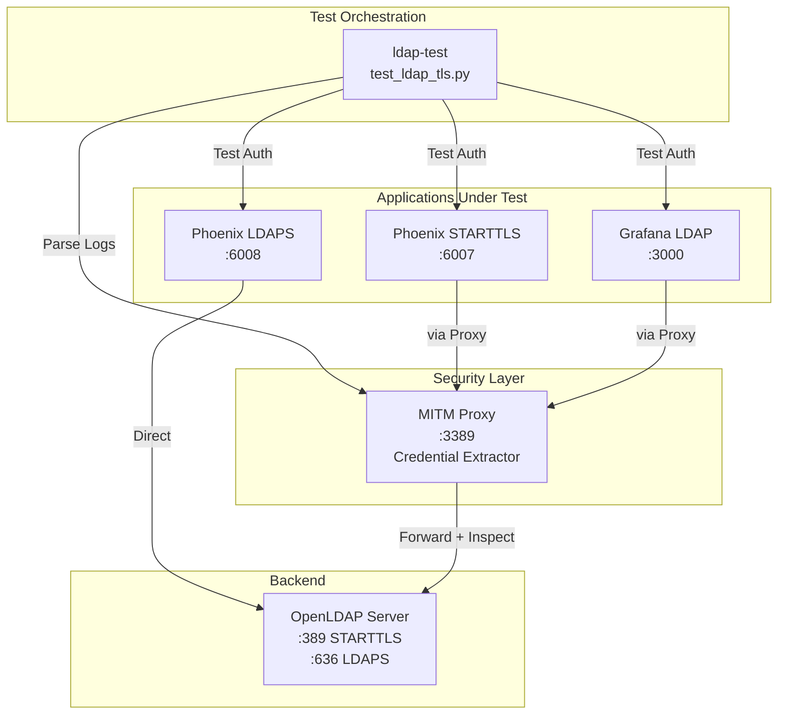
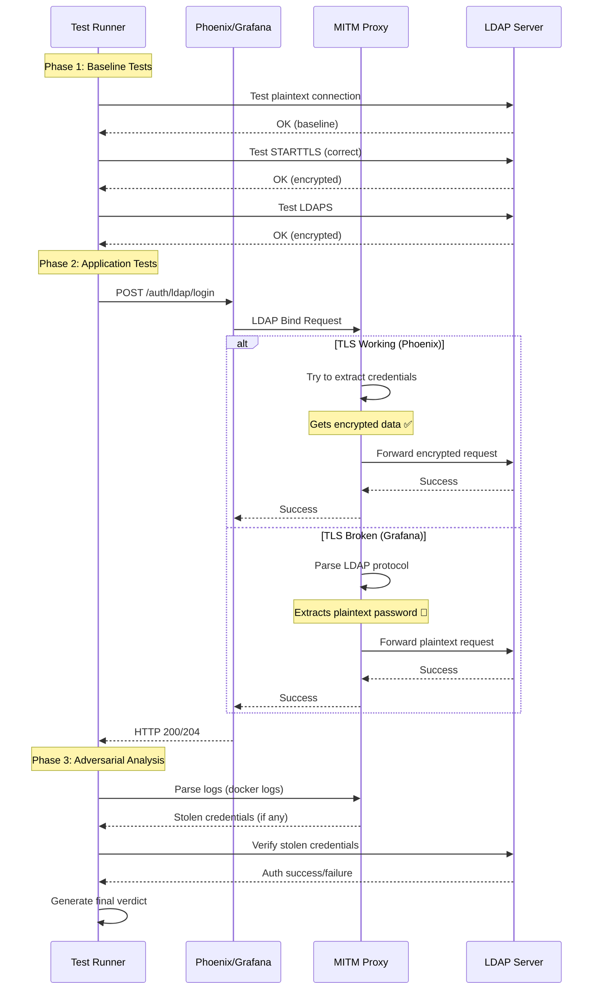
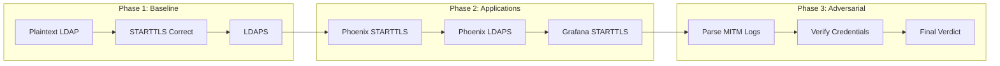
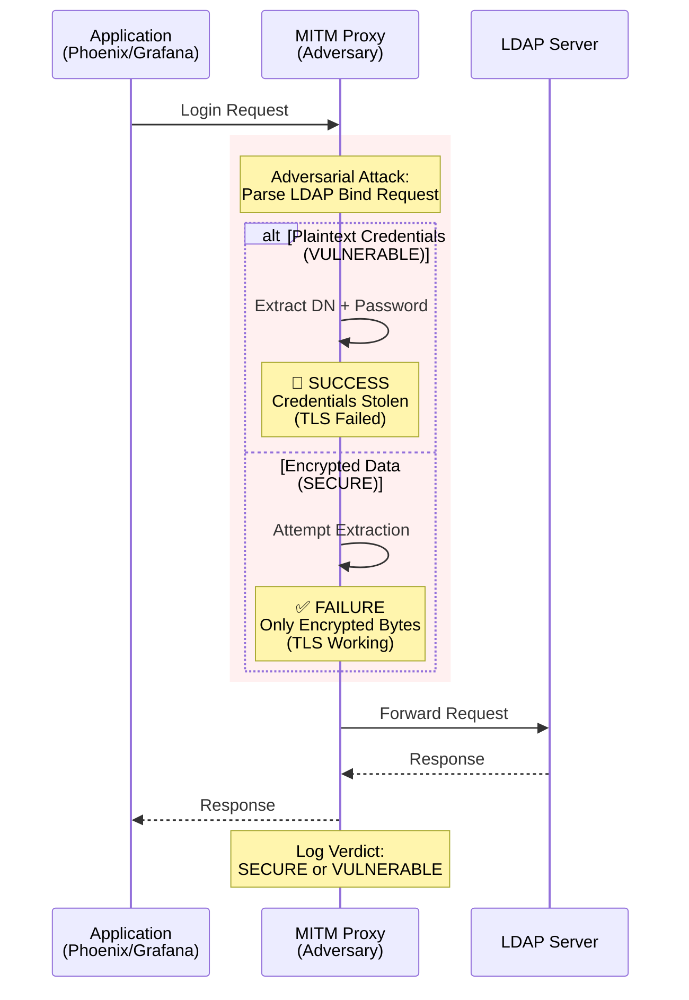
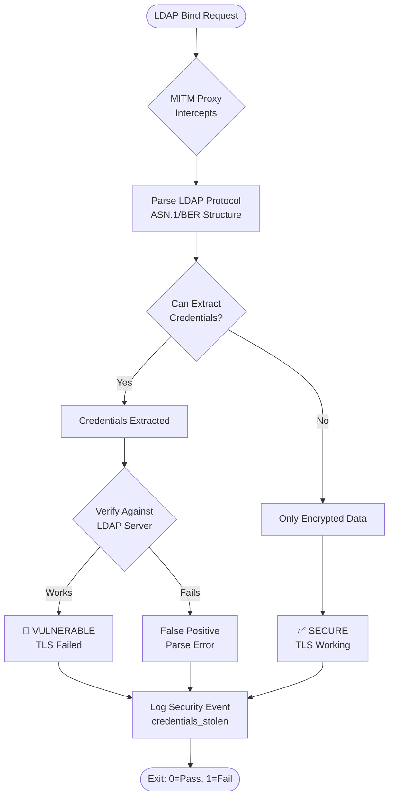
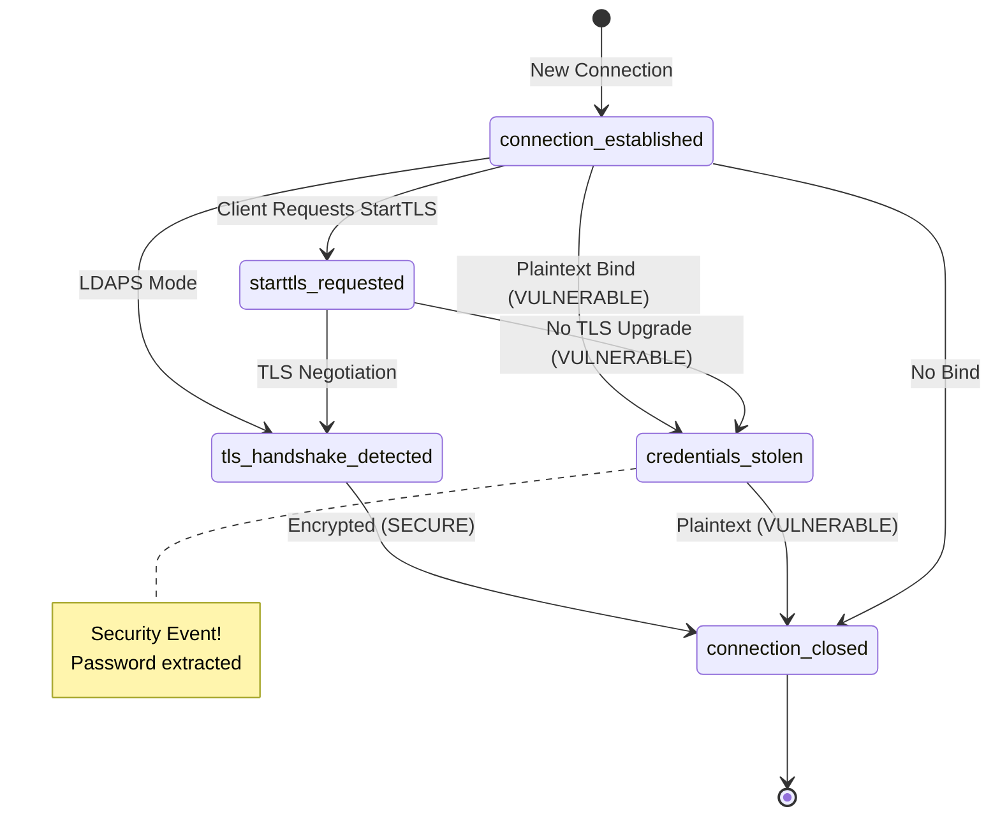
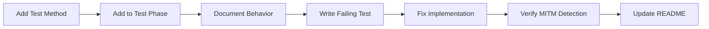

<a id="ldap-tls-security-testing"></a>

# LDAP TLS 安全测试

<a id="overview"></a>

## 概述

使用**对抗性中间人（MITM）代理**验证 LDAP TLS 实现的全面自动化测试套件。代理会主动尝试从 LDAP 流量中窃取凭证；窃取成功表示存在漏洞，失败表示安全。

<a id="architecture"></a>

## 架构



<a id="files"></a>

## 文件

```
scripts/docker/devops/
├── scripts/
│   ├── ldap_mitm_proxy.py      # Adversarial MITM proxy (credential extraction)
│   └── test_ldap_tls.py         # Test orchestration (all tests here)
├── overrides/
│   └── ldap-test.yml             # Docker Compose config (all services)
├── ldap-seed.ldif               # Test data (11 users with edge cases)
└── ldap-grafana.toml            # Grafana LDAP config (for comparison)
```

<a id="quick-start"></a>

## 快速开始

```bash
# Start all services and run tests
cd scripts/docker/devops
COMPOSE_PROFILES=ldap-test docker compose \
    -f docker-compose.yml \
    -f overrides/ldap-test.yml \
    up -d --build

# View test results
docker logs devops-ldap-test

# View MITM proxy analysis
docker logs devops-ldap-mitm-proxy

# Parse structured logs
docker logs devops-ldap-mitm-proxy 2>&1 | grep "^{" | jq

# Stop everything
COMPOSE_PROFILES=ldap-test docker compose \
    -f docker-compose.yml \
    -f overrides/ldap-test.yml \
    down
```

<a id="services"></a>

## 服务

| 服务 | 用途 | 端口 |
| --- | --- | --- |
| `ldap` | 支持 TLS 的 OpenLDAP 服务 | 389, 636 |
| `ldap-mitm-proxy` | 对抗性凭证提取器及 HTTP API | 3389（代理）, 8080（API） |
| `phoenix-starttls` | 使用 STARTTLS 模式的 Phoenix | 6007 |
| `phoenix` | 使用 LDAPS 模式的 Phoenix | 6006 |
| `grafana-ldap` | 用于对比的 Grafana | 3000 |
| `ldap-test` | 测试运行器（执行 test_ldap_tls.py） | - |

<a id="test-execution-flow"></a>

## 测试执行流程



<a id="test-phases"></a>

## 测试阶段



<a id="phase-1-baseline-ldap-connectivity"></a>

### 阶段 1：LDAP 基础连接

验证 LDAP 服务在不同 TLS 模式下是否正常：

- **明文**（389 端口，无 TLS）：基线
- **STARTTLS**（389 端口，连接后升级）：正确实现
- **LDAPS**（636 端口，连接建立时即启用 TLS）：直接 TLS

<a id="phase-2-application-security-tests"></a>

### 阶段 2：应用安全测试

通过 MITM 代理测试 Phoenix 和 Grafana：

- **Phoenix STARTTLS** → 经代理路由 → 应为 SECURE
- **Phoenix LDAPS** → 直接连接 → 应为 SECURE
- **Grafana STARTTLS** → 经代理路由 → 当前为 VULNERABLE

<a id="phase-3-adversarial-analysis"></a>

### 阶段 3：对抗性分析

- 解析 MITM 代理日志中的已提取凭证
- 验证提取到的凭证是否确实可用
- 得出安全结论

<a id="security-validation-model"></a>

## 安全验证模型



<a id="security-decision-flow"></a>

## 安全判定流程



<a id="expected-results"></a>

## 预期结果

<a id="phoenix-secure"></a>

### Phoenix（安全，SECURE）

```
Application: phoenix-starttls
StartTLS requested: True
TLS handshake detected: True
Credentials extracted: 0
Verdict: SECURE ✅
```

<a id="grafana-vulnerable"></a>

### Grafana（存在漏洞，VULNERABLE）

```
Application: grafana-ldap
StartTLS requested: False
TLS handshake detected: False
Credentials extracted: 2
  • cn=readonly,dc=example,dc=com → readonly_password
  • uid=alice,ou=users,dc=example,dc=com → password123
Verdict: VULNERABLE 🚨
```

<a id="structured-logging"></a>

## 结构化日志

所有安全事件均以 JSON 记录，便于程序分析：

```json
{
  "timestamp": 1764371725.425,
  "event": "credentials_stolen",
  "connection_id": 3,
  "application": "grafana-ldap",
  "client_ip": "172.18.0.13",
  "bind_dn": "cn=readonly,dc=example,dc=com",
  "password": "readonly_password",
  "password_length": 17,
  "direction": "client→server"
}
```

<a id="mitm-http-api"></a>

### MITM HTTP API

代理现在提供轻量级只读 API，可流式读取相同的结构化事件，无需访问 Docker：

```bash
# Fetch all recorded events (Phoenix STARTTLS, Grafana, etc.)
curl -s http://localhost:8080/events | jq

# Fetch only events newer than a UNIX timestamp
curl -s "http://localhost:8080/events?since=$(date +%s)" | jq
```

- 端点：`GET /events` → `{ "events": [...] }`
- 可选查询参数 `since` 按 `timestamp` 筛选。
- 健康检查：`GET /healthz` → `{ "status": "ok" }`

`test_ldap_tls.py` 在阶段 3 通过 `MITM_API_URL`（默认 `http://ldap-mitm-proxy:8080`）调用此 API，使运行器能够在自身容器内分析对抗测试结果。

<a id="event-types"></a>

### 事件类型



事件说明：

- `connection_established`：建立新的客户端连接
- `starttls_requested`：客户端请求升级为 StartTLS
- `tls_handshake_detected`：开始 TLS 协商
- `credentials_stolen`：成功提取明文凭证（存在漏洞）
- `connection_closed`：连接结束，并附带判定结果

<a id="exit-codes"></a>

## 退出码

- **0**：所有测试通过，未检测到漏洞
- **1**：测试失败或发现安全漏洞

<a id="test-data"></a>

## 测试数据

`ldap-seed.ldif` 包含 11 个覆盖边界情况的测试用户。

<a id="troubleshooting"></a>

## 故障排查

<a id="tests-fail-with-connection-errors"></a>

### 测试因连接错误而失败

```bash
# Check if services are running
docker ps | grep devops

# Restart services
COMPOSE_PROFILES=ldap-test docker compose \
    -f docker-compose.yml \
    -f overrides/ldap-test.yml \
    restart
```

<a id="mitm-proxy-shows-no-connections"></a>

### MITM 代理未显示连接

```bash
# Check if apps are configured to use proxy
docker exec devops-phoenix-starttls env | grep LDAP_HOST
# Should show: PHOENIX_LDAP_HOST=ldap-mitm-proxy
```

<a id="want-to-test-manually"></a>

### 手动测试

```bash
# Test Phoenix STARTTLS
curl -X POST http://localhost:6007/auth/ldap/login \
  -H "Content-Type: application/json" \
  -d '{"username":"admin","password":"password123"}'

# Check MITM logs
docker logs devops-ldap-mitm-proxy 2>&1 | tail -30
```

<a id="reproducibility-checklist"></a>

## 可复现性检查清单

- ✅ 统一入口：`test_ldap_tls.py`
- ✅ 无需手动步骤
- ✅ 所有依赖均位于 Docker 中
- ✅ 确定性的测试数据
- ✅ 幂等执行
- ✅ 明确的退出码（0 = 通过，1 = 失败）
- ✅ 便于自动化的结构化日志
- ✅ 通过日志输出提供操作说明

<a id="future-testing"></a>

## 后续测试

添加新测试：



1. 向 `LDAPTLSSecurityTester` 类添加测试方法
2. 在 `run_all_tests()` 的相应测试阶段加入调用
3. 在此 README 中说明预期行为
4. 先使测试失败，再修复实现
5. 验证 MITM 代理能够检测该问题
6. 在此 README 中补充新测试文档

示例：

```python
def test_new_feature(self) -> TestResult:
    """Test description here."""
    return self._test_http_login(
        name="New Feature Test",
        url=f"{self.config.phoenix_url}/auth/new",
        payload={"user": "test"},
        expected_status=200,
        description="New feature works",
    )
```
