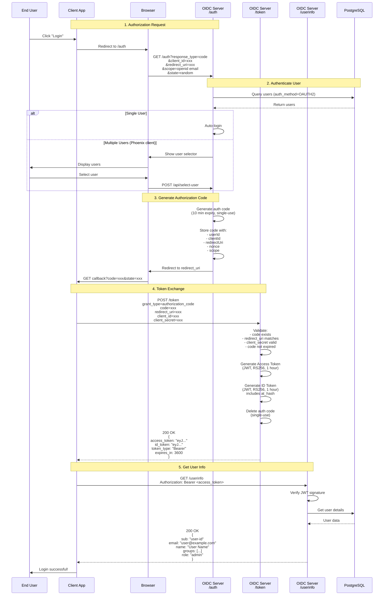
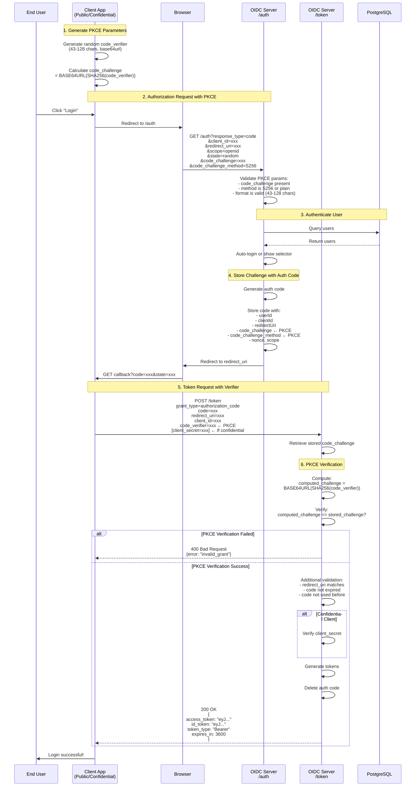
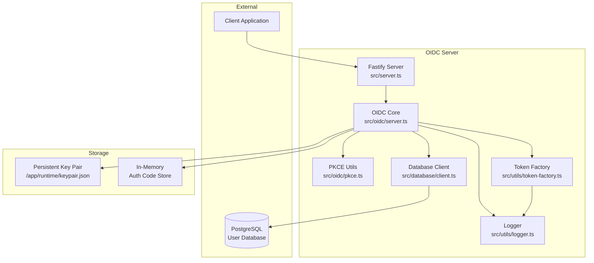

<a id="phoenix-oidc-debug-server"></a>

# Phoenix OIDC 调试服务

一个**完全符合 OpenID Connect 1.0 规范**的服务实现，用于测试和调试认证流程。服务面向开发环境，提供完整日志，帮助理解 OIDC 协议。

> ⚠️ **仅供开发使用**：这是带大量日志的调试服务，不适用于生产环境。

<a id="-table-of-contents"></a>

## 📚 目录

- [概述](#overview)
- [功能](#features)
- [快速开始](#quick-start)
- [OIDC 流程](#oidc-flows)
  - [授权码流程](#authorization-code-flow)
  - [PKCE 流程](#pkce-flow)
- [API 端点](#api-endpoints)
- [配置](#configuration)
- [架构](#architecture)
- [规范符合性](#spec-compliance)
- [学习资料](#educational-resources)

---

<a id="overview"></a>

## 概述

此 OIDC 服务实现 **OpenID Connect Core 1.0** 规范，完整支持：

- **授权码流程**（第 3.1 节）
- 面向公共客户端和机密客户端的 **PKCE**（RFC 7636）
- **发现文档**（OpenID Connect Discovery 1.0）
- **UserInfo 端点**（第 5.3 节）
- **基于 JWT 的 ID 令牌和访问令牌**（RS256）

<a id="what-is-openid-connect"></a>

### 什么是 OpenID Connect

OpenID Connect（OIDC）是建立在 OAuth 2.0 之上的身份层，允许客户端：

1. **验证最终用户的身份**
2. **获取用户的基本资料**
3. 以**可互操作、类似 REST 的方式**完成上述操作

```
┌─────────────┐
│   OAuth 2.0 │  ← Authorization framework
└──────┬──────┘
       │
       │ adds identity layer
       ▼
┌─────────────┐
│ OpenID      │  ← Authentication protocol
│ Connect     │    (verifies who you are)
└─────────────┘
```

---

<a id="features"></a>

## 功能

<a id="-spec-compliance"></a>

### ✅ 规范符合性

- **OpenID Connect Core 1.0**：完全符合规范的实现
- **RFC 7636（PKCE）**：授权码交换证明密钥
- **OAuth 2.0（RFC 6749）**：授权框架
- 每个函数都标注对应的规范章节

<a id="-debug-features"></a>

### 🔍 调试功能

- **结构化 JSON 日志**：每个操作均带时间戳记录
- **请求和响应跟踪**：完整审计轨迹
- **多用户支持**：由数据库驱动的用户管理
- **用户选择界面**：使用多个用户测试

<a id="-security-features"></a>

### 🔐 安全功能

- **RS256 JWT 签名**：非对称密钥加密
- **持久化密钥对**：容器重启后保留密钥
- **一次性授权码**：防止重放攻击
- **PKCE 支持**：增强公共客户端安全性
- **客户端认证**：HTTP Basic Auth 和 POST 请求体方式

<a id="-client-support"></a>

### 🎯 客户端支持

- **标准 OAuth/OIDC**：使用密钥的机密客户端
- **PKCE 公共客户端**：移动应用、单页应用
- **PKCE 机密客户端**：使用 PKCE 的服务端应用
- **可配置模式**：支持一种或全部流程

---

<a id="quick-start"></a>

## 快速开始

<a id="prerequisites"></a>

### 前置条件

- Node.js 18+
- PostgreSQL 数据库（用于用户管理）

<a id="installation"></a>

### 安装

```bash
# Install dependencies
pnpm install

# Build the server
pnpm build

# Start the server
pnpm start
```

<a id="environment-variables"></a>

### 环境变量

```bash
# Server Configuration
OIDC_PORT=9000
OIDC_ISSUER=http://localhost:9000
OIDC_PUBLIC_BASE_URL=http://localhost:9000

# Client Configuration
OIDC_CLIENT_ID=phoenix-oidc-client-id
OIDC_CLIENT_SECRET=phoenix-oidc-client-secret-abc-123

# Authentication Method: "oidc" | "pkce-public" | "pkce-confidential" | "all"
OIDC_CLIENT_AUTH_METHOD=all

# Database Configuration
DB_HOST=db
DB_PORT=5432
DB_NAME=postgres
DB_USER=postgres
DB_PASSWORD=postgres
```

<a id="test-the-server"></a>

### 测试服务

```bash
# Check discovery document
curl http://localhost:9000/.well-known/openid-configuration | jq

# View JWKS (public keys)
curl http://localhost:9000/.well-known/jwks.json | jq

# Health check
curl http://localhost:9000/health
```

---

<a id="oidc-flows"></a>

## OIDC 流程

<a id="authorization-code-flow"></a>

### 授权码流程

**授权码流程**是最安全的 OAuth 2.0 流程，推荐用于服务端 Web 应用。

<a id="flow-diagram"></a>

#### 流程图



<a id="key-steps"></a>

#### 关键步骤

1. **授权请求**（第 3.1.2.1 节）
   - 客户端将用户重定向到 `/auth` 端点
   - 包含：`client_id`、`redirect_uri`、`response_type=code`、`scope`、`state`

2. **用户认证**（第 3.1.2.3 节）
   - 服务端验证用户身份
   - 调试时从 PostgreSQL 查询 OAuth2 用户
   - 只有一个用户时自动登录，否则显示用户选择器

3. **授权响应**（第 3.1.2.5 节）
   - 服务端生成短期授权码（10 分钟）
   - 携带授权码和 state 重定向回客户端

4. **令牌请求**（第 3.1.3.1 节）
   - 客户端用授权码交换令牌
   - 包含：`grant_type=authorization_code`、`code`、`redirect_uri`、`client_secret`

5. **令牌响应**（第 3.1.3.3 节）
   - 服务端返回 `access_token` 和 `id_token`
   - ID 令牌包含用户身份声明
   - 访问令牌用于访问 API

6. **UserInfo 请求**（第 5.3.1 节）
   - 客户端使用访问令牌请求用户详情
   - 服务端返回用户资料、组和角色

---

<a id="pkce-flow"></a>

### PKCE 流程

**PKCE**（授权码交换证明密钥，RFC 7636）为无法安全保存客户端密钥的公共客户端（移动应用、单页应用）增加额外安全层。

<a id="how-pkce-works"></a>

#### PKCE 工作原理

```
┌─────────────────────────────────────────────────────────┐
│ Client Generates Random Code Verifier                   │
│ code_verifier                                           |
|   = "dBjftJeZ4CVP-mB92K27uhbUJU1p1r_wW1gFWFOEjXk"       │
└────────────────────┬────────────────────────────────────┘
                     │
                     ▼
┌─────────────────────────────────────────────────────────┐
│ Client Creates Code Challenge                           │
│ code_challenge                                          |
|   = BASE64URL(SHA256(code_verifier))                    │
│   = "E9Melhoa2OwvFrEMTJguCHaoeK1t8URWbuGJSstw-cM"       │
└────────────────────┬────────────────────────────────────┘
                     │
                     ▼
┌─────────────────────────────────────────────────────────┐
│ Send code_challenge to Server (Authorization Request)   │
└────────────────────┬────────────────────────────────────┘
                     │
                     ▼
┌─────────────────────────────────────────────────────────┐
│ Server Stores code_challenge                            │
└────────────────────┬────────────────────────────────────┘
                     │
                     ▼
┌─────────────────────────────────────────────────────────┐
│ Send code_verifier to Server (Token Request)            │
└────────────────────┬────────────────────────────────────┘
                     │
                     ▼
┌─────────────────────────────────────────────────────────┐
│ Server Verifies:                                        │
│ BASE64URL(SHA256(code_verifier)) == code_challenge?     │
└─────────────────────────────────────────────────────────┘
```

<a id="pkce-flow-diagram"></a>

#### PKCE 流程图



<a id="pkce-security-benefits"></a>

#### PKCE 的安全收益

| 攻击场景 | 不使用 PKCE | 使用 PKCE |
| --- | --- | --- |
| **授权码拦截** | 攻击者可用窃取的授权码交换令牌 | 没有 `code_verifier` 就无法交换令牌 |
| **设备上的恶意应用** | 可以从合法应用窃取授权码 | 没有原始 `code_verifier` 就无法使用授权码 |
| **网络拦截** | 仅有授权码即可 | 必须同时持有授权码和 verifier，后者从不发送到授权端点 |

<a id="pkce-methods"></a>

#### PKCE 方法

1. **S256**（推荐）

   ```
   code_challenge = BASE64URL(SHA256(ASCII(code_verifier)))
   ```

2. **plain**（不推荐）

   ```
   code_challenge = code_verifier
   ```

---

<a id="api-endpoints"></a>

## API 端点

<a id="discovery-endpoint"></a>

### 发现端点

**GET** `/.well-known/openid-configuration`

返回 OpenID 提供方配置。

**响应：**

```json
{
  "issuer": "http://localhost:9000",
  "authorization_endpoint": "http://localhost:9000/auth",
  "token_endpoint": "http://localhost:9000/token",
  "userinfo_endpoint": "http://localhost:9000/userinfo",
  "jwks_uri": "http://localhost:9000/.well-known/jwks.json",
  "response_types_supported": ["code"],
  "grant_types_supported": ["authorization_code"],
  "subject_types_supported": ["public"],
  "id_token_signing_alg_values_supported": ["RS256"],
  "token_endpoint_auth_methods_supported": [
    "client_secret_basic",
    "client_secret_post",
    "none"
  ],
  "scopes_supported": ["openid", "email", "profile", "groups", "roles"],
  "claims_supported": ["sub", "email", "name", "groups", "role"],
  "code_challenge_methods_supported": ["S256", "plain"]
}
```

---

<a id="jwks-endpoint"></a>

### JWKS 端点

**GET** `/.well-known/jwks.json`

返回 JSON Web Key Set，其中包含用于验证令牌的公钥。

**响应：**

```json
{
  "keys": [
    {
      "kty": "RSA",
      "n": "w7Zdfmece8ia...",
      "e": "AQAB",
      "kid": "phoenix-dev-key-1",
      "alg": "RS256",
      "use": "sig"
    }
  ]
}
```

---

<a id="authorization-endpoint"></a>

### 授权端点

**GET** `/auth`

发起认证流程。

**查询参数：**

| 参数 | 是否必填 | 说明 |
| --- | --- | --- |
| `response_type` | 是 | 必须为 `code` |
| `client_id` | 是 | 客户端标识符 |
| `redirect_uri` | 是 | 回调 URL |
| `scope` | 是 | 以空格分隔的作用域，必须包含 `openid` |
| `state` | 推荐 | CSRF 防护令牌 |
| `nonce` | 可选 | 防重放值，在 ID 令牌中返回 |
| `code_challenge` | PKCE | Base64URL 编码的 challenge |
| `code_challenge_method` | PKCE | `S256` 或 `plain` |

**成功响应：**

```
HTTP/1.1 302 Found
Location: {redirect_uri}?code={authorization_code}&state={state}
```

**错误响应：**

```
HTTP/1.1 302 Found
Location: {redirect_uri}?error=invalid_request&error_description=...&state={state}
```

---

<a id="token-endpoint"></a>

### 令牌端点

**POST** `/token`

用授权码交换令牌。

**请求头：**

```
Content-Type: application/x-www-form-urlencoded
Authorization: Basic {BASE64(client_id:client_secret)}  [Optional]
```

**请求体：**

| 参数 | 是否必填 | 说明 |
| --- | --- | --- |
| `grant_type` | 是 | 必须为 `authorization_code` |
| `code` | 是 | 从 `/auth` 获取的授权码 |
| `redirect_uri` | 是 | 必须与授权请求一致 |
| `client_id` | 是 | 客户端标识符 |
| `client_secret` | 机密客户端 | 客户端密钥，通过请求体或 Basic Auth 发送 |
| `code_verifier` | PKCE | PKCE 流程的验证值 |

**成功响应：**

```json
{
  "access_token": "eyJhbGciOiJSUzI1NiIsImtpZCI6InBob2VuaXgtZGV2LWtleS0xIn0...",
  "id_token": "eyJhbGciOiJSUzI1NiIsImtpZCI6InBob2VuaXgtZGV2LWtleS0xIn0...",
  "token_type": "Bearer",
  "expires_in": 3600,
  "scope": "openid email profile"
}
```

**错误响应：**

```json
{
  "error": "invalid_grant",
  "error_description": "Authorization code is invalid or expired"
}
```

<a id="id-token-claims"></a>

#### ID 令牌声明

```json
{
  "sub": "user-123",
  "email": "user@example.com",
  "name": "John Doe",
  "iss": "http://localhost:9000",
  "aud": "phoenix-oidc-client-id",
  "exp": 1234567890,
  "iat": 1234564290,
  "at_hash": "E9Melhoa2OwvFrEM...",
  "nonce": "n-0S6_WzA2Mj"
}
```

---

<a id="userinfo-endpoint"></a>

### UserInfo 端点

**GET** `/userinfo`

返回已认证用户的声明。

**请求头：**

```
Authorization: Bearer {access_token}
```

**成功响应：**

```json
{
  "sub": "user-123",
  "email": "user@example.com",
  "name": "John Doe",
  "role": "admin",
  "groups": ["phoenix-admins", "full-access"]
}
```

---

<a id="health-check"></a>

### 健康检查

**GET** `/health`

返回服务健康状态。

**响应：**

```json
{
  "status": "ok",
  "service": "phoenix-oidc-dev",
  "timestamp": "2025-10-03T10:30:00.000Z",
  "users": 3
}
```

---

<a id="configuration"></a>

## 配置

<a id="authentication-methods"></a>

### 认证方式

服务通过 `OIDC_CLIENT_AUTH_METHOD` 支持四种模式：

<a id="1-standard-oidc-oidc"></a>

#### 1. 标准 OIDC（`"oidc"`）

- 仅支持机密客户端
- 需要 `client_secret`
- 不支持 PKCE

<a id="2-pkce-public-pkce-public"></a>

#### 2. PKCE 公共客户端（`"pkce-public"`）

- 仅支持公共客户端
- 不需要 `client_secret`
- 必须使用 PKCE

<a id="3-pkce-confidential-pkce-confidential"></a>

#### 3. PKCE 机密客户端（`"pkce-confidential"`）

- 使用 PKCE 的机密客户端
- 同时需要 `client_secret` 和 `code_verifier`
- 最高安全性

<a id="4-all-methods-all"></a>

#### 4. 全部方式（`"all"`）

- 支持上述全部方式
- 根据请求参数自动识别

<a id="supported-clients"></a>

### 支持的客户端

服务识别以下客户端 ID：

```typescript
const clients = {
  "phoenix-oidc-client-id": {
    secret: "phoenix-oidc-client-secret-abc-123",
    type: "confidential",
  },
  "grafana-oidc-client-id": {
    secret: "grafana-oidc-client-secret-abc-123",
    type: "confidential",
  },
};
```

---

<a id="architecture"></a>

## 架构

<a id="component-diagram"></a>

### 组件图



<a id="key-components"></a>

### 关键组件

<a id="1-oidcserver-srcoidcserverts"></a>

#### 1. **OIDCServer**（`src/oidc/server.ts`）

- OIDC 协议核心实现
- 处理授权和令牌端点
- 管理授权码
- 生成 JWT 令牌
- 约 2000 行，包含大量规范注释

<a id="2-tokenfactory-srcutilstoken-factoryts"></a>

#### 2. **TokenFactory**（`src/utils/token-factory.ts`）

- 生成访问令牌和 ID 令牌
- 计算 `at_hash` 声明
- RS256 JWT 签名
- 完整日志

<a id="3-pkceutils-srcoidcpkcets"></a>

#### 3. **PKCEUtils**（`src/oidc/pkce.ts`）

- PKCE challenge 校验
- code verifier 验证
- 支持 S256 和 plain 方法

<a id="4-databaseclient-srcdatabaseclientts"></a>

#### 4. **DatabaseClient**（`src/database/client.ts`）

- PostgreSQL 连接
- 用户管理
- 每 5 秒轮询用户变更
- 数据库不可用时回退到默认用户

<a id="5-logger-srcutilsloggerts"></a>

#### 5. **Logger**（`src/utils/logger.ts`）

- 结构化 JSON 日志
- 每个操作均带时间戳记录
- 请求与响应跟踪

---

<a id="spec-compliance"></a>

## 规范符合性

此实现**完全符合**以下规范：

<a id="openid-connect-core-10"></a>

### OpenID Connect Core 1.0

- ✅ 第 2 节：ID 令牌
- ✅ 第 3.1.2 节：授权端点
- ✅ 第 3.1.3 节：令牌端点
- ✅ 第 5.3 节：UserInfo 端点
- ✅ 第 9 节：客户端认证
- ✅ 第 16 节：安全注意事项

<a id="rfc-7636-pkce"></a>

### RFC 7636（PKCE）

- ✅ 第 4.1 节：创建 code verifier
- ✅ 第 4.2 节：创建 code challenge
- ✅ 第 4.4 节：授权请求
- ✅ 第 4.5 节：令牌请求
- ✅ 第 4.6 节：服务端验证

<a id="code-annotations"></a>

### 代码注释

代码库中的每个函数均包含 JSDoc 注释，注明：

- 规范章节引用
- 规范的直接链接
- 要求说明
- REQUIRED/RECOMMENDED/OPTIONAL 标记

**示例：**

```typescript
/**
 * Token Endpoint - Authorization Code Flow
 * Spec: OIDC Core Section 3.1.3 - Token Endpoint
 * https://openid.net/specs/openid-connect-core-1_0.html#TokenEndpoint
 *
 * Exchanges authorization codes for access tokens and ID tokens.
 *
 * Section 3.1.3.1 - Token Request
 * Section 3.1.3.2 - Token Request Validation
 * Section 3.1.3.3 - Successful Token Response
 */
async handleToken(body: any, headers: any) {
  // Implementation with inline spec citations
}
```

---

<a id="educational-resources"></a>

## 学习资料

<a id="understanding-the-flow"></a>

### 理解流程

<a id="1-why-two-endpoints"></a>

#### 1. 为什么需要两个端点

```
Authorization Endpoint (/auth)
↓
Purpose: Get user consent
Frontend-focused: Browser redirects
Returns: Short-lived code (10 min)

Token Endpoint (/token)
↓
Purpose: Exchange code for tokens
Backend-focused: Direct HTTP call
Returns: Long-lived tokens (1 hour)
```

**安全收益：** 没有在令牌端点完成客户端认证，授权码就无法使用。

<a id="2-why-authorization-code-flow"></a>

#### 2. 为什么使用授权码流程

| 流程 | 安全性 | 使用场景 |
| --- | --- | --- |
| **隐式流程** | ❌ 令牌出现在 URL 中 | 已弃用 |
| **密码流程** | ❌ 凭证交给客户端 | 已弃用 |
| **授权码流程** | ✅ 最安全 | **推荐** |
| **授权码 + PKCE** | ✅✅ 增强安全性 | **最佳实践** |

<a id="3-understanding-tokens"></a>

#### 3. 理解令牌

```
┌─────────────────┐
│  Access Token   │
├─────────────────┤
│ Purpose:        │
│ - API access    │
│ - Short-lived   │
│ - Opaque to     │
│   client        │
└─────────────────┘

┌─────────────────┐
│   ID Token      │
├─────────────────┤
│ Purpose:        │
│ - User identity │
│ - Client reads  │
│ - Contains      │
│   claims        │
│ - Has at_hash   │
└─────────────────┘
```

<a id="4-jwt-structure"></a>

#### 4. JWT 结构

```
Header.Payload.Signature

Header (Base64URL encoded):
{
  "alg": "RS256",
  "kid": "phoenix-dev-key-1"
}

Payload (Base64URL encoded):
{
  "sub": "user-123",
  "iss": "http://localhost:9000",
  "aud": "client-id",
  "exp": 1234567890,
  "iat": 1234564290,
  "email": "user@example.com",
  "name": "John Doe"
}

Signature (RS256):
RSASHA256(
  base64UrlEncode(header) + "." +
  base64UrlEncode(payload),
  privateKey
)
```

<a id="common-pitfalls"></a>

### 常见错误

<a id="-wrong-sending-client_secret-in-authorization-request"></a>

#### ❌ 错误：在授权请求中发送 client_secret

```javascript
// NEVER DO THIS
window.location = `/auth?client_id=x&client_secret=SECRET`;
```

**原因：** 授权端点位于浏览器中，URL 对用户可见。

<a id="-correct-send-client_secret-only-in-token-request"></a>

#### ✅ 正确：仅在令牌请求中发送 client_secret

```javascript
// Backend only
fetch("/token", {
  method: "POST",
  body: new URLSearchParams({
    client_secret: "SECRET", // Safe: server-to-server
    // ...
  }),
});
```

<a id="-wrong-storing-access-token-without-expiration-check"></a>

#### ❌ 错误：存储访问令牌却不检查过期时间

```javascript
// WRONG
localStorage.setItem("token", accessToken);
```

<a id="-correct-store-token-with-expiration"></a>

#### ✅ 正确：同时保存令牌及过期时间

```javascript
// CORRECT
const expiresAt = Date.now() + expiresIn * 1000;
localStorage.setItem(
  "token",
  JSON.stringify({
    accessToken,
    expiresAt,
  })
);
```

<a id="-wrong-using-authorization-code-twice"></a>

#### ❌ 错误：使用同一授权码两次

```javascript
// This will fail - codes are single-use
await fetch("/token", { code: "abc123" });
await fetch("/token", { code: "abc123" }); // ERROR: invalid_grant
```

<a id="testing-examples"></a>

### 测试示例

<a id="test-authorization-code-flow"></a>

#### 测试授权码流程

```bash
# 1. Get authorization code
curl -v "http://localhost:9000/auth?response_type=code&client_id=phoenix-oidc-client-id&redirect_uri=http://localhost:3000/callback&scope=openid%20email&state=random123"

# 2. Extract code from redirect Location header
CODE="..."

# 3. Exchange code for tokens
curl -X POST http://localhost:9000/token \
  -H "Content-Type: application/x-www-form-urlencoded" \
  -d "grant_type=authorization_code" \
  -d "code=$CODE" \
  -d "redirect_uri=http://localhost:3000/callback" \
  -d "client_id=phoenix-oidc-client-id" \
  -d "client_secret=phoenix-oidc-client-secret-abc-123"

# 4. Get user info
ACCESS_TOKEN="..."
curl http://localhost:9000/userinfo \
  -H "Authorization: Bearer $ACCESS_TOKEN"
```

<a id="test-pkce-flow"></a>

#### 测试 PKCE 流程

```bash
# 1. Generate code verifier and challenge
CODE_VERIFIER=$(openssl rand -base64 32 | tr -d '=' | tr '+/' '-_')
CODE_CHALLENGE=$(echo -n "$CODE_VERIFIER" | openssl dgst -sha256 -binary | base64 | tr -d '=' | tr '+/' '-_')

echo "Verifier: $CODE_VERIFIER"
echo "Challenge: $CODE_CHALLENGE"

# 2. Authorization request with challenge
curl -v "http://localhost:9000/auth?response_type=code&client_id=phoenix-oidc-client-id&redirect_uri=http://localhost:3000/callback&scope=openid&state=random123&code_challenge=$CODE_CHALLENGE&code_challenge_method=S256"

# 3. Exchange code with verifier
CODE="..."
curl -X POST http://localhost:9000/token \
  -H "Content-Type: application/x-www-form-urlencoded" \
  -d "grant_type=authorization_code" \
  -d "code=$CODE" \
  -d "redirect_uri=http://localhost:3000/callback" \
  -d "client_id=phoenix-oidc-client-id" \
  -d "code_verifier=$CODE_VERIFIER"
```

---

<a id="troubleshooting"></a>

## 故障排查

<a id="common-issues"></a>

### 常见问题

<a id="1-no-users-available"></a>

#### 1. "No users available"

**原因：** 数据库未连接，或不存在 OAuth2 用户。

**解决方案：**

```sql
-- Create a test user
INSERT INTO users (email, username, auth_method, user_role_id)
VALUES ('test@example.com', 'Test User', 'OAUTH2', 1);
```

<a id="2-invalid-redirect_uri"></a>

#### 2. "Invalid redirect_uri"

**原因：** 令牌请求中的重定向 URI 与授权请求不一致。

**解决方案：** 确保完全一致，包括末尾斜杠。

<a id="3-invalid-client_secret"></a>

#### 3. "Invalid client_secret"

**原因：** 密钥错误，或发送格式错误。

**解决方案：** 检查客户端配置，并使用以下任一方式：

- HTTP Basic Auth：`Authorization: Basic BASE64(client_id:client_secret)`
- POST 请求体：`client_secret=...`

<a id="4-pkce-verification-failed"></a>

#### 4. "PKCE verification failed"

**原因：** code verifier 与 code challenge 不匹配。

**解决方案：**

- 确保两次请求使用相同 `code_verifier`
- 检查 `code_challenge_method` 是否一致
- 验证 base64url 编码：没有 `=`，使用 `-_` 代替 `+/`

<a id="debug-logging"></a>

### 调试日志

全部日志均为结构化 JSON，可按事件类型筛选：

```bash
# Watch token exchanges
docker logs oidc-server | grep token_exchange

# Watch PKCE verification
docker logs oidc-server | grep pkce_verification

# Watch user authentication
docker logs oidc-server | grep user_found
```

---

<a id="development"></a>

## 开发

<a id="project-structure"></a>

### 项目结构

```
oidc-server/
├── src/
│   ├── server.ts              # Fastify server setup
│   ├── oidc/
│   │   ├── server.ts          # OIDC protocol implementation
│   │   └── pkce.ts            # PKCE utilities
│   ├── utils/
│   │   ├── token-factory.ts   # JWT token generation
│   │   ├── logger.ts          # Structured logging
│   │   └── validators.ts      # Input validation
│   ├── database/
│   │   └── client.ts          # PostgreSQL client
│   └── types/
│       └── index.ts           # TypeScript types
├── frontend/                   # User selector UI
├── runtime/
│   └── keypair.json           # Persistent RSA keys
├── package.json
└── tsconfig.json
```

<a id="build--run"></a>

### 构建与运行

```bash
# Development with watch mode
pnpm dev

# Build
pnpm build

# Production
pnpm start

# Type check
pnpm type-check

# Lint
pnpm lint
```

---

<a id="references"></a>

## 参考资料

<a id="specifications"></a>

### 规范

- [OpenID Connect Core 1.0](https://openid.net/specs/openid-connect-core-1_0.html)
- [OpenID Connect Discovery 1.0](https://openid.net/specs/openid-connect-discovery-1_0.html)
- [RFC 7636 - PKCE](https://tools.ietf.org/html/rfc7636)
- [RFC 6749 - OAuth 2.0](https://tools.ietf.org/html/rfc6749)
- [RFC 7519 - JWT](https://tools.ietf.org/html/rfc7519)
- [RFC 7517 - JWK](https://tools.ietf.org/html/rfc7517)

<a id="tools"></a>

### 工具

- **JWT 调试器**：https://jwt.io
- **Base64URL 编码器**：https://base64.guru/standards/base64url
- **OIDC 试验台**：https://openidconnect.net/

---

<a id="license"></a>

## 许可

此 OIDC 服务是 Phoenix 项目的一部分。

---

<a id="contributing"></a>

## 贡献

这是调试和开发服务。生产用途可考虑：

- [ORY Hydra](https://www.ory.sh/hydra/)
- [Keycloak](https://www.keycloak.org/)
- [Auth0](https://auth0.com/)
- [Okta](https://www.okta.com/)

---

**用 ❤️ 构建，助力 Phoenix 认证流程调试**
