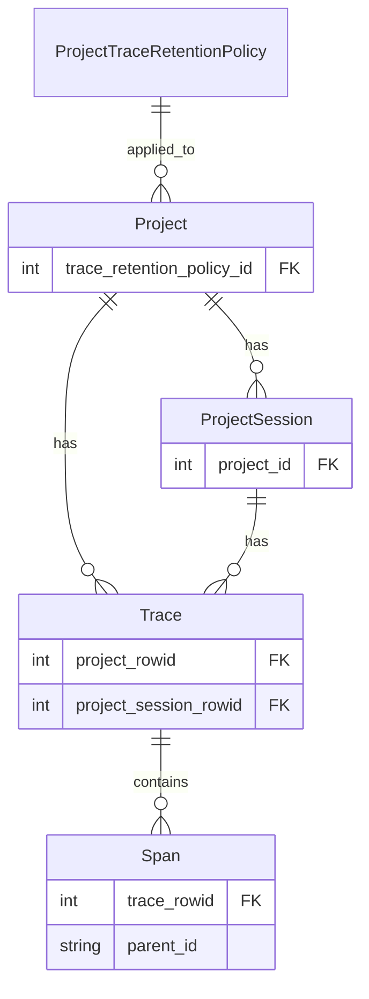
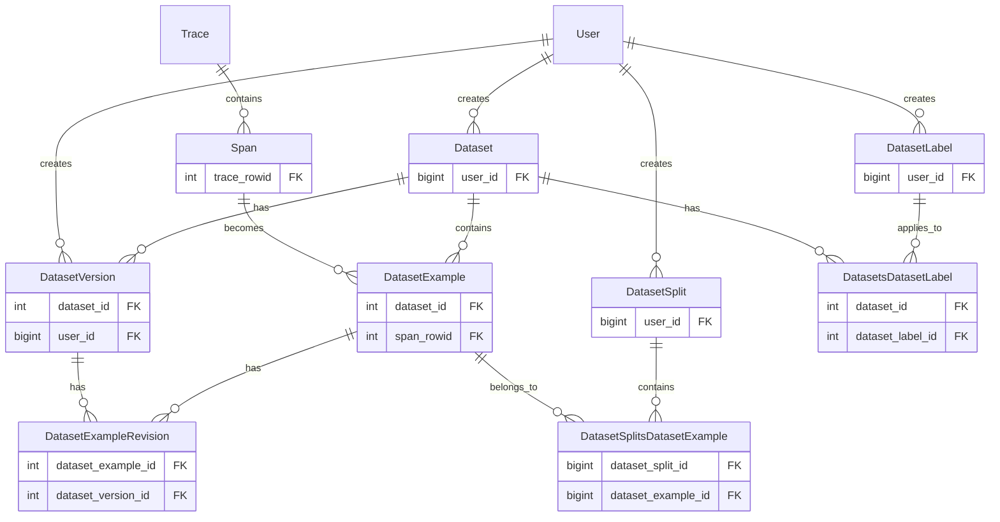
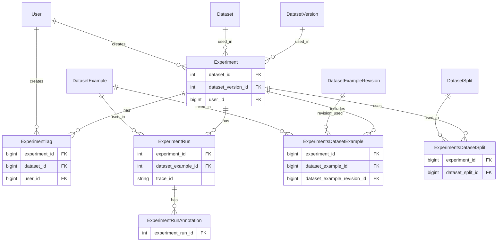
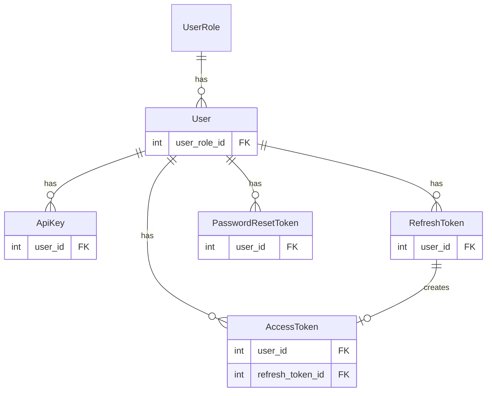
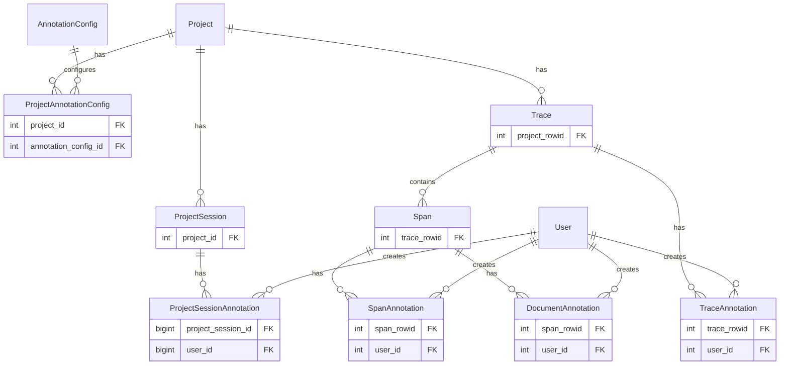
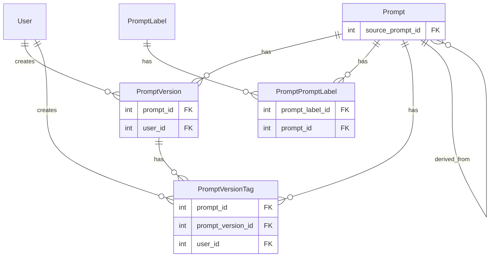
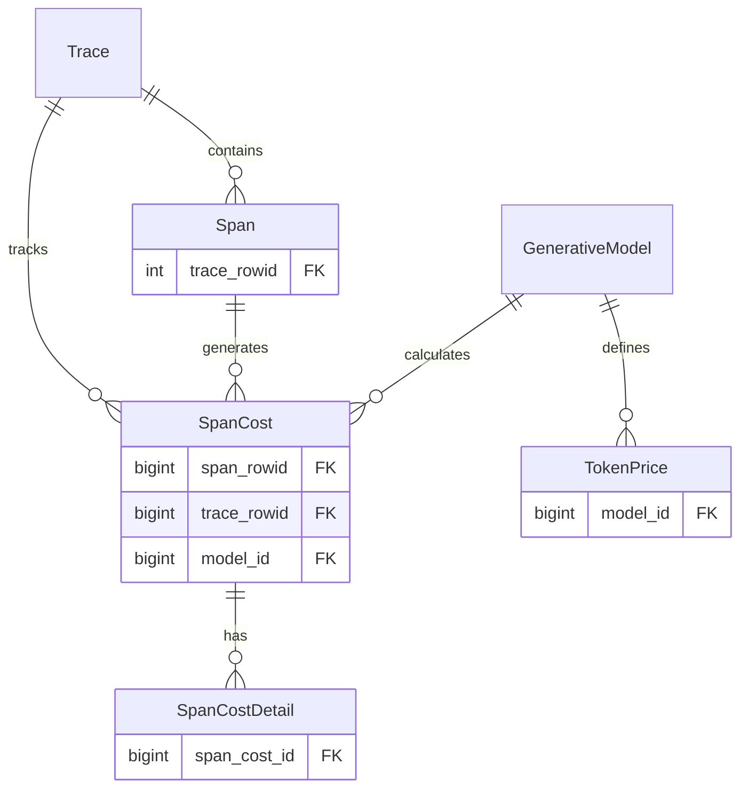
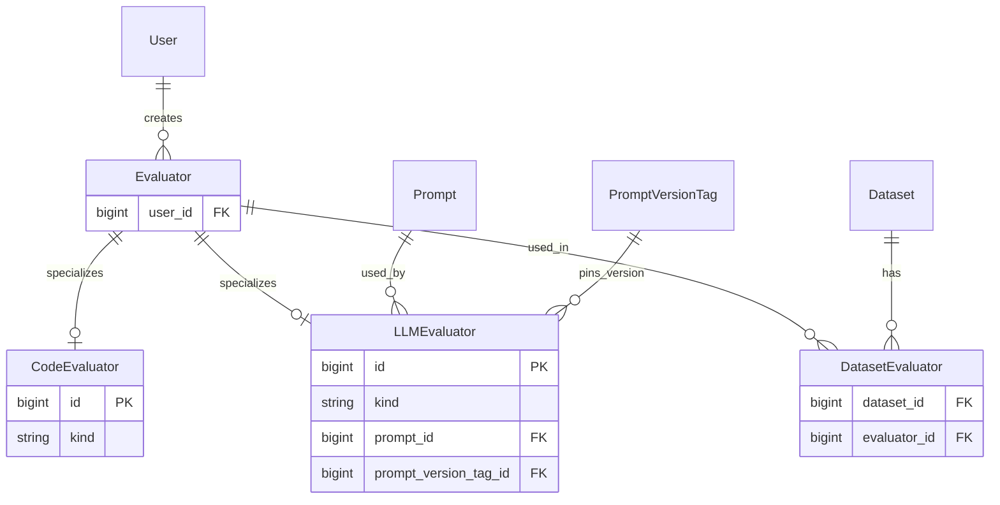

<a id="database"></a>

# 数据库

本模块负责数据库连接和迁移。

<a id="migrations"></a>

## 迁移

全部迁移由 Alembic 管理，应用启动时会自动应用到数据库。

<a id="manually-applying-migrations"></a>

### 手动应用迁移

有时需要手动应用迁移，例如从迁移失败中恢复。手动迁移前必须先克隆 Phoenix 仓库。

```bash
git clone https://github.com/Arize-ai/phoenix.git
```

然后进入当前目录。

```bash
cd phoenix/src/phoenix/db
```

如果使用非默认 SQL 数据库 URL（例如运行 PostgreSQL），请确保设置 `PHOENIX_SQL_DATABASE_URL`。使用默认 SQLite URL 运行 Phoenix 时不需要设置。

```bash
export PHOENIX_SQL_DATABASE_URL=<sql-database-url>
```

手动执行升级迁移，请运行：

```bash
alembic upgrade head
```

如果上述命令失败，可能需要先执行降级迁移，撤销失败迁移中已经部分应用的改动。先找出希望回退到的迁移修订 ID，修订定义见[此目录](./migrations/versions/)。

⚠️ 降级迁移可能导致数据丢失。仅在明确了解操作影响时执行，并考虑先备份数据库。如有疑问，可在 [Arize AI Slack 社区](https://join.slack.com/t/arize-ai/shared_invite/zt-3r07iavnk-ammtATWSlF0pSrd1DsMW7g) 的 `#phoenix-support` 频道或通过 GitHub 联系 Phoenix 团队。

```bash
alembic downgrade <revision-id>
```

<a id="creating-a-migration"></a>

### 创建迁移

所有迁移存放在 `migrations` 文件夹中。运行以下命令创建新迁移：

```bash
alembic revision -m "your_revision_name"
```

然后在迁移文件中填写所需改动。

<a id="entity-relationship-diagram-erd"></a>

## 实体关系图（ERD）

以下 Mermaid 图展示数据库主要实体当前的关系：

```mermaid
erDiagram
    ProjectTraceRetentionPolicy ||--o{ Project : applied_to
    ProjectTraceRetentionPolicy {
        int id PK
        string name
        string cron_expression
        jsonb rule
    }

    Project ||--o{ Trace : has
    Project ||--o{ ProjectSession : has
    Project ||--o{ ProjectAnnotationConfig : has
    Project {
        int id PK
        string name
        string description
        string gradient_start_color
        string gradient_end_color
        datetime created_at
        datetime updated_at
        int trace_retention_policy_id FK
    }

    ProjectSession ||--o{ Trace : has
    ProjectSession ||--o{ ProjectSessionAnnotation : has
    ProjectSession {
        int id PK
        string session_id
        int project_id FK
        datetime start_time
        datetime end_time
    }

    Trace ||--o{ Span : contains
    Trace ||--o{ ExperimentRun : has
    Trace ||--o{ TraceAnnotation : has
    Trace ||--o{ ExperimentRunAnnotation : has
    Trace {
        int id PK
        int project_rowid FK
        string trace_id
        int project_session_rowid FK
        datetime start_time
        datetime end_time
    }

    Span ||--o{ DocumentAnnotation : has
    Span ||--o{ DatasetExample : has
    Span ||--o{ SpanAnnotation : has
    Span {
        int id PK
        int trace_rowid FK
        string span_id
        string parent_id
        string name
        string span_kind
        datetime start_time
        datetime end_time
        jsonb attributes
        jsonb events
        string status_code
        string status_message
        int cumulative_error_count
        int cumulative_llm_token_count_prompt
        int cumulative_llm_token_count_completion
        int llm_token_count_prompt
        int llm_token_count_completion
    }

    DocumentAnnotation {
        int id PK
        int span_rowid FK
        int document_position
        string name
        string label
        double score
        string explanation
        jsonb metadata
        string annotator_kind
        datetime created_at
        datetime updated_at
        string identifier
        string source
        int user_id FK
    }

    SpanAnnotation {
        int id PK
        int span_rowid FK
        string name
        string label
        double score
        string explanation
        jsonb metadata
        string annotator_kind
        datetime created_at
        datetime updated_at
        string identifier
        string source
        int user_id FK
    }

    TraceAnnotation {
        int id PK
        int trace_rowid FK
        string name
        string label
        double score
        string explanation
        jsonb metadata
        string annotator_kind
        datetime created_at
        datetime updated_at
        string identifier
        string source
        int user_id FK
    }

    Dataset ||--o{ DatasetVersion : has
    Dataset ||--o{ DatasetExample : contains
    Dataset ||--o{ Experiment : used_in
    Dataset ||--o{ DatasetsDatasetLabel : has
    Dataset ||--o{ ExperimentTag : tagged_with
    Dataset {
        int id PK
        string name
        string description
        jsonb metadata
        datetime created_at
        datetime updated_at
        bigint user_id FK
    }

    DatasetVersion ||--o{ DatasetExampleRevision : has
    DatasetVersion ||--o{ Experiment : used_in
    DatasetVersion {
        int id PK
        int dataset_id FK
        string description
        jsonb metadata
        datetime created_at
        bigint user_id FK
    }

    DatasetExample ||--o{ DatasetExampleRevision : has
    DatasetExample ||--o{ DatasetSplitsDatasetExample : belongs_to
    DatasetExample ||--o{ ExperimentsDatasetExample : linked_in
    DatasetExample {
        int id PK
        int dataset_id FK
        int span_rowid FK
        datetime created_at
    }

    DatasetExampleRevision ||--o{ ExperimentsDatasetExample : revision_used
    DatasetExampleRevision {
        int id PK
        int dataset_example_id FK
        int dataset_version_id FK
        jsonb input
        jsonb output
        jsonb metadata
        string revision_kind
        datetime created_at
    }

    Experiment ||--o{ ExperimentRun : has
    Experiment ||--o{ ExperimentTag : has
    Experiment ||--o{ ExperimentsDatasetExample : includes
    Experiment ||--o{ ExperimentsDatasetSplit : uses
    Experiment {
        int id PK
        int dataset_id FK
        int dataset_version_id FK
        string name
        string description
        int repetitions
        jsonb metadata
        string project_name
        datetime created_at
        datetime updated_at
        int user_id FK
    }

    ExperimentRun ||--o{ ExperimentRunAnnotation : has
    DatasetExample ||--o{ ExperimentRun : used_in
    ExperimentRun {
        int id PK
        int experiment_id FK
        int dataset_example_id FK
        int repetition_number
        string trace_id
        jsonb output
        datetime start_time
        datetime end_time
        int prompt_token_count
        int completion_token_count
        string error
    }

    ExperimentRunAnnotation {
        int id PK
        int experiment_run_id FK
        string name
        string annotator_kind
        string label
        double score
        string explanation
        string trace_id
        string error
        jsonb metadata
        datetime start_time
        datetime end_time
    }

    DatasetSplit ||--o{ DatasetSplitsDatasetExample : contains
    DatasetSplit ||--o{ ExperimentsDatasetSplit : used_in
    DatasetSplit {
        bigint id PK
        string name
        string description
        string color
        jsonb metadata
        datetime created_at
        datetime updated_at
        bigint user_id FK
    }

    DatasetSplitsDatasetExample {
        bigint dataset_split_id FK
        bigint dataset_example_id FK
    }

    DatasetLabel ||--o{ DatasetsDatasetLabel : applies_to
    DatasetLabel {
        bigint id PK
        string name
        string description
        string color
        bigint user_id FK
    }

    DatasetsDatasetLabel {
        int id PK
        int dataset_id FK
        int dataset_label_id FK
    }

    ExperimentTag {
        bigint id PK
        bigint experiment_id FK
        bigint dataset_id FK
        string name
        string description
        bigint user_id FK
    }

    ExperimentsDatasetExample {
        bigint experiment_id FK
        bigint dataset_example_id FK
        bigint dataset_example_revision_id FK
    }

    ExperimentsDatasetSplit {
        bigint experiment_id FK
        bigint dataset_split_id FK
    }

    ProjectSessionAnnotation {
        bigint id PK
        bigint project_session_id FK
        string name
        string label
        double score
        string explanation
        jsonb metadata
        string annotator_kind
        bigint user_id FK
        string identifier
        string source
        datetime created_at
        datetime updated_at
    }

    User ||--o{ ApiKey : has
    User ||--o{ AccessToken : has
    User ||--o{ RefreshToken : has
    User ||--o{ PasswordResetToken : has
    User ||--o{ PromptVersion : has
    User ||--o{ PromptVersionTag : has
    User ||--o{ SpanAnnotation : has
    User ||--o{ DocumentAnnotation : has
    User ||--o{ TraceAnnotation : has
    User ||--o{ ProjectSessionAnnotation : has
    User ||--o{ Experiment : creates
    User ||--o{ ExperimentTag : creates
    User ||--o{ DatasetLabel : creates
    User ||--o{ Dataset : creates
    User ||--o{ DatasetVersion : creates
    User ||--o{ DatasetSplit : creates
    User {
        int id PK
        int user_role_id FK
        string username
        string email
        string profile_picture_url
        bytes password_hash
        bytes password_salt
        boolean reset_password
        string oauth2_client_id
        string oauth2_user_id
        string auth_method
        datetime created_at
        datetime updated_at
    }

    UserRole ||--o{ User : has
    UserRole {
        int id PK
        string name
    }

    ApiKey {
        int id PK
        int user_id FK
        string name
        string description
        datetime created_at
        datetime expires_at
    }

    RefreshToken ||--o| AccessToken : creates
    AccessToken {
        int id PK
        int user_id FK
        datetime created_at
        datetime expires_at
        int refresh_token_id FK
    }

    RefreshToken {
        int id PK
        int user_id FK
        datetime created_at
        datetime expires_at
    }

    PasswordResetToken {
        int id PK
        int user_id FK
        datetime created_at
        datetime expires_at
    }

    Prompt ||--o{ PromptVersion : has
    Prompt ||--o{ PromptPromptLabel : has
    Prompt ||--o{ PromptVersionTag : has
    Prompt ||--o{ Prompt : derived_from
    Prompt {
        int id PK
        int source_prompt_id FK
        string name
        string description
        jsonb metadata
        datetime created_at
        datetime updated_at
    }

    PromptVersion ||--o{ PromptVersionTag : has
    PromptVersion {
        int id PK
        int prompt_id FK
        string description
        int user_id FK
        string template_type
        string template_format
        jsonb template
        jsonb invocation_parameters
        json tools
        json response_format
        string model_provider
        string model_name
        jsonb metadata
        datetime created_at
    }

    PromptLabel ||--o{ PromptPromptLabel : has
    PromptLabel {
        int id PK
        string name
        string description
        string color
    }

    PromptPromptLabel {
        int id PK
        int prompt_label_id FK
        int prompt_id FK
    }

    PromptVersionTag {
        int id PK
        string name
        string description
        int prompt_id FK
        int prompt_version_id FK
        int user_id FK
    }

    AnnotationConfig ||--o{ ProjectAnnotationConfig : used_in
    AnnotationConfig {
        int id PK
        string name
        jsonb config
    }

    ProjectAnnotationConfig {
        int id PK
        int project_id FK
        int annotation_config_id FK
    }

    GenerativeModel ||--o{ TokenPrice : has
    GenerativeModel ||--o{ SpanCost : used_in
    GenerativeModel {
        bigint id PK
        string name
        string provider
        string name_pattern
        boolean is_built_in
        datetime start_time
        datetime created_at
        datetime updated_at
        datetime deleted_at
    }

    TokenPrice {
        bigint id PK
        bigint model_id FK
        string token_type
        boolean is_prompt
        double base_rate
        json customization
    }

    SpanCost ||--o{ SpanCostDetail : has
    SpanCost {
        bigint id PK
        bigint span_rowid FK
        bigint trace_rowid FK
        bigint model_id FK
        datetime span_start_time
        double total_cost
        double total_tokens
        double prompt_cost
        double prompt_tokens
        double completion_cost
        double completion_tokens
    }

    SpanCostDetail {
        bigint id PK
        bigint span_cost_id FK
        string token_type
        boolean is_prompt
        double cost
        double tokens
        double cost_per_token
    }

    Evaluator ||--o| CodeEvaluator : specializes
    Evaluator ||--o| LLMEvaluator : specializes
    Evaluator ||--o{ DatasetEvaluator : used_in
    Evaluator {
        bigint id PK
        string name
        string description
        jsonb metadata
        string kind
        bigint user_id FK
        datetime created_at
    }

    CodeEvaluator {
        bigint id PK
        string kind
        datetime updated_at
    }

    Prompt ||--o{ LLMEvaluator : used_by
    PromptVersionTag ||--o{ LLMEvaluator : pins_version
    LLMEvaluator {
        bigint id PK
        string kind
        bigint prompt_id FK
        bigint prompt_version_tag_id FK
        string annotation_name
        jsonb output_config
        datetime updated_at
    }

    Dataset ||--o{ DatasetEvaluator : has
    DatasetEvaluator {
        bigint id PK
        bigint dataset_id FK
        bigint evaluator_id FK
        bigint builtin_evaluator_id
        string display_name
        jsonb input_mapping
        datetime created_at
        datetime updated_at
    }

    User ||--o{ Evaluator : creates
```



---

<a id="focused-relationship-views"></a>

## 分组关系视图

> **注意**：以下各节的图表仅展示外键相关的简化表结构，以突出实体关系。表中还有其他列（包括主键等字段），此处未显示；完整表定义请参阅上方的总 ERD。

<a id="core-tracing--projects"></a>

### 核心追踪与项目

本组展示 Phoenix 的核心功能：项目将追踪记录组织为会话，追踪记录包含跨度，保留策略管理数据生命周期。



<a id="datasets--data-management"></a>

### 数据集与数据管理

本组展示如何从跨度创建数据集，通过版本和划分组织数据，并使用标签改善管理。



<a id="experiments--evaluation"></a>

### 实验与评估

本组展示实验如何使用数据集运行评估、跟踪结果，并通过标签和标注组织发现。



<a id="user-management--authentication"></a>

### 用户管理与认证

本组展示通过角色和不同认证方式管理用户的方式。



<a id="annotations"></a>

### 标注

本组展示如何将标注附加到跨度、文档、追踪记录和项目会话，以及相应配置。



<a id="prompts"></a>

### 提示词

本组展示用户如何创建和管理提示词模板、版本、版本标签及分类标签。



<a id="cost--pricing"></a>

### 成本与定价

本组展示如何计算并跟踪跨度和追踪记录的 LLM 费用。



<a id="evaluators"></a>

### 评估器

本组展示如何定义评估器，并将其关联到数据集以运行评估。评估器可以基于代码或 LLM；LLM 评估器通过引用提示词定义评估逻辑。



<a id="user-created-content"></a>

### 用户创建的内容

本组展示所有通过 user_id 外键跟踪用户所有权的实体，包括用户在数据集、实验、提示词和标注中创建或管理的内容。

```mermaid
erDiagram
    User ||--o{ Dataset : creates
    User ||--o{ DatasetVersion : creates
    User ||--o{ DatasetSplit : creates
    User ||--o{ DatasetLabel : creates
    User ||--o{ Experiment : creates
    User ||--o{ ExperimentTag : creates
    User ||--o{ Evaluator : creates
    User ||--o{ PromptVersion : creates
    User ||--o{ PromptVersionTag : creates
    User ||--o{ SpanAnnotation : creates
    User ||--o{ DocumentAnnotation : creates
    User ||--o{ TraceAnnotation : creates
    User ||--o{ ProjectSessionAnnotation : creates
    User {
    }

    Evaluator {
        bigint user_id FK
    }

    Dataset {
        bigint user_id FK
    }

    DatasetVersion {
        bigint user_id FK
    }

    DatasetSplit {
        bigint user_id FK
    }

    DatasetLabel {
        bigint user_id FK
    }

    Experiment {
        bigint user_id FK
    }

    ExperimentTag {
        bigint user_id FK
    }

    PromptVersion {
        int user_id FK
    }

    PromptVersionTag {
        int user_id FK
    }

    SpanAnnotation {
        int user_id FK
    }

    DocumentAnnotation {
        int user_id FK
    }

    TraceAnnotation {
        int user_id FK
    }

    ProjectSessionAnnotation {
        bigint user_id FK
    }
```



